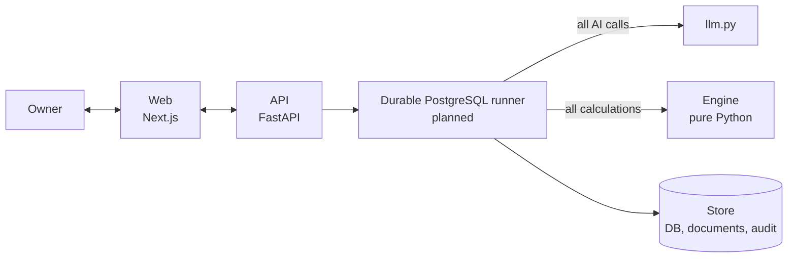

<div align="center">

# OrderFit

**Can my business afford to take this order, and how do I make it safe?**

An order decision assistant for small businesses. The AI reads documents and drafts messages,
a deterministic engine does every calculation, and the owner approves every outgoing action.

[](https://github.com/md-sazid9089/Order_Fit/actions/workflows/tests.yml)


[Features](#features) ·
[Architecture](#architecture) ·
[Getting started](#getting-started) ·
[Configuration](#configuration) ·
[Testing](#testing) ·
[Documentation](#documentation)

</div>

---

> [!NOTE]
> P1 supplies password sessions, tenant-scoped transactions, durable operations and private
> storage. P2 adds the pure deterministic financial engine and confirmed-input adapter.
> P3 adds persisted manual-input workflows; P4 adds private documents, bounded extraction
> (off/recorded by default; live OpenAI is unverified), field review and CSV import.
> P5 adds persisted what-if comparisons, exact draft revisions, reviewed reply reassessment
> and party attestations. P6 adds exact-bundle approval and **sandbox-only** execution
> (no real email, bank, payment or lender adapter exists), the serialized commitment gate
> and compensation; P7 adds membership, invitations, payee verification, notifications and
> exports; P8 adds readiness, graceful shutdown and the Vercel/Render/Neon configuration.
> Hosted (Neon/Render/Vercel), live-OpenAI and restore acceptance remain unverified, and P4's
> separate final review remains pending.
> See [implementation progress](docs/backend_implementation_progress.md),
> [contract guide](docs/contracts/README.md) and [implementation plan](docs/initial_backend_implementation_plan.md).
> The feature list below describes intended behavior, not completed capabilities.

## Table of contents

- [Overview](#overview)
- [Features](#features)
- [Architecture](#architecture)
- [Tech stack](#tech-stack)
- [Project structure](#project-structure)
- [Getting started](#getting-started)
  - [Prerequisites](#prerequisites)
  - [Run with Docker](#run-with-docker)
  - [Run locally](#run-locally)
- [Configuration](#configuration)
- [Testing](#testing)
- [Scripts](#scripts)
- [Documentation](#documentation)
- [Contributing](#contributing)

## Overview

A small business receives an order. Accepting it means buying materials up front and waiting
weeks to be paid, and a late payment can leave the business unable to cover its other bills.
OrderFit takes the customer order and the supplier quote, works out the cash position day by
day, stress-tests it against late payment, and proposes ways to make the order safe, such as
asking for a deposit, changing payment terms, or taking short-term financing.

Three rules shape the design:

1. **The AI never produces a number.** Every figure comes from the engine. AI text uses
   placeholders, and a guard blocks any figure that doesn't match an engine value
   ([ADR 0003](docs/adr/0003-ai-never-types-numbers.md)).
2. **The engine is pure and deterministic.** It has no AI and no I/O. The same inputs always
   give the same result, and money is held as integer minor units
   ([ADR 0001](docs/adr/0001-integer-minor-units.md)).
3. **A human approves every outgoing action.** The workflow pauses for the owner to confirm the
   extracted figures and again to approve each message before it is sent.

## Features

- **Document ingestion**: reads customer orders and supplier quotes and extracts the terms.
- **Cash-flow timeline**: day-by-day cash position for the life of the order.
- **Delay tolerance**: how many days late the customer can pay before the business runs out of
  cash ([ADR 0002](docs/adr/0002-linear-delay-scan.md)).
- **Ranked options**: deposits, term changes and financing from a catalogue, sized to meet a
  target tolerance and ranked by cost.
- **Stress testing**: shows how each option holds up under adverse scenarios.
- **Negotiation drafts**: writes messages to customers and suppliers. Replies are read back,
  re-validated and re-confirmed before anything is recomputed
  ([ADR 0004](docs/adr/0004-replies-revalidated.md)).
- **Safety guards**: number, terms, prompt-injection and fraud checks (for example, changed bank
  details or a mismatched sender domain). Guards report problems; they never rewrite text.
- **Audit trail**: append-only log of every decision and action. Documents are stored by hash.

## Architecture



The planned workflow persists confirmation and approval boundaries in PostgreSQL:

```
ingest → extract → validate → [confirm] → compute → explain → draft → [approve] → send
                                  ↑                                                  │
                                  └──────── validate ← read_reply ← (reply) ─────────┘   max 3 rounds
```

Layer boundaries are enforced by [tests/test_architecture.py](backend/tests/test_architecture.py):
AI calls go only through `agent/llm.py`, and engine calls go only through `agent/nodes/compute.py`.

## Tech stack

| Layer    | Technology |
|----------|------------|
| Backend  | Python 3.12, FastAPI, Pydantic v2, Uvicorn |
| Workflow | Plain durable PostgreSQL jobs, separate API/worker (P1+) |
| Storage  | PostgreSQL 17 (psycopg 3), SQLAlchemy 2, Alembic |
| Frontend | Next.js 16, React 19, TypeScript, Tailwind CSS 4, shadcn/ui |
| Tooling  | pytest, Ruff, GitHub Actions, Docker Compose |

## Project structure

```
.
├── backend/
│   ├── orderfit/
│   │   ├── engine/      # Decision engine. Pure Python, no AI, no I/O.
│   │   ├── agent/       # Compute boundary, language nodes/guards/prompts (scaffold)
│   │   ├── contracts/   # Strict P0 target DTOs, protocol, OpenAPI/type generator
│   │   ├── api/         # FastAPI routes (thin)
│   │   ├── store/       # Database, documents by hash, append-only audit
│   │   ├── domain.py    # Shared contracts for agent, API and store
│   │   └── config.py    # Settings from environment
│   └── tests/           # architecture, engine, agent, e2e
├── web/                 # Next.js app (display only)
├── data/                # Demo business, financing catalogue, test cases
├── scripts/             # Demo seeding, PDF generation, baseline evaluation
├── docs/                # Design notes and ADRs
└── docker-compose.yml
```

## Getting started

### Prerequisites

- [Docker](https://docs.docker.com/get-docker/) with Compose v2, **or**
- Python 3.12+ and Node.js 22+
- An API key for the AI provider (only needed once the agent makes AI calls)

### Run with Docker

```bash
git clone https://github.com/md-sazid9089/Order_Fit.git
cd Order_Fit
cp .env.example .env    # configure separate local runtime/migrator credentials
docker compose build api
docker compose --profile setup run --rm provision  # first setup only; refuses existing roles
docker compose up --build
```

| Service | URL |
|---------|-----|
| Web     | http://localhost:3000 |
| API / Postgres | Internal Compose network only; use `docker compose exec api ...` / `docker compose exec db ...` |
| API docs (OpenAPI) | Disabled by default; API is not published to the host |
| Health check | http://localhost:3000/api/health (same-origin web proxy) |

Use independently generated passwords (at least 32 characters) for the API and
worker logins, and distinct session/fingerprint secrets (at least 32 characters).
Keep provisioning passwords consistent with the URL-encoded runtime URLs. The
setup command migrates first, then creates only non-owner, non-admin logins; it
deliberately refuses implicit password rotation or reuse of an existing role.
On later starts, omit the setup command. Startup validates the actual role and
schema and fails closed if either is wrong. Never point migration regression
tests at a shared/configured database. Startup order:
`db` becomes healthy → `migrate` runs `alembic upgrade head` and exits →
`api` and separate `worker` → `web`. Full-stack/browser deployment acceptance
remains P8; local P1 acceptance uses disposable PostgreSQL and real runtime logins.

To stop the services, run `docker compose down`. Data is kept; add `-v` to also delete the
`pg-data` and `documents` volumes.

If a port is already taken on your machine, copy `.env.example` to `.env` at the repo root and
change `WEB_PORT`.

> [!TIP]
> Deals, durable jobs and audit history live in Postgres (`pg-data` volume). Uploaded
> documents live in the `documents` volume locally; hosted API and worker share a private S3-compatible bucket. The API, worker and database have no outbound route; only the web proxy is host-facing. Browser API calls use the same-origin Next rewrite over the internal network. `data/` is mounted read-only at `/app/data`.
> `API_INTERNAL_URL` is baked into the web image to target the internal API; rebuild `web` after changing it. The image is built from `web/`.

### Run locally

For the configured Neon database, from `backend/` use the explicit launcher in
two terminals:

```bash
uv run --frozen python -m orderfit.runtime api
uv run --frozen python -m orderfit.runtime worker
```

The launcher reads `backend/.env` explicitly, selects the API or worker URL and
forwards only runtime settings. It excludes migration/provisioning credentials
even if they exist in the parent environment. Stop each service with Ctrl+C.
The default Compose configuration above is for local PostgreSQL; it is not needed
for these Neon commands. See [Neon setup evidence](docs/neon_connection_review.md).

**Backend**

```bash
cd backend
uv sync --frozen --extra dev     # uses Python 3.12 and committed uv.lock
uv run --frozen python -m orderfit.contracts.export --check
uv run --frozen pytest tests/contracts tests/test_architecture.py -q
# Inject explicit runtime settings from backend/.env.example into this process.
# Run migrations/provisioning in separate processes with DATABASE_URL_DIRECT only.
uv run --frozen uvicorn orderfit.api.main:app --reload
# Separate terminal with WORKER_DATABASE_URL supplied as DATABASE_URL:
uv run --frozen python -m orderfit.workflow.worker
# Disposable PG17 acceptance (requires local Docker; never reads application DB URLs):
uv run --frozen pytest tests/db tests/test_private_documents.py -q
```

**Frontend** (in a second terminal)

```bash
cd web
npm ci
cp .env.example .env.local
npm run dev
```

## Configuration

### Database (Neon)

Local PostgreSQL 17 is the initial target. Hosted PostgreSQL/Neon requires separate
role, SSL, pooling, migration, worker and restore acceptance; it is not verified by local P1.

- `DATABASE_URL`: the **pooled** endpoint (host contains `-pooler`), with the scheme changed to
  `postgresql+psycopg://`. API uses a restricted non-owner `orderfit_app` member login.
- `WORKER_DATABASE_URL`: a distinct restricted `orderfit_worker` member login;
  inject it as `DATABASE_URL` in the worker process only.
- `DATABASE_URL_DIRECT`: the same URL without `-pooler`. Alembic uses it, because schema
  changes should not go through the transaction-mode pooler.
- Keep `?sslmode=require&channel_binding=require`.

Inject `DATABASE_URL_DIRECT` only into a migration process. There is no fallback
to the runtime URL. Compose may interpolate a local ignored root `.env`, but never
passes direct credentials into API. Never use a shared database for destructive tests.


Backend settings read explicit process environment, not developer `.env` automatically.
See [backend/.env.example](backend/.env.example) and RuntimeConfiguration;
P1 wires this strict contract into runtime startup. Missing DB/auth settings fail closed.

| Variable | Default | Description |
|----------|---------|-------------|
| `LLM_MODE` | `off` | Explicit off/recorded/live; no automatic live fallback |
| `LLM_RECORDINGS_DIR` | *(empty)* | Folder of recorded extraction responses for `LLM_MODE=recorded` |
| `OPENAI_API_KEY`, `OPENAI_MODEL` | *(empty)* | Server-only; required for live, model selected/evaluated in P4 |
| `DATABASE_URL` | *(empty)* | Restricted SQLAlchemy psycopg runtime URL |
| `DATABASE_URL_DIRECT` | *(empty)* | Required migrator-only direct URL, no runtime fallback |
| `SESSION_SECRET` | *(required P1)* | At least 32 characters, server-only |
| `ACCOUNT_FINGERPRINT_KEY`, `ACCOUNT_FINGERPRINT_KEY_VERSION` | *(required P1)* | Distinct versioned HMAC secret |
| `DOCUMENT_DIR` | `./var/documents` | Where uploaded documents are stored |
| `ALLOWED_ORIGINS`, `COOKIE_SECURE` | *(explicit P1)* | Exact permitted origins and HTTPS cookie security |

Frontend settings are read from `web/.env.local`. See [web/.env.example](web/.env.example).

| Variable | Default | Description |
|----------|---------|-------------|
| `NEXT_PUBLIC_API_URL` | *(empty for Compose/Vercel)* | Leave empty to use the same-origin `/api/v1` proxy; direct browser/API mode is for local non-Compose development only |
| `API_INTERNAL_URL` | *(falls back to `NEXT_PUBLIC_API_URL`)* | Server-side API URL and rewrite target. Compose builds/runs with `http://api:8000` |

> [!WARNING]
> Never commit `.env` files. They are listed in `.gitignore`.

## Testing

```bash
cd backend
uv sync --frozen --extra dev
uv run --frozen pytest tests/contracts tests/test_architecture.py tests/engine tests/agent -q
uv run --frozen ruff check .
uv run --frozen python -m orderfit.contracts.export --check
```

```bash
cd web
npm run typecheck
npm run lint
npm run build
```

The full browser journey builds and starts an isolated disposable Compose stack, then removes
its containers and volumes:

```powershell
./scripts/run-e2e.ps1
```

CI runs lint, backend tests, frontend type check, lint, unit tests and build, plus a Docker build on every push
and pull request. See [.github/workflows/tests.yml](.github/workflows/tests.yml).

The reference calculator cases are maintained in [docs/architecture/orderfit/fixtures](docs/architecture/orderfit/fixtures/README.md) and checked directly in CI; the backend does not load `data/test_cases.json`.

## Scripts

| Script | Purpose |
|--------|---------|
| [scripts/run-e2e.ps1](scripts/run-e2e.ps1) | Isolated Compose-backed browser journey and cleanup |

## Documentation

| Document | Contents |
|----------|----------|
| [docs/initial_backend_implementation_plan.md](docs/initial_backend_implementation_plan.md) | Backend contracts, implementation phases and acceptance gates |
| [docs/backend_implementation_progress.md](docs/backend_implementation_progress.md) | Verified implementation history, current status and open gates |
| [docs/architecture/orderfit/README.md](docs/architecture/orderfit/README.md) | Revised architecture, contracts, ADRs and reference fixtures |
| [docs/deployment/](docs/deployment/) | Render, Neon and Vercel runbooks |
| [docs/engine.md](docs/engine.md) | Algorithms, money rules, ranking, adding test cases |
| [docs/agent.md](docs/agent.md) | Workflow, pause points, guards |
| [docs/adr/](docs/adr/) | Architecture decision records |
| [docs/technical.md](docs/technical.md) | Technical write-up |
| [docs/security-assessment.md](docs/security-assessment.md) | Threat model and mitigations |
| [docs/security/hackathon-security-matrix-2026-10-17.md](docs/security/hackathon-security-matrix-2026-10-17.md) | Security, approval and audit evidence mapped to the hackathon rubric |
| [docs/evaluation.md](docs/evaluation.md) | Evaluation against a plain-AI baseline |
| [docs/checkpoint.md](docs/checkpoint.md) | Progress report, next targets and risks |
| [docs/team-assessment.md](docs/team-assessment.md) | Team, ownership, skills and working agreements |
| [docs/deployment/vercel.md](docs/deployment/vercel.md) | Deploying `web/` to Vercel behind the same-origin `/api/v1` proxy |

## Contributing

1. Create a branch from `main`.
2. Keep the layer rules: no AI or I/O in `engine/`, AI calls only through `agent/llm.py`, and
   engine calls only through `agent/nodes/compute.py`.
3. Any change that can alter an engine result must bump `ENGINE_VERSION`.
4. Run `ruff check .` and `pytest` before opening a pull request.
5. Record significant design decisions as a new ADR in `docs/adr/`.
