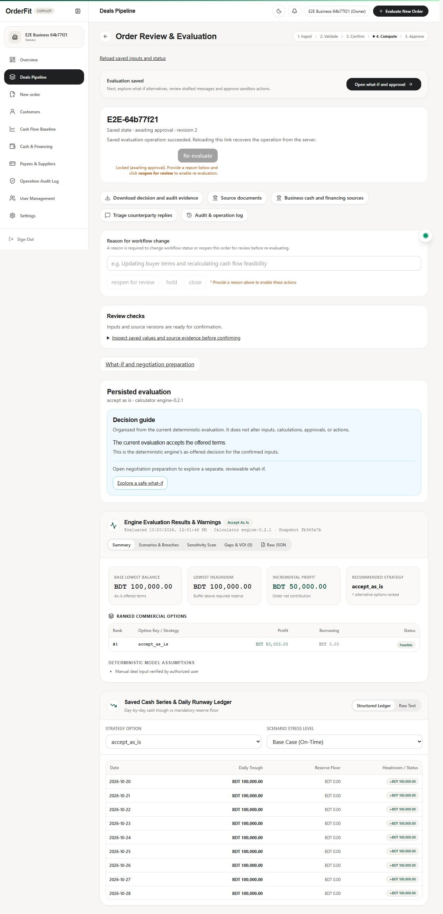
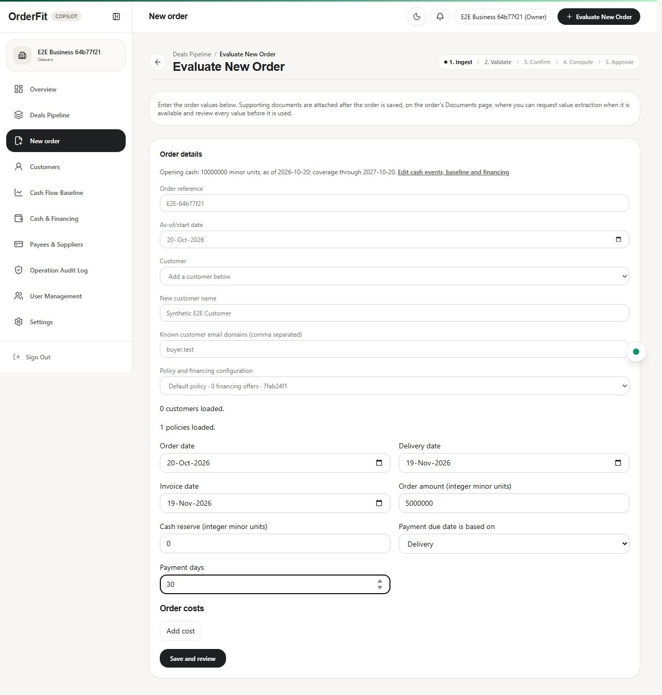
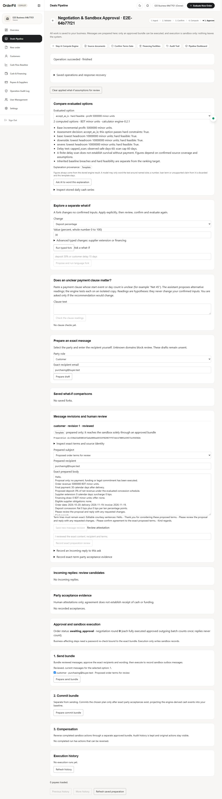
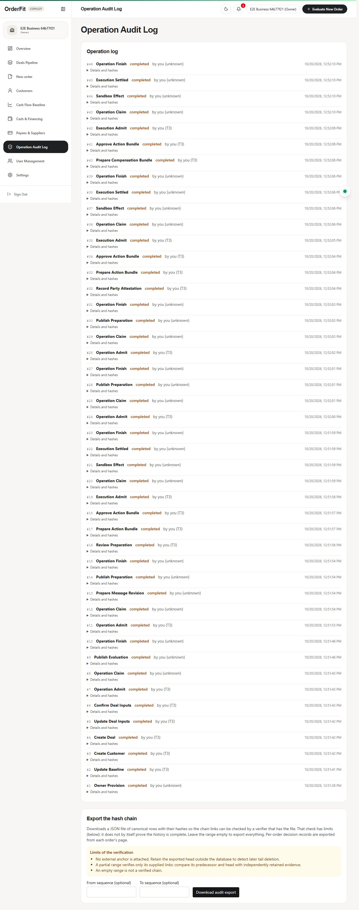
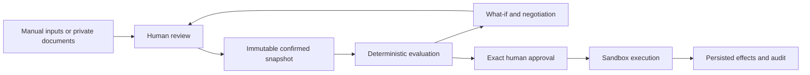
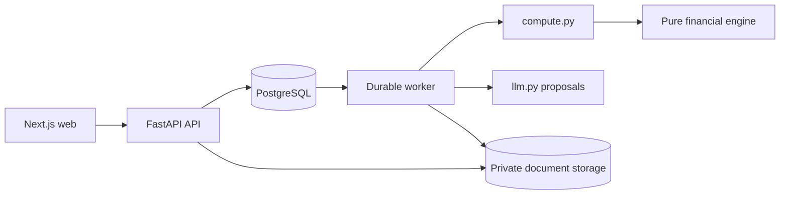

<div align="center">

# OrderFit

**Understand whether an order fits your cash position—and which terms make it safer.**

AI proposes facts and language. A deterministic engine calculates.
A person confirms inputs and approves every sandbox action.

[](https://github.com/md-sazid9089/Order_Fit/actions/workflows/tests.yml)


[GitHub repository](https://github.com/md-sazid9089/Order_Fit) · [Deployment instructions](docs/deployment/README.md) · [Test cases](docs/test-cases.md)

[Preview](#preview) · [How it works](#how-it-works) · [Quick start](#quick-start) · [Verification](#verification) · [Documentation](#documentation)

</div>

## What it does

A profitable order can still leave a business short of cash before the customer
pays. OrderFit compares the dated baseline with the order, evaluates supported
changes to deposits, supplier terms and fixed-term financing, and explains the
profit/resilience trade-off without inventing missing facts.

- **Saved review:** manual input and private documents, quoted extraction candidates,
  explicit missing/conflicting fields, and immutable confirmed snapshots.
- **Deterministic evaluation:** daily cash troughs, baseline-relative reserve checks,
  ranked options, delay scenarios, sensitivity, and analysis bounds.
- **Reviewed negotiation:** separate what-if forks, exact draft revisions, incoming
  reply review, and recorded party acceptances.
- **Sandbox execution:** exact-bundle approval, session-bound step-up, durable recovery,
  serialized commitments, compensation, and tenant audit exports.

## Preview

These are authentic browser captures from a disposable PostgreSQL/API/worker/web
stack using synthetic data and `LLM_MODE=off`. They demonstrate local persisted
workflows and sandbox effects, not live AI quality or real payments.

[](docs/assets/screenshots/financial-evaluation.jpg)

<details>
<summary>Manual intake, negotiation preparation, and audit history</summary>

| Saved-input intake | Reviewed sandbox preparation |
|---|---|
| [](docs/assets/screenshots/manual-order.jpg) | [](docs/assets/screenshots/negotiation-preparation.jpg) |

[](docs/assets/screenshots/audit-trail.jpg)

</details>

## How it works



The API checks current identity, business membership, versions, and freshness.
A failed read remains an error; the UI does not substitute synthetic results or
owner authority. Confirmation and outgoing approval are separate persisted boundaries.
Changing approved content requires a new bundle and approval.

## Architecture



| Component | Technology / responsibility |
|---|---|
| Web | Next.js 16, React 19, TypeScript, Tailwind CSS 4, React Query |
| API and worker | Python 3.12, FastAPI, Pydantic v2; separate processes |
| Financial engine | Pure Python, integer minor units, explicit calendar dates |
| Persistence | PostgreSQL, SQLAlchemy/Core, psycopg 3, manual Alembic/SQL migrations |
| AI boundary | Bounded OpenAI Responses proposals; explicit off/recorded/live modes |
| Verification | pytest, Ruff, TypeScript, ESLint, Node tests, Playwright, Docker |

See [architecture and financial contracts](docs/architecture/orderfit/README.md)
for versioned semantics, ADRs, reference fixtures, and historical design evidence.

## Quick start

Use Docker Compose, or Python 3.12 and Node.js 22 for host development.
For a **new local database**, copy `.env.example` to an ignored `.env` and configure
separate migration/API/worker credentials and distinct application secrets.

```sh
git clone https://github.com/md-sazid9089/Order_Fit.git
cd Order_Fit
cp .env.example .env
# Fill the required local credentials before continuing.
docker compose build api
docker compose --profile setup run --rm provision
docker compose up --build
```

Open [localhost:3000](http://localhost:3000). API and PostgreSQL remain internal.
Provisioning refuses existing roles; ordinary restarts omit that command.
The web proxies API calls on the same origin. No AI key is needed for manual operation.

[Development](docs/development.md) covers host setup, environment settings, commands,
and safe disposable testing. Do not point migration tests at an existing application DB.

## Verification

The [test-case catalog](docs/test-cases.md) describes the 22 checked-in synthetic
financial cases and edge conditions, with expected outcomes and commands to run
them. These reference cases complement the API, database, unit, and browser suites.

| Directory | Commands |
|---|---|
| `backend/` | `uv sync --frozen --extra dev`; `uv run --frozen ruff check .`; `uv run --frozen python -m orderfit.contracts.export --check`; `uv run --frozen pytest -q` |
| `web/` | `npm ci`; `npm run lint`; `npm run typecheck`; `npm run test`; `npm run build` |
| Repository root | `./scripts/run-e2e.ps1` (PowerShell; disposable Compose stack) |

Financial reference cases and AI recording evaluations are separate from API,
DB, browser, hosted-provider, and restore acceptance. See the exact
[verification procedures](docs/development.md#verification) and [AI evaluation limits](docs/evaluation.md).

## Safety and limitations

Commercial email, banking, payments, and lender execution are **sandbox-only**.
There is no real-money adapter. Models cannot calculate authoritative figures,
confirm facts, choose trusted recipients, or approve effects. Missing or stale
inputs remain explicit. Supported financial inputs use one currency; no automatic
FX, APR conversion, tax calculation, OCR, or portfolio optimization is supplied.

Live-model quality and multilingual qualification require independent provider
acceptance; authored recordings prove pipeline behavior only. Account-mail features
have a separate default-off backend rollout. Admin reads are capability-gated;
global logs and platform mutations are unavailable. Historical credential rotation,
production storage privileges, durable backup/restore, and hosted acceptance remain
operational gates. The audit chain is tamper-evident, with explicit anchoring limits.

[Deployment options](docs/deployment/README.md) cover local Compose, Azure/Neon,
Vercel, and a Render Blueprint that requires external private object storage and
environment-specific acceptance. This repository does not claim production readiness.

## Documentation

[Technical documentation](technical_document.md) ·
[Development](docs/development.md) · [Workflows](docs/workflows.md) ·
[Architecture](docs/architecture/orderfit/README.md) · [API contracts](docs/contracts/README.md) ·
[Security](docs/security/README.md) · [Deployment](docs/deployment/README.md) ·
[Full index](docs/README.md)

Contribute through a reviewed branch and preserve the financial/security boundaries;
see [contribution rules](docs/development.md#contributing). No application-level license
is declared in this checkout. Bundled third-party skills retain their own licenses.
