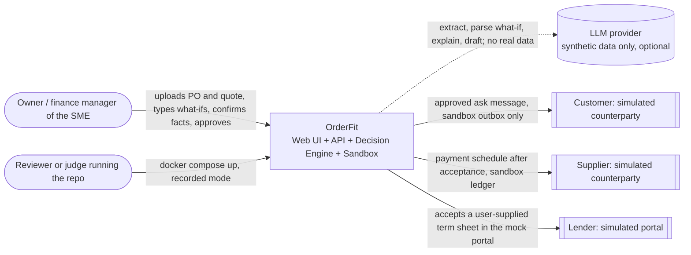
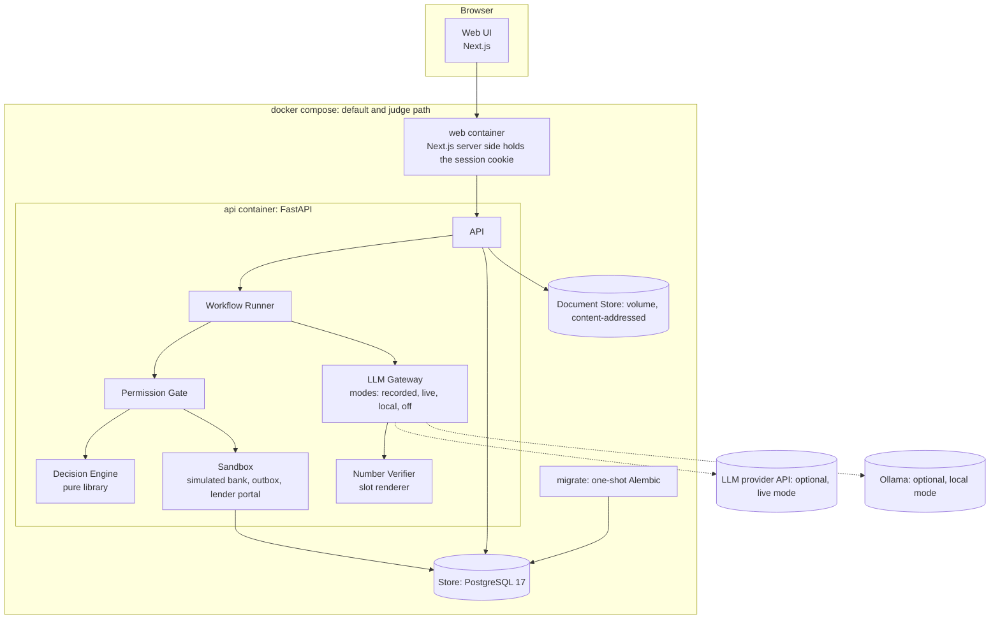
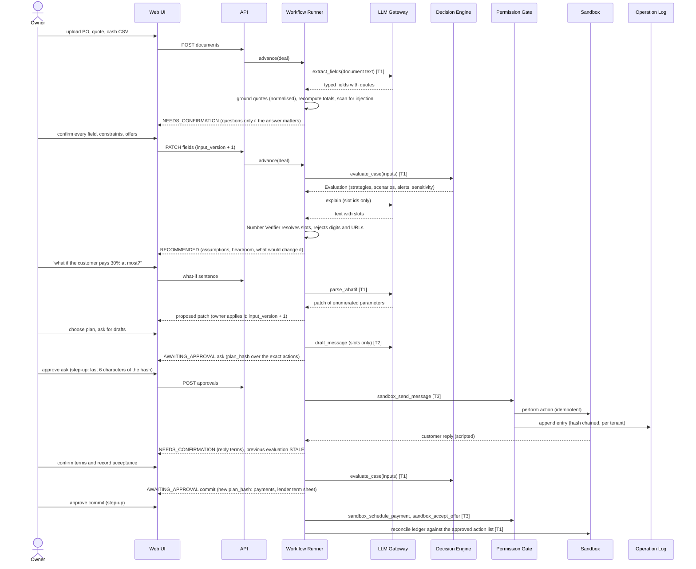
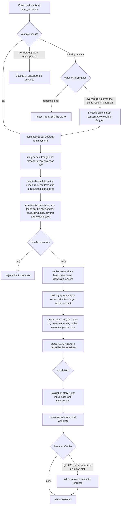
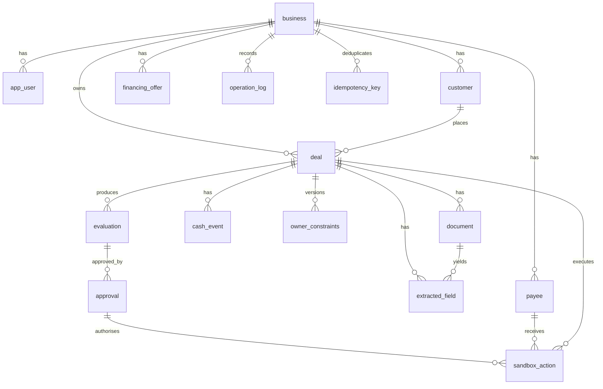
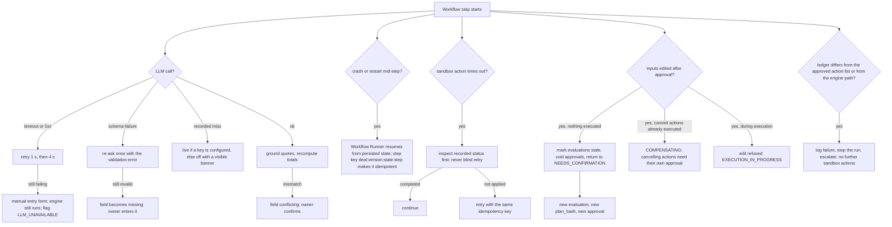
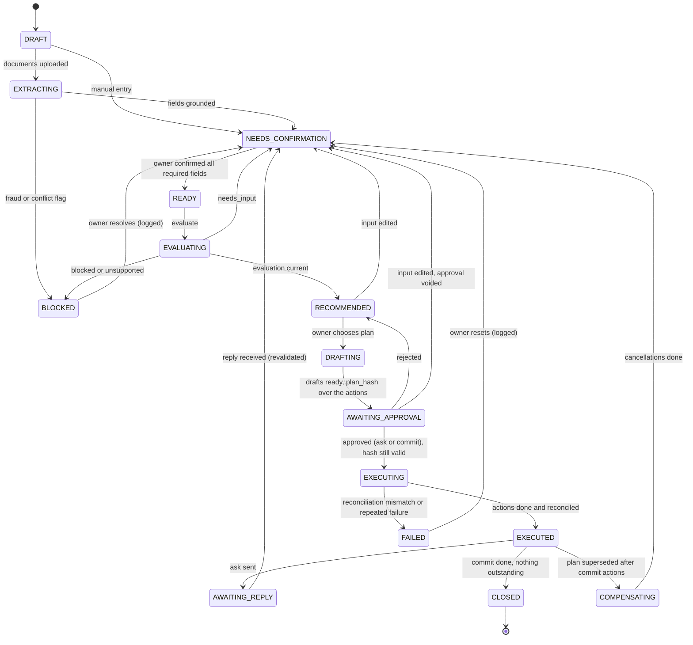

# 03 System architecture

Part of the [OrderFit design set](README.md). Calculation semantics, entities and API payloads are in [04](04-decision-engine-and-data-contracts.md); threats, tests and fixtures in [05](05-security-and-evaluation.md); requirements and the demo in [01](01-requirements-scenario-edge-cases.md). This document is written so that sections 1 to 9 can become competition deliverable 1 (technical documentation) with light editing.

Evidence labels: `[R]` repo, `[W]` web (accessed 2026-10-14), `[I]` inference, `[A]` assumption, `[?]` unverified. Nothing is built; no performance result exists. The only executed artefact is the reference calculation in [`fixtures/`](fixtures/).

**Revised after the independent review** (`_work/review-log.md`): the approval now binds the exact actions that run; execution is split into an *ask* phase and a *commit* phase; the model-visible strings are enumerated; the number check is slot-based; staged delivery, deferral and invoice-advance financing are deferred out of the MVP; Row-Level Security is hardening rather than a dependency; the reference engine is the starting point of the production engine.

## 1. Architecture decision

**Chosen: Option B, a fixed workflow of typed tools over a deterministic decision engine, with a language model used for five narrow jobs (extract, parse a what-if, explain, draft, read a reply) and a simulated sandbox where approved actions are executed and logged.** In plain terms: code decides and calculates; the model reads documents, understands what the owner types, writes explanations and drafts, and reads replies; the owner approves; the agent carries the approved plan out in a simulated bank, mail outbox and lender portal and proves it with a hash-chained log.

### 1.1 Options

| | A. Deterministic engine, LLM only at the edges (extract, explain) | B. Fixed workflow with a few LLM steps and a sandbox executor | C. Bounded tool-using agent over deterministic tools | D. Multi-agent |
|---|---|---|---|---|
| Gate 1: buildable and demonstrable by the 18 Oct freeze by a team of 5 students (stated by the user on 2026-10-14) | pass | pass | pass with risk (non-deterministic tool choice makes demos flaky) | **fail** (four or more agents, debugging a financial decision across agents, six days) `[A]` |
| Gate 2: free or low-cost infrastructure the team can reach | pass | pass | pass (more LLM calls) | pass (most LLM calls) |
| Gate 3: hard financial constraints enforced outside the LLM | pass | pass | pass if every tool enforces them | pass if enforced |
| Gate 4: yields the required sandbox execution evidence | **fail** (nothing executes: deliverable 6 would be empty) | pass | pass | pass |
| Survives gates | no | yes | yes | no |
| Task completion (40%) | 2 | 4 | 4 | 3 |
| Security and compliance (30%) | 4 | 5 | 3 | 2 |
| Innovation and interaction (30%) | 2 | 3 | 4 | 3 |
| Weighted score (40/30/30) | 2.60 | **4.00** | 3.70 | 2.70 |

Scores (1 to 5) are team-judgment placeholders `[A]`, not measurements; the weights 40/30/30 are the published rubric weights `[W: PBCSF Appendix 2, via research-market.md]`. Option A is Option B without the sandbox, so the decision rests on gate 4 and on the requirement that execution evidence exist; the score table is a sanity check, not a measurement.

**Weight sensitivity (each dimension moved by 10 points, the others adjusted):**

| Weights (task/security/innovation) | A | B | C | D |
|---|---:|---:|---:|---:|
| 40/30/30 (default) | 2.60 | 4.00 | 3.70 | 2.70 |
| 50/25/25 | 2.50 | 4.00 | 3.75 | 2.75 |
| 30/35/35 | 2.70 | 4.00 | 3.65 | 2.65 |
| 35/40/25 | 2.80 | 4.15 | 3.60 | 2.60 |
| 45/20/35 | 2.40 | 3.85 | 3.80 | 2.80 |
| 35/25/40 | 2.50 | 3.85 | 3.75 | 2.75 |
| 45/35/20 | 2.70 | 4.15 | 3.65 | 2.65 |

B wins in every row; its lead is smallest (0.05) when security is weighted 20 and innovation 35.

**Why each rejected option loses for this project.** A cannot produce the required execution evidence, and "decision support only" would leave deliverable 6 empty `[R: task section 2]`. C buys adaptive dialogue at the price of a model that chooses tools: that raises the excessive-agency and injection surface (OWASP LLM06, LLM01 `[W]`), makes the recorded demo order fragile, and adds nothing the what-if intent parser (section 6) and the engine's value-of-information loop do not already provide without giving the model a tool. D multiplies model calls and failure points and makes a financial decision harder to audit `[R: Strategy PDF s2]`.

**What would change my mind.** (1) If the organizers confirm that code, security self-assessment and execution evidence are optional (the official website marks them optional while the PDF lists them `[W: research-market.md row 13]`), A plus a thin demo would be viable, but it would still lose on the security and interaction demos. (2) If a bounded-tool experiment shows the model chooses the correct next tool in at least 95% of 100 recorded traces with zero out-of-tier attempts, C's security score rises to 4 and C ties B at the 45/20/35 weighting. (3) If judges weight dialogue efficiency heavily, the what-if conversation moves earlier in the demo.

**Why B still counts as an agent that completes tasks, and its honest limit.** The rubric asks for "an AI agent capable of completing real tasks in a financial scenario" `[W]`. OrderFit autonomously carries one multi-step financial task to completion: it reads the documents, decides which facts are missing and whether asking matters (value of information), computes and compares strategies, drafts the counterparty message, executes the approved actions in a sandbox, reconciles the simulated ledger against the approved action list, monitors alerts, reads the counterparty's reply and re-plans (input versions, stale results, new approval). The owner can also converse: typing "what if the supplier gives 45 days?" or "the customer says 30% at most" is parsed by a model into a **patch of enumerated engine parameters**, shown to the owner, applied as an owner-confirmed edit and re-evaluated by the engine; the model never computes the answer. The planning policy is deterministic by design; the model supplies perception, language and intent parsing. **The honest limit:** with `LLM_MODE=off` the whole demo still runs, which proves safety and reproducibility but also shows that the *decisions* are code; the evidence that a model participates is the live and recorded traces of extraction, what-if parsing, drafting and reply reading, and the dialogue metrics (questions asked per decision, turns to an approved plan, both read from the Operation Log). If the organizers supply their own sandbox or tool API, an adapter maps T0 to T3 tool names onto it while the Permission Gate and the approval binding stay ours and no T4 equivalent is ever mapped. If the planning policy were ever delegated to a model, it would sit behind the same Permission Gate (section 8.4) and be disabled by default.

## 2. Principles

1. The engine computes and verifies; the model proposes, reads and writes. No model output reaches a monetary field or a hard-constraint decision without deterministic validation ([ADR 0002](adrs/0002-ai-calculation-separation.md)).
2. The model has no tools. It is a function from untrusted text to typed JSON or to text with named slots. Tool use is the workflow's, behind the Permission Gate.
3. Documents, replies and web text are data. Typed, owner-confirmed fields are the only path from a document to the engine.
4. Any edit of an input marks every dependent result stale; a stale result is never shown as current; an approval is bound to the hash of the exact actions it authorises.
5. The system runs end to end with every language-model component disabled (`LLM_MODE=off`), and the demo never depends on a live API. A `recorded` miss never fails silently (section 5).
6. Everything is logged in an append-only, hash-chained operation log that also is the execution evidence.
7. Simplicity burden: any framework, queue, vector database, solver or extra infrastructure must name the requirement it meets and a testable benefit over plain code. None is adopted by default (section 7).
8. Commitments follow acceptance: the ask is sent first; payments and term-sheet acceptance are scheduled only after the counterparty's acceptance is recorded by the owner and the plan is re-evaluated (section 4).

## 3. Diagrams

All diagrams use the same component names: **Owner**, **Web UI**, **API**, **Workflow Runner**, **Permission Gate**, **Decision Engine**, **LLM Gateway**, **Number Verifier** (slot renderer and checker), **Sandbox** (simulated bank, outbox, lender portal), **Store** (PostgreSQL), **Operation Log**, **Document Store**.

### 3.1 System context



### 3.2 Containers and deployment



The repository's compose file provides `db`, `migrate`, `api`, `worker` and `web` `[R: docker-compose.yml]`; the Neon hosted database remains optional `[R: ADR 0005]`. API, worker and database use an internal network with no outbound route. The host-facing web proxy is also attached to a separate edge network; it has no database or storage credentials. The default local filesystem + `off`/`recorded` setup therefore needs no provider egress. Explicit local live inference or external S3 use requires an intentional Compose network-topology override, not an environment-mode toggle. Hosted deployment uses a shared private S3-compatible bucket for API/worker document access.

### 3.3 Main workflow sequence



### 3.4 Decision-evaluation flow



### 3.5 Entity relationships



The `operation_log` belongs to the tenant, not to a deal: it carries a plain `deal_id` value without a foreign key, so deleting a deal never conflicts with the append-only rule. Fields, enums and constraints for each entity are in [04](04-decision-engine-and-data-contracts.md) section 10.2.

### 3.6 Failure and recovery path



## 4. Workflow and state machine

### 4.1 States and transitions



### 4.2 Transition table, guards, stops

| From | To | Trigger | Guard |
|---|---|---|---|
| DRAFT | EXTRACTING | document uploaded | file passes allowlist, size, page and hash checks |
| EXTRACTING | NEEDS_CONFIRMATION | extraction done | every field has a quote that occurs in the whitespace- and Unicode-normalised text and parses to its value, or is `missing`, `ambiguous` or `conflicting` |
| EXTRACTING | BLOCKED | flags | a blocking flag: bank detail differing from the stored payee fingerprint (F-02), PO versus quote conflict (D-03, D-06) |
| NEEDS_CONFIRMATION | READY | owner confirms | no required field missing; no unresolved input whose alternatives flip the answer |
| READY | EVALUATING | `evaluate` | none |
| EVALUATING | RECOMMENDED | result | decision not `needs_input`, `blocked_data_conflict` or `unsupported_escalate` |
| RECOMMENDED | DRAFTING | owner picks a strategy | the evaluation is `current` for the present `input_version` |
| AWAITING_APPROVAL | EXECUTING | approval | `approval.status = valid`, not expired (24 h `[A]`), freshly recomputed `plan_hash` (over the exact actions) equals the stored one, role `owner`, step-up passed |
| EXECUTING (ask) | EXECUTED | messages sent | only `sandbox_send_message` is allowed in the ask phase |
| EXECUTING (commit) | EXECUTED | payments scheduled, term sheet accepted | allowed only if every external dependency of the plan (customer, supplier, lender) has an owner-recorded acceptance and the evaluation is current; then `reconcile_ledger` (section 8.5) must pass, otherwise FAILED |
| EXECUTED | AWAITING_REPLY | ask sent | at most 3 negotiation rounds, then BLOCKED |
| AWAITING_REPLY | NEEDS_CONFIRMATION | reply | counterparty text is extracted, scanned and shown to the owner |
| EXECUTED | COMPENSATING | an edit supersedes a plan whose commit actions already ran | the only state in which a cancelling T3 action (with its own approval) is allowed |
| any except EXECUTING and COMPENSATING | NEEDS_CONFIRMATION | input edited | see invalidation below |
| EXECUTING, COMPENSATING | (unchanged) | input edited | refused with `409 EXECUTION_IN_PROGRESS` |

**Stops for human input** (the workflow never proceeds past them alone): `NEEDS_CONFIRMATION` (every extracted number is confirmed by the owner; questions are asked only if the answer could change the ranking), `AWAITING_APPROVAL` (ask and commit are separate approvals), `BLOCKED`, `AWAITING_REPLY`, `FAILED` (owner reset), and the acknowledgement of any escalation (`E-NO-FEASIBLE`, `E-FRAGILE-BEST`, `E-PRE-EXISTING-BREACH`, `E-UNPROFITABLE-AFTER-COSTS`, `E-CLOSE-CALL`).

**Invalidation.** `deal.input_version` increments on any edit of a field, event, offer or constraint, including the what-if patches the owner applies and a re-evaluation "as of today". Every `evaluation` row stores the version and the `as_of` date it was computed for; `status` becomes `stale` when the versions differ; the interface renders a stale result greyed with a "recalculate" banner and never as the current recommendation. Every `approval` whose evaluation is stale becomes `voided`; unsent drafts become `voided` (`sandbox_action.status = voided`). `E-DATE-IN-PAST` is judged against the evaluation's own `as_of`; an approval older than 24 hours or an evaluation older than the current date triggers "date has moved: re-evaluate". Sandbox actions already executed are never undone silently: after a *commit*, a superseding edit moves the deal to `COMPENSATING`, where cancelling actions are new T3 actions with their own approval; a message already sent stays sent and a follow-up message is drafted.

**Timeouts, retries and idempotency.** LLM call: 30 s each, two retries after 1 s and 4 s, one re-ask on schema failure, then manual entry. Engine: no retry (deterministic; a failure is a bug and goes to FAILED with a request id). Sandbox action: per-action timeout 10 s `[A]`; after a timeout inspect the recorded status before any retry; retry only with the same idempotency key. Idempotency: workflow steps use the key `deal_id:input_version:state:step`; `sandbox_action.idempotency_key` is unique and equals `hash(plan_hash, action index)` (mandatory); an `Idempotency-Key` header on API writes is IF-TIME.

**Errors.** User-facing errors carry a code and an action; internal failures show only a request id ([04](04-decision-engine-and-data-contracts.md) section 10.4).

## 5. Technology stack

| Layer | Choice | Evidence and reasoning |
|---|---|---|
| Frontend | Next.js 15, React 19, TypeScript | already scaffolded `[R: README, web/ directory]`; display only, no money logic in the browser |
| Backend | Python 3.12, FastAPI, Pydantic v2, psycopg 3, SQLAlchemy 2, Alembic | already chosen `[R: backend/pyproject.toml]`; **the reference engine is stdlib-only Python that already passes the fixtures, so it is vendored into `backend/orderfit/engine/` as the starting point (typed wrapper, Pydantic models at the edge) rather than re-implemented: a second engine is the largest avoidable risk** |
| Boundary | Decision Engine is a pure library with no I/O, enforced by the existing architecture test `[R: tests/test_architecture.py]` | extend it: only the workflow `evaluate` step may import `evaluate_case`; only the LLM Gateway may import a model SDK |
| Storage | PostgreSQL 17 in compose by default; Neon optional; Alembic for schema; application-level tenant scoping plus a non-owner application role are mandatory; Row-Level Security with `FORCE ROW LEVEL SECURITY` is hardening (IF-TIME) | [ADR 0004](adrs/0004-persistence-and-isolation.md), [repo ADR 0005](../../adr/0005-postgres-from-day-one.md) |
| Files | Private generated-key store; local Compose volume or hosted shared S3-compatible bucket; SHA-256 integrity metadata, create-only writes; PDFs parsed with `pdfplumber` (MIT) or `pypdf` (BSD) `[W]`; no OCR in the MVP | licence register in `LICENSES.md`, deployment runbook |
| Auth | seeded users, a standard password hash (argon2id or bcrypt), opaque random session token stored hashed (8 h `[A]`) in an `HttpOnly; SameSite=Strict` cookie set server-side by the web app; `Origin` check on writes; owner role required to approve, with step-up; a `viewer` role is IF-TIME | removes the repo's constant `current_business_id()` `[R: api/deps.py]` |
| Progress to the UI | polling of the deal state; server-sent events are IF-TIME | simplest thing that works |
| Model provider | `LLM_MODE=live`: OpenAI Responses API with structured output; `recorded` replays fixtures; `off` makes no model call. Local Ollama is not currently wired to the runtime. Provider cost/model is selected by explicit `OPENAI_MODEL` and must be verified before enabling | hosted use requires provider terms, privacy, quality and cost approval |
| Data sent to the provider | the text of synthetic documents (extraction prompt only), the owner's typed what-if sentence, slot ids and enumerated labels (explanation and drafts); never real customer data, bank details, credentials or the operation log. The demo uses synthetic data only | policy: API inputs not used for training by default; retention per commercial terms `[W: research-technical.md]`. **Verify the provider's terms the day before the demo**: free tiers of Gemini and OpenRouter (`data_collection: allow`) may train on or review inputs and must not be used with anything but synthetic data |
| Deployment | `docker compose up --build` on a judge's machine; no external account needed in `recorded` or `off` mode; an optional hosted demo is not required | [R: docker-compose.yml]; **rehearse the fresh-clone run on a second machine on 17 Oct** |
| Configuration and secrets | environment variables only; `.env` files are gitignored; `.env.example` holds placeholders; only the LLM Gateway reads the provider key and only the store layer reads the database URL; secrets never appear in logs or responses | [R: .gitignore, README] |

**LLM modes** (the `LLM Gateway` is the only module that calls a model; [ADR 0005](adrs/0005-model-failure-handling.md)):

| Mode | Behavior | Use |
|---|---|---|
| `recorded` (default for judges and CI) | replays JSON keyed by `prompt_name + sha256(input)` from `tests/fixtures/llm/`. **A key that is not recorded is never an error or a silent fallback**: if a provider key is configured the call goes to `live` and the recording can be saved; otherwise the step falls to `off` behavior and the interface shows a banner "no recorded model output for this document: manual entry". A "bring your own key" paragraph in the README tells a judge how to use their own documents | offline, free, deterministic; the demo and the test suite |
| `live` | calls the provider with structured output, validation and retries | the recording session and development |
| `local` | Not implemented by current runtime configuration; do not select it | future work only |
| `off` | no model: pre-extracted fixture fields or a manual form, template explanation, template drafts, typed what-if patches from a form | the **no-LLM fallback path**: the whole demo runs this way |

## 6. Roles of AI versus deterministic logic

| Job | Who does it | Constraint |
|---|---|---|
| Read PO, quote, reply into typed fields with quotes | LLM (extraction) | quote must appear in the normalised text and parse to the value; owner confirms every number |
| Parse what the owner types ("what if the supplier gives 45 days?", "I would rather not ask my customer") into a patch | LLM (`parse_whatif`), prompted, output limited to a patch over enumerated parameter paths and enumerated priority keys | schema-validated; the patch is shown to the owner and applied only on confirmation; the engine computes the answer |
| All arithmetic, dates, constraints, loan sizing, ranking, scenarios, sensitivity, alerts | Decision Engine | pure, versioned, tested against the reference |
| Explanation of the recommendation | LLM writes text with named slots, or a template | the Number Verifier resolves the slots; any digit in any script, any number word (English, Bengali, Hindi), any URL or address, any unknown slot makes the text unusable and the template is shown |
| Draft messages to customer or supplier | LLM with slots, or a template | slots only for figures; the draft text is hashed into the approval; the terms guard compares rates and terms with the stored offers; T2 only |
| Decide what to ask the owner | Decision Engine (value of information) | ask only if the answer flips the recommendation |
| Approve a plan, confirm a field, record an acceptance, override the reserve | the owner only (human endpoints, not tools) | step-up on approval; logged |

### 6.1 The strings that reach each prompt (enumerated)

| Prompt | Text that comes from outside the system | Everything else the model sees |
|---|---|---|
| `extract_fields` | the extracted text of one uploaded document (untrusted) | field schema, instructions |
| `read_reply` | the counterparty reply text (untrusted) | term schema |
| `parse_whatif` | the owner's typed sentence | the list of patchable parameter paths and the six priority keys |
| `explain` | nothing: slot ids and strategy ids built from engine parameters; no customer name, no quote, no document-derived string | slot list |
| `draft_message` | the counterparty display name from the `customer` or `payee` table, escaped; no free text from documents | slots, templates, strategy labels |

Only the first two prompts read untrusted document text, and their output is typed JSON. A hidden or paraphrased instruction in a document can therefore reach the model only in a prompt whose output cannot carry prose into a message or a number into the engine unchecked.

## 7. Orchestration and learned-layer decision

### 7.1 Requirements the orchestration must meet (from section 4)

R1 durable state and resume after a restart; R2 two or more human-approval pauses (ask and commit); R3 retries with backoff; R4 tracing; R5 progress to the UI; R6 invalidation, stale marking, idempotency and plan-hash binding (domain logic: no framework provides it); R7 runs offline in compose.

### 7.2 Candidates (versions from PyPI/npm on 2026-10-14 `[W: research-technical.md]`)

| Candidate | Version, date | Meets | Does not meet or costs | Fit |
|---|---|---|---|---|
| LangGraph + `langgraph-checkpoint-postgres` | 1.2.15; checkpoint-postgres 3.1.3 (2026-10-12), MIT | R1, R2 (`interrupt` + resume on a `thread_id`), R3 (`RetryPolicy`), R5 (stream modes) | R6 is still yours; on resume the interrupted node re-runs from its start, so side effects must be idempotent; about 11 security advisories since 2025-10, mostly checkpoint deserialization (patched at langgraph 1.2.14, checkpoint 4.1.1, checkpoint-postgres 3.1.1; set `LANGGRAPH_STRICT_MSGPACK=true`); the repo pins stale floors `>=0.2` and `>=2.0` `[R]`; compatibility of its Postgres checkpointer with the Neon pooled endpoint is unverified `[?]`; checkpoint tables live outside Alembic `[R]`; the repo's own Windows note about the async event loop `[R: store/db.py]` | same language and database as the rest of the backend |
| LangChain (1.x agents layer) | 1.4.5 | built on LangGraph | heavy; two critical or high CVEs in 2025-2026 | nothing here needs it |
| LlamaIndex Workflows | 2.26.0 | R1 (documented), R5 | Postgres persistence not confirmed `[?]`; no requirement LangGraph lacks | none |
| Pydantic AI (+ graph) | 2.56.0; V2 major on 2026-06-23; 198 releases in 12 months | R2, R5 | durability is delegated to other engines; fast churn; about 19 advisories in 2026 | none |
| DSPy | 3.4.1 | none (prompt optimiser, not an orchestrator) | | not applicable |
| Vercel AI SDK | 7.0.140 | R5 for a TypeScript UI only | TypeScript only; the agent logic is Python | not adopted |
| OpenAI Agents SDK / Claude Agent SDK | 0.23.1 / 0.2.166 | R2, R5 (OpenAI), generic agent loop | general agent harness; the workflow is fixed; Agents SDK is still 0.x | none |
| Temporal | SDK 1.34.0 | R1 to R3 | needs a server | disproportionate |
| **Plain code with an explicit state machine** | zero dependencies | R1 (state in Postgres), R2 (an `AWAITING_APPROVAL` state), R3 (a retry helper), R4 (structured log lines and the Operation Log), R5 (polling), R7; R6 is domain code in either case | you write about 150 to 250 lines and the transition table; no time-travel debugger | best fit |

### 7.3 Recommendation, gate and fallback

**Recommended: plain-code Workflow Runner behind a small `WorkflowRunner` interface** (`advance(deal_id, event) -> StepResult`, a transition table as data, steps as pure functions plus gated tool calls). The only requirement a framework could satisfy better is R1 and R2 durable interrupts; plain code meets them with a state column and an approval row, and R6 (the hard part) is domain logic under either option. The repository's LangGraph code is a set of stubs (`agent/graph.py` raises `NotImplementedError` `[R]`), so adopting plain code costs nothing already built.

**LangGraph remains an explored option with a gate, unscheduled** ([ADR 0006](adrs/0006-orchestration-and-learned-layer.md)): it is not on the day plan; if a volunteer has three spare hours it is adopted only if all of: the Postgres checkpointer works on both local Postgres and the pooled Neon endpoint; killing the API between interrupt and resume and restarting completes with identical state and no repeated model call or sandbox action; the patched versions and strict msgpack setting are pinned and tested; the spike finishes inside 3 hours; and the team states a concrete benefit beyond familiarity. **Default: no-go.** **Fallback** (also the default): the plain-code runner, built first, so there is never a day on which the demo depends on the spike.

### 7.4 Learned decision layer: evaluation, not adoption

A fine-tuned open-weight model is a candidate for exactly one role; everything else is rejected or stays prompted. It never performs monetary arithmetic, checks hard constraints, or authorizes actions: the engine computes, the verifier checks, and a model only proposes or ranks among options the engine has already verified.

| Candidate role | Decision | Reason |
|---|---|---|
| 1. Extract structured data from messy POs and quotes | **candidate, gated, default off** | the one thing the engine cannot do is understand language; labels come from a document generator whose ground truth is known by construction, not from the engine, so it is not mere imitation |
| 2. Propose strategies beyond the enumerated space | rejected for the MVP | a proposal outside the parameter grid cannot be verified unless expressed as engine parameters; the grid is already enumerated exhaustively. Interface kept (`StrategyProposer`, default = the grid enumerator): a proposer returns parameter records only and the engine verifies them |
| 3. Rank engine-verified strategies from natural-language preferences | rejected as a tuned model; a **prompted** model maps a free-text preference to the six priority keys inside `parse_whatif` | training on the engine's own rankings can at best imitate the explicit rule; the only added value, understanding the sentence, needs no tuning. Interface kept (`PlanRanker`, default = the lexicographic rule) |
| 4. Draft explanations and negotiation messages | prompted model, not tuned | covered by the slot renderer and terms guard; tuning adds data-provenance risk for no measured benefit |

The honest tension: the reference engine can generate unlimited labelled cases, so training data is cheap, but a model trained on the engine's labels can at best imitate the engine. That is why only role 1, whose labels come from the document generator rather than the engine, is a candidate, and why it is justified by language understanding, speed, cost and offline or private operation, measured below. Using a fine-tuned model is not innovation in itself.

**Plan for role 1 (all of it is design; nothing is trained in this session):**

| Item | Plan |
|---|---|
| Base model candidates | with 16 GB of VRAM `[A: stated by the user; GPU model, driver and operating system unknown, run nvidia-smi first]`: Qwen3.5-4B (3.3 to 4.0 GB in Ollama 4-bit), Qwen3.5-9B (6.6 to 7.6 GB), Ministral-3 8B (6.0 GB), Granite 4.2 8B (5.3 GB), Gemma 4 E4B (6.6 to 9.5 GB; its extra terms beyond Apache-2.0 are unverified `[?]`); gpt-oss-20b (14 GB) is too tight. Keep a 2B to 3B model (Qwen3.5-2B 2.7 GB, Granite 4.2 3B 2.2 GB, Ministral-3 3B 3.0 GB) as the variant a judge's small machine could run. Every one is Apache-2.0 on its model card `[W: research-technical.md section 4]`, compatible with the competition's licensing rule; record the exact revision and the SHA-256 of the weights in `LICENSES.md` |
| Tuning ladder | (1) prompting with few-shot examples and schema-constrained decoding (Ollama `format`, vendor JSON-schema modes) first; (2) parameter-efficient fine-tuning (QLoRA with Unsloth or TRL) only if prompting fails the named metric below |
| Training data | synthetic only, produced by a document generator with templates (PO, quote, reply; plain, table, footnote, hidden-text layouts; English, South Asian number formats). No real customer data. Held-out evaluation split by **template family** (templates never seen in training), and the 22 fixture files are excluded from training and tuning. Leakage rules: no demo-fixture number, name or template string in the training set; the held-out set is generated once, frozen with a hash, and never used for prompt tuning |
| Compute | the team's 16 GB GPU, locally: Unsloth lists absolute-minimum QLoRA VRAM of about 6 GB for 8B, 6.5 GB for 9B and 8.5 GB for 14B `[W]`, so QLoRA of a 4B to 9B model at short sequence length is plausible `[I]`, untested; free Colab is only a backup (quotas not guaranteed `[W]`). Training is a one-evening job after the generator exists, or it is not done |
| Serving | local Ollama with a GGUF export on the team's GPU; a judge's machine is not assumed to have a GPU, so judges use recorded outputs (or the 2B to 3B variant); no hosted dependency |
| Interface | `Extractor` protocol; default implementation = prompted model through the LLM Gateway or recorded outputs; the tuned model is a second implementation behind the same schema and the same grounding checks |
| **Go/no-go gate (Sat 17 Oct 22:00 Dhaka)** | on at least 300 held-out documents (about 2,400 field decisions `[A]`, enough to resolve a 5-point difference only if fields were independent, which they are not; treat the result as indicative `[I]`): field-level exact-match F1 (value plus source quote) of the tuned model must (a) beat the same base model prompted with constrained decoding by at least 5 points, (b) be within 3 points of the hosted prompted baseline (Haiku 5.5), (c) produce zero schema-invalid outputs, (d) not change any field on the injection subset of 60 documents, and (e) run on the team's 16 GB GPU at 20 s or less per document (judges use recorded outputs). If any fails, ship the prompted baseline and present the tuned layer as future work |
| What the evidence can support | about 18 core fixtures cannot show a statistically meaningful gain; the 300-document set can only support a claim about the generator's templates. **Unsupported claims:** better performance on real documents, better decisions, better safety than the deterministic engine, lower cost at scale |
| Fallback | the system runs end to end with the learned layer disabled (`LLM_MODE=off`, `recorded`, or the prompted extractor); the demo never depends on it |

Provenance, licences, data sent to hosted inference and prompt injection of the learned layer are in the threat model ([05](05-security-and-evaluation.md) threats TH-14 and TH-15).

## 8. Agent action surface and permission tiers

### 8.1 Task loop

The Workflow Runner is the agent's loop: **observe** the persisted deal state and inputs, **select** the next step from the transition table (a deterministic policy keyed by state and input version; an optional `NextActionProposer` interface exists and defaults to this table), **act** through the Permission Gate, **record** the result in the Operation Log, repeat until a stop condition (section 4.2). The model contributes perception, intent parsing and language inside specific steps; it never sees a tool.

### 8.2 Tiers

| Tier | Meaning | Examples | Approval |
|---|---|---|---|
| T0 | read only | read a document, list events, read constraints | none |
| T1 | compute and propose, no side effect | extract fields, parse a what-if, validate, evaluate, rank, scan, alerts, explain, reconcile | none; outputs are verified; a patch is applied only by the owner |
| T2 | draft external communication | draft a message to the customer or supplier | the draft cannot leave without T3 approval |
| T3 | change sandbox state | send a message from the sandbox outbox, schedule a payment in the simulated bank, accept a term sheet in the mock lender portal, cancel a scheduled payment (COMPENSATING only) | explicit owner approval bound to `plan_hash` over the exact actions, with step-up; fully logged |
| T4 | real money movement, real financing applications, binding commitments | none | **forbidden: no code path** |

### 8.3 Tools

| Tool | Tier | Input | Output | Logged | Approval |
|---|---|---|---|---|---|
| `get_deal`, `get_document_text`, `list_cash_events`, `get_offers`, `get_constraints` | T0 | ids | typed records | attempted, completed | none |
| `extract_fields` | T1 | document id | `ExtractedField[]` (LLM; grounded) | input hash, model id, mode, result hash | none |
| `parse_whatif` | T1 | the owner's sentence | a patch over enumerated parameter paths and priority keys (LLM) | sentence hash, patch hash | the owner applies or discards the patch |
| `validate_inputs` | T1 | deal id | flags, blocking errors, questions | result | none |
| `evaluate` (engine) | T1 | deal id, `input_version` | `Evaluation` | input hash, calc version | none |
| `explain_recommendation` | T1 | evaluation id | verified text or template | verifier verdict | none |
| `reconcile_ledger` | T1 | deal id, plan hash | match or mismatch with the first differing entry | result | none |
| `draft_message` | T2 | evaluation id, recipient (a `payee` or `customer` id) | `sandbox_action(kind=message, status=drafted)` with an immutable payload | text hash | none to draft |
| `sandbox_send_message` | T3 | action id | `sent` | plan hash, approval id, text hash | owner approval of the ask (its exact text) |
| `sandbox_schedule_payment` | T3 | ledger entry (`payee_id`, amount, date) | `scheduled` | plan hash, approval id | owner approval of the commit; only after the plan's acceptances are recorded |
| `sandbox_accept_offer` | T3 | offer id, terms hash | `accepted` only if the terms equal the stored offer and it is not expired | plan hash, approval id | owner approval of the commit |
| `sandbox_cancel_action` | T3 | action id | `cancelled` | plan hash, approval id | own approval; only in COMPENSATING |
| Human endpoints (not tools): `confirm_field`, `apply_patch`, `record_acceptance`, `approve_plan`, `override_reserve`, `resolve_block`, `reset_failed` | owner | | | actor `owner`, step-up method | session role `owner` |

Any tool not in this registry (for example `bank_transfer`, `submit_loan_application`, `send_email_real`) is **not registered**: the Permission Gate denies unknown names, writes a `blocked` entry, and a CI test asserts that the registry contains no T4 name. Evidence of that blocking is labelled for what it is: a red-team script ([05](05-security-and-evaluation.md) SEC-REDTEAM) that tries the names, not a user-facing path.

### 8.4 Permission Gate

`invoke(tool, args, ctx)`: (1) look the tool up in the registry (unknown means deny); (2) check that the current workflow state and phase allow that tier (T3 only in `EXECUTING` or, for cancellations, `COMPENSATING`; payments and term-sheet acceptance only in the commit phase); (3) validate `args` against the tool's schema; (4) for T3, load the approval and require `status = valid`, unexpired, same `business_id`, the action id inside the approval's action list, and `plan_hash` equal to a hash **freshly recomputed from the stored actions** (kind, `payee_id`, amount, currency, date, `sha256(text)`) plus strategy parameters, `input_hash`, `calc_version`, scenarios and phase; (5) write an `attempted` entry to the Operation Log before acting and a `completed`, `blocked` or `failed` entry after; (6) apply the idempotency key. `sandbox_action.payload` is immutable after drafting (an `UPDATE` of it is rejected), so an edit after approval changes the hash and execution is refused. The gate lives in ordinary backend code, not in prompts, and is the same code path for every tool.

### 8.5 Simulated sandbox

Components inside the API process, backed by the `sandbox_action`, `payee` and `operation_log` tables:

- **Simulated bank**: an account whose opening balance is the deal's cash position; ledger entries are `scheduled` payments to a `payee_id` and `posted` receipts; `advance_clock(to_date)` posts due entries so a daily balance path exists. Payments can only target a stored `payee`; a bank detail found in a document is compared with the payee's stored fingerprint (case F-02).
- **Outbox**: drafted messages; `sent` means "marked sent in the database"; nothing is delivered.
- **Mock lender portal**: accepts one of the user's stored term sheets and records the accepted terms and repayment schedule; rejects any term that differs from the stored offer or an offer past its `valid_until`.
- **Counterparty simulator** (test data, not an agent tool): scripted customer, supplier and lender replies from JSON, for example the 30% counter-offer in `DEMO-REPLY`.
- **Reconciliation, and what it proves.** `reconcile_ledger` checks (a) that the simulated ledger contains exactly the approved action list (no extra, missing or altered entry) and (b) that the balance path derived from the ledger equals the engine's predicted path for those entries. It proves integrity of execution against the approval; it proves nothing about real counterparties. After a superseding edit the ledger no longer matches the new plan, which is why a commit that was already executed forces COMPENSATING instead of silently comparing against the new plan.

### 8.6 Operation Log format and evidence

One row per attempted action or decision, in order, **chained per tenant**:

```json
{"seq": 41, "ts": "2026-10-18T09:12:03Z", "business_id": "...", "deal_id": "...",
 "actor": "agent", "tool": "sandbox_send_message", "tier": 3, "outcome": "completed",
 "input_hash": "sha256:...", "approval_id": "...", "plan_hash": "sha256:...", "step_up": "hash_suffix", "reason": null,
 "prev_hash": "sha256:...", "hash": "sha256:..."}
```

`hash = sha256(prev_hash || canonical_json(row without hash))` where `prev_hash` is the previous row of the same `business_id`; inserts take `pg_advisory_xact_lock(hashtext(business_id))` so concurrent writers cannot fork a chain; `seq` is per tenant; the table has no foreign key to `deal` (deleting a deal leaves the log intact with a tombstone entry). A database trigger rejects `UPDATE`, `DELETE` and `TRUNCATE`. The application connects as a role that does not own the tables (migrations use another role), so with `FORCE ROW LEVEL SECURITY` enabled the policy applies to it. A verifier script recomputes each tenant's chain and prints the head hash, which the demo shows and the evidence package records. **How it feeds the deliverables:** deliverable 6 (execution evidence) is the JSONL export of the scripted demo run plus the recording; deliverable 5 (security self-assessment) cites the same log for tier enforcement: counts of `blocked` entries from the red-team script, the stale-approval attempt and the cross-tenant attempt, each tied to a test ([05](05-security-and-evaluation.md)).

## 9. Failure handling summary

| Failure | Detection | Response |
|---|---|---|
| LLM down or slow | timeout, 5xx | two retries (1 s, 4 s), then manual entry; the engine still runs (X-05) |
| Recorded output missing | replay key not found | `live` if a key exists, else `off` with a banner |
| Malformed model output | Pydantic validation, `extra=forbid` | one re-ask with the error, then the field is `missing` |
| Plausible but wrong extraction | quote not in the normalised text, parse mismatch, totals disagree; owner confirms every number | `conflicting`, owner decides |
| Fabricated number or link in an explanation | slot renderer rejects digits, number words, URLs and unknown slots | template fallback; blocked text logged (X-06) |
| Injection in a document or reply | structural: typed fields only; scan flags for the owner | verdict unchanged; flagged; reply re-enters validation (D-05, D-12) |
| Value manipulation in a document (a grounded but false clause) | two candidate quotes or a conflicting total; the owner sees both | field `conflicting`; owner decides |
| Crash or restart mid-flow | persisted state | resume; step key makes steps idempotent |
| Duplicate click or request | sandbox idempotency key | stored result replayed |
| Stale result reaches a decision | `input_version` comparison; plan hash over the actions | greyed; approval voided; recompute |
| Edit after a commit | commit actions exist | COMPENSATING with its own approval |
| Sandbox timeout | recorded status | inspect, then retry with the same key |
| Ledger differs from the approved actions or the engine path | `reconcile_ledger` | stop, log, escalate |
| Engine bug | `calc_version` stored with each result | re-run stored results after a fix and compare |

## 10. Implications for the existing repository (not done in this session)

1. Vendor `fixtures/reference_engine.py` into `backend/orderfit/engine/` (calendar dates, certainty classes, scenarios, enumeration, ranking, delay scan, value of information, validation, alerts, slot renderer), wrap it with Pydantic models at the edge, keep `bruteforce_series` as the test oracle, and delete the stub modules it replaces; keep the architecture test.
2. Replace `agent/graph.py` and `store/checkpoint.py` with the plain `WorkflowRunner` (or keep them only if the LangGraph gate passes); if kept, raise the floors to `langgraph>=1.2.14`, `langgraph-checkpoint>=4.1.1`, `langgraph-checkpoint-postgres>=3.1.1`.
3. Fill `data/demo/`, `data/financing_catalogue.json` and `data/test_cases.json` from `fixtures/cases/` and `fixtures/expected/`; make `tests/engine/test_catalogue.py` compare every case to its expected output.
4. Replace `current_business_id()` with real sessions, add two seeded tenants and a non-owner application role.
5. Update the README and `docs/agent.md` statements that call the pause points LangGraph interrupts if the gate fails.
