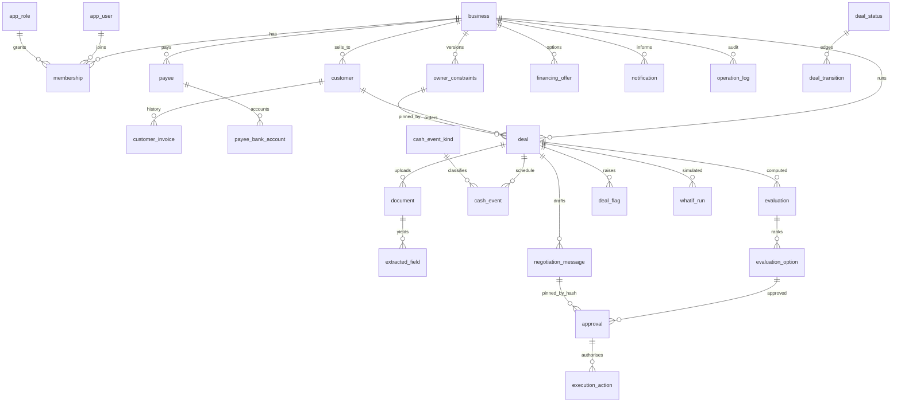

# OrderFit database design (PostgreSQL 15+)

Status: built and tested on PostgreSQL 16. The checks are:
- `backend/migrations/tests/test_schema.sql`: 296 checks, run as the real application roles under RLS.
- `test_concurrency.sh`: 8 concurrent writers on the audit chain, plus the optimistic lock.
- An Alembic upgrade → downgrade → upgrade round trip.

There are 28 tables plus `alembic_version`, 5 views and 1 domain. The independent review and its fixes are in [../database-verification-report.md](../database-verification-report.md).

## 1. Principles

1. **The database enforces the rules.** CHECK constraints, triggers and foreign keys refuse bad states even when the API has a bug. The AI never decides. The Python engine decides, and the schema only stores and protects its output.
2. **Inputs are snapshotted on the deal.** Once the owner confirms, every figure the engine uses is frozen on the deal: cash, reserve, terms, anchor dates, deposit concession, scenario and customer. Later edits to settings never change a past decision. To change an input, move the deal back to `awaiting_confirm`, which produces a new evaluation and makes old approvals stale.
3. **AI extraction is kept separate from owner confirmation.** `extracted_field` holds what the model read and where it read it. The confirmed values live on `deal`.
4. **Trust is derived, never stored as a label.** The `customer_payment_stats` view computes it from the payment facts in `customer_invoice`.
5. **Owner constraints are versioned and immutable.** Each deal pins the version it was evaluated under.
6. **Append-only where it matters.**
   - `evaluation_option`, `approval`, `owner_constraints` and `operation_log` refuse UPDATE and DELETE.
   - `evaluation` allows one change: setting `superseded_at`, once.
   - `execution_action` allows only status changes.
   - No financial table can be TRUNCATEd, not even by a superuser.
7. **Hash-chained operation log.** Per business, `row_hash = sha256(prev_hash || canonical row)`, and appends are serialised by an advisory lock. `verify_operation_log(business_id)` recomputes the chain in a single statement.
8. **Tenant safety at three levels.**
   - Composite foreign keys `(business_id, [deal_id,] id)` stop rows pointing at another tenant's data, or at another deal's.
   - Row-level security is enabled and forced on every tenant table, keyed on `app.business_id`.
   - Cross-tenant access is a database **role** (`orderfit_admin`), not a setting the application could flip.
9. **Three separate notions of "status".** Workflow state is `deal.status`, the engine verdict is `evaluation.verdict`, and risk is `deal_flag`. The single status word the frontend shows is derived in `deal_pipeline.ui_status`.
10. **Money is `bigint` minor units plus a currency code.** A deal's currency must equal its business's currency. Dates use the `biz_date` domain (finite, 2000–2100). The engine's day offset is derived, never stored.
11. **Lookup tables or text + CHECK instead of native enums.** For example, `cash_event_kind` and `deal_status`. Adding a value is an INSERT in a migration.
12. **Every function pins its `search_path`.** Without that, a session could create a TEMP table that shadows `deal_transition`, `deal_flag` or `operation_log` inside a trigger. TEMP is also revoked from PUBLIC.

## 2. Entity relationship diagram



## 3. Table groups

| Group | Tables |
|---|---|
| Reference (seeded, read-only to the app) | `currency`, `app_role`, `deal_status`, `deal_transition`, `cash_event_kind` |
| Tenants and users | `business`, `app_user`, `membership` |
| Counterparties | `customer`, `customer_invoice`, `payee`, `payee_bank_account` |
| Owner settings | `owner_constraints` (versioned), `financing_offer` |
| Deal | `deal`, `document`, `extracted_field`, `cash_event`, `evaluation`, `evaluation_option`, `deal_flag`, `negotiation_message`, `approval`, `execution_action` |
| App support | `whatif_run` (sandbox sliders), `notification` (the bell), `idempotency_key` |
| Audit | `operation_log` |
| Views (security_invoker) | `engine_input_events`, `engine_input_coverage`, `customer_payment_stats`, `deal_pipeline`, `approval_staleness` |

## 4. Engine contract

The engine contract follows `docs/architecture/orderfit/04` and `fixtures/cases/*.json`.

| Engine input (fixture key) | Where it is stored |
|---|---|
| `as_of` | `deal.start_date` (day 0) |
| `opening_balance`, `reserve` | `deal.opening_cash_minor`, `deal.reserve_minor` (snapshot; the reserve defaults from the constraints) |
| `baseline_events[]` (`date, amount, direction, kind, certainty, invoice_ref`) | `cash_event` rows with `deal_id IS NULL` |
| `order.revenue`, `order.terms{anchor, days}`, `order.anchor_dates{order, invoice, delivery}` | `deal.order_value_minor`, `payment_basis` (`invoice`/`delivery`/`order`; NULL = ambiguous), `payment_days`, `order_date`, `invoice_date`, `delivery_date` |
| `order.costs[]` (`date, amount, kind, deferrable, incremental`) | `cash_event` rows with `deal_id` set, `is_deferrable`, `incremental` |
| `order.deposit_discount_bps[_per_10pct]` | `deal.deposit_discount_bps[_per_10pct]` (snapshot, defaulted from the constraints) |
| `financing_offers[]` (`fee_bps, fee_flat, fee_at, interest_bps, lead_days, term_days, min, max, step`) | `financing_offer`. `interest_bps` is charged **once** on the principal for the term, as in the reference engine |
| `owner{priorities, target_scenario, min_order_profit, max_financing_cost, close_call_bps}` | `owner_constraints` (`deal.target_scenario` may override) |
| `scenarios.downside / severe{order_receipt_delay_days, ar_delay_days, cost_overrun_bps, deposit_follows_customer_delay}` | `owner_constraints.downside_*` / `severe_*` |
| `strategy_space{deposit_pcts, extensions, offer_ids, stages, ...}` | `owner_constraints.strategy_space` (jsonb) |
| Engine reads events | `SELECT * FROM engine_input_events WHERE deal_id = $1 ORDER BY day, apply_order, event_id` (outflows before inflows on the same day) |
| Coverage warning (W-BASELINE-COVERAGE) | `engine_input_coverage` (events before day 0 or after day 540, last baseline date) |
| Result | `evaluation` (+ `inputs` snapshot, `input_hash` 32 bytes, `engine_version`) and `evaluation_option` per strategy. Delay tolerance: NULL = safe even with no payment, −1 = fails on time |

The engine view reproduces Rina R-01 ($13,000 lowest on day 60) and R-02 ($2,000 on day 30) from stored rows. Both are checked in `test_schema.sql`.

## 5. Frontend entity to table mapping

| Frontend concept | Table / column |
|---|---|
| Deal list, status chip, KPIs | `deal_pipeline` (`ui_status` = COMMITTED, CLOSED, FAILED, BLOCKED, INGESTING, NEEDS_CONFIRMATION, AWAITING_REPLY, FEASIBLE, RECOMMENDED; also `incremental_costs_minor`, `profit_before_financing_minor`, `recommended_delay_tolerance_days`) |
| Warnings (E-MISSING-ANCHOR, F-INJECTION, SEC-FRAUD …) | `deal_flag` (blocking flags gate transitions) |
| Customer and trust | `customer` + `customer_payment_stats` |
| Payees (suppliers) | `payee` (`category`, `terms_note`, `delay_tolerance_note`, `risk_rating`) + `payee_bank_account` (`bank_name`, `last4`, `status`) |
| Financing facilities | `financing_offer` (`kind`, `limit_minor`, `drawn_minor`, `available_minor`, `interest_bps`, `interest_method`) |
| Risk constraints / engine settings | `owner_constraints` (percentages stored as bps) |
| Company / user / security settings | `business.profile`, `app_user.preferences` (jsonb) |
| Upload and extracted values with citations | `document`, `extracted_field` (`source_page`, `source_quote`, `status`) |
| Cost lines, cash plan, CSV import | `cash_event` (`deal_id` NULL = baseline) |
| Ranked options, sensitivity, timeline | `evaluation_option`, `evaluation.output` |
| Draft message, step-up approval, plan hash | `negotiation_message`, `approval` (`action_plan_hash`, `step_up_verified_at`) |
| Counterparty reply | `negotiation_message` (`direction = 'inbound'`, `extracted_terms`) |
| Scheduled payments / outbox / lender acceptance | `execution_action` |
| STALE banner | `approval_staleness.approval_status` (valid / voided / expired / used / rejected) |
| Sandbox page | `whatif_run` |
| Notifications bell | `notification` |
| Users page and roles; tenants page | `membership`, `app_role`, `app_user`; `business` (`status`, `is_synthetic`) |
| Audit log page and "Verify Hash Chain" | `operation_log`, `verify_operation_log()` |

## 6. Key mechanisms

- **Deal state machine.** `deal_guard` checks each status change against `deal_transition` (OF001), bumps `version`, and blocks forward moves while a blocking flag is open (OF002). The negotiation round may stay the same or go up by one (OF004). Every engine input is frozen after confirmation (OF003). New deals must start in `ingesting`, round 0 (OF008).
- **Ambiguous terms cannot be computed on.** The CHECK `deal_terms_present_after_confirm` applies to every deal past confirmation. Such a deal needs customer, opening cash, order value, delivery date, payment days, a payment basis, and the anchor date that basis refers to.
- **One live evaluation per deal.** A partial unique index allows only one evaluation per deal with `superseded_at IS NULL`. A new run supersedes the old one, and earlier inputs can be evaluated again. An evaluation must match the deal's negotiation round. The app may store one only while the deal is `computing`.
- **Approvals.**
  - The approver must be an **active** member of the business.
  - Sending, committing, compensating or overriding needs tier **T3+**; confirming figures needs **T2+**.
  - The evaluation must be live.
  - Send, commit and compensate need the step-up.
  - The approval pins the evaluation and option *of the same deal*. For a send it also pins the message body by SHA-256, through composite foreign keys. Editing an approved draft changes its hash and is refused.
  - `UNIQUE (business_id, idempotency_key)` prevents double actions.
- **Messages.** `body_sha256` is recomputed on every write, so it can never disagree with the body. The status may only go draft → approved → sent, and only with a matching send approval (OF006).
- **Execution.** An `execution_action` starts as `drafted` and its payload is immutable. To move past drafted it needs an approved send/commit/compensate approval for the same deal with the same plan hash, unexpired and not stale (OF007).
- **Bank accounts** store an HMAC fingerprint plus the last four digits only, never raw numbers.
- **Documents** are limited to 25 MB and a MIME whitelist. The same file twice in one deal triggers the dedupe prompt (D-09). Storage is content-addressed per business (`document_business_hash_idx`).

## 7. Security and the connection model

- **Roles (NOLOGIN groups):**
  - `orderfit_app`: the API and agent.
  - `orderfit_admin`: the cross-tenant console; a member of `orderfit_app`.
  - `orderfit_readonly`: reports.

  Per environment, create LOGIN roles that are members of these. The API must **never** connect as the owner, migrator or `postgres`. Superusers bypass RLS, and FORCE restricts the table owner.
- **URLs.** `DATABASE_URL` uses the app login. `DATABASE_URL_DIRECT` uses the migrator (owner), which Alembic needs.
- **Per request**, inside an explicit transaction (with autocommit the setting is lost after one statement):

  ```sql
  SELECT set_config('app.business_id', '<business uuid>', true);
  SELECT set_config('app.user_id',     '<user uuid>',     true);
  ```

  This is safe with Neon / PgBouncer transaction pooling. Never use a session-level `SET`. Also add an explicit `WHERE business_id = …` to list queries so the planner can use the `(business_id, …)` indexes.
- **Login.**
  - `auth_lookup(email)` returns the password hash. It is SECURITY DEFINER and the only way the app can read hashes.
  - `user_businesses(user_id)` lists the businesses a user can switch to.
  - `app_user` columns `password_hash` and `auth_subject` are not readable by the app or readonly roles. `is_platform_admin` is not writable by them.
  - To read back a just-inserted user, set `app.user_id` to its id first.
- **Deletes.** There is no DELETE anywhere except `idempotency_key`. There is no UPDATE on append-only tables and no writes to reference tables. The app cannot assign the `superadmin` role (OF009).
- **LangGraph checkpointer** (if used): it creates its tables in schema `langgraph`. The app role has CREATE there. Connect it with `options=-c search_path=langgraph`.
- **Isolation level.** Write the operation log under READ COMMITTED, the default. Under REPEATABLE READ, concurrent writers fail with 23505 on `(scope, seq)`. The chain stays safe, but the write must be retried.

### SQLSTATE → HTTP mapping for the API

| SQLSTATE | Raised by | Suggested response |
|---|---|---|
| OF001 | illegal status transition | 409 `ILLEGAL_TRANSITION` |
| OF002 | unresolved blocking flags | 409 `NEEDS_INPUT` |
| OF003 | edit of a frozen input | 409 `STALE_INPUT_VERSION` (move back to awaiting_confirm) |
| OF004 | negotiation round / evaluation round | 409 |
| OF005 | approver inactive, tier too low, stale evaluation, message not a draft | 403 `TIER_DENIED` / 409 `APPROVAL_INVALID` |
| OF006 | message status rule | 409 `APPROVAL_REQUIRED` |
| OF007 | execution action rule | 409 `APPROVAL_INVALID` |
| OF008 | workflow entry (insert) rule | 409 |
| OF009 | role assignment rule | 403 `FORBIDDEN` |
| 23505 | `approval_business_id_idempotency_key_key` / `idempotency_key_pkey` | replay the stored response |
| 23505 | `evaluation_one_live_per_deal`, `document_deal_id_content_hash_key` | 409 `STALE_EVALUATION` / `DUPLICATE_DOCUMENT` |
| 23503 | approval message/evaluation FKs | 409 `APPROVAL_INVALID` |
| 23514, 22P02, 22008, 22003, 54000, 22P05 | CHECK / format | 400 `VALIDATION_FAILED` |
| 23000 | append-only table | 409 |
| 42501 | privilege or RLS | 404 (never reveal another tenant's rows) |

## 8. Known limitations

- Deleting the **newest** operation-log rows is not detectable by the chain alone. Mitigation: periodically store the latest `(seq, row_hash)` outside the database, for example a signed daily anchor or a write-once bucket. `verify_operation_log` reports `rows_checked = 0` when nothing was visible; show that as "nothing verified", not "valid".
- GUC-based RLS protects against a missed `WHERE` clause, not against a compromised application session. Any app session can set `app.business_id`. Never build SQL from request input.
- The approval rules check the approver's tier, but not that the approver is the person making the request. The API must pass the authenticated user's id as `approver_id`. The API must also check that a user changing someone's role is an owner.
- `deal_status` has 8 states: the 7 in `domain.py` plus `committed`. Spec 03 §4.1 lists 15. Adopting more states only means adding rows and edges in `0004_reference_data.sql`; no schema change is needed.
- The frontend's MIME type is whatever the browser claims. The API must sniff the bytes, strip `\x00` from extracted text (PostgreSQL rejects NUL), and enforce the 25 MB limit before upload.

## 9. Open questions

1. Expected scale: number of businesses and users, and deals per business per month.
2. Can one user belong to several businesses? The schema allows it through `membership`.
3. Which currencies at launch? Seeded: USD, BDT, EUR, GBP.
4. Retention for documents and audit records. This drives deletion jobs, and whether personal data needs redaction without breaking the hash chain.

## 10. Running it

```bash
# with Alembic (from backend/): runs sql/0001..0004 through the raw DBAPI cursor
alembic upgrade head          # down: alembic downgrade base  (runs sql/down_0001.sql)

# plain psql
for f in 0001_core_schema 0002_integrity_and_audit 0003_security 0004_reference_data; do
  psql -v ON_ERROR_STOP=1 -d orderfit -f backend/migrations/sql/$f.sql
done

# tests: superuser, on a THROWAWAY migrated database
psql -v ON_ERROR_STOP=1 -d orderfit_test -f backend/migrations/tests/test_schema.sql   # rolled back; exits non-zero on failure
PGDATABASE=orderfit_test bash backend/migrations/tests/test_concurrency.sh             # writes rows that cannot be deleted
```

The migration sends the files through the raw DBAPI cursor, because SQLAlchemy `text()` and psycopg both misread `:` and `%` inside trigger bodies. Autogenerate is disabled (`target_metadata = None` in `env.py`), because it cannot see triggers, RLS or generated columns. Write new migrations by hand.
