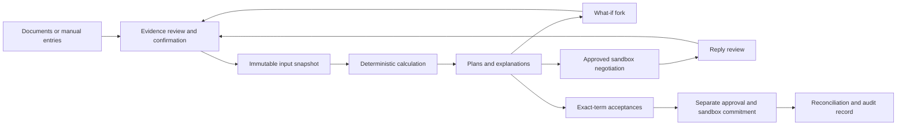

# OrderFit backend implementation plan — regenerated after database integration

> Checkout reconciliation, 16 October 2026: the preparation-time statements below
> describe `a0608e6`, not today's tree. The current frontend is `web/`; root,
> `backend/` and `web/AGENTS.md`, contracts, lockfile and progress now exist.
> Use those current instructions. Implementation and acceptance evidence are in
> [the audit matrix](orderfit_audit_2026-10-16.md) and
> [progress](backend_implementation_progress.md). P4 and P8 acceptance remain partial.
> Historical file-presence claims below are retained as history, not setup commands.

Prepared: **15 October 2026**. Audited checkout: **`a0608e6`**, branch `main`, matching the locally fetched `origin/main`. Database integration: `c8c1163`, merged by `1d68023`. Frontend integration: `a927123` and `8f0d2d7`, merged by `a0608e6`.

This is an implementation handoff, not a claim that the backend is complete. It replaces the earlier plan written for a different checkout. The current frontend is **`frontend/`**. The database now has a substantial SQL implementation. The earlier P0 contracts, progress file, root/backend `AGENTS.md` files and Python lockfile are **not present in this checkout**. The user's earlier completion of P0 is historical context; verify or recover that work before marking any regenerated phase complete.

- Reuse migration `0001_core_schema`, its 28 tables, guards, RLS, views and audit functions.
- Implement the missing application services, authentication, engine, durable jobs and frontend integration around that schema.
- Use **OpenAI** as the sole initial LLM API provider, through a bounded server-side adapter.
- Preserve one deterministic calculator and explicit human approval for every sandbox effect.
- Separate existing facts, proposed changes, reported tests and checks actually rerun. Never invent a missing financial rule or label an unverified capability complete.

## 1. Reading rules, evidence and implementation scope

### 1.1 How the coding agent should use this document

Read the entire plan before implementing the first phase. Then work through section 14's phases and acceptance gates. Inspect any changes since the audited commit first. Read applicable `AGENTS.md` instructions; only `frontend/AGENTS.md` exists in this checkout. Do not recreate old instructions that say `web/` is the current application.

Create `docs/backend_implementation_progress.md` when implementation starts. Record completed files, decisions, test commands/results, remaining dependencies and the next phase. An old progress report or passing reference suite does not establish that application code was recovered.

Use these evidence labels:

| Label | Meaning |
|---|---|
| Observed | Present in the current checkout; may be a stub or demonstration. |
| Reported | A repository report claims a prior run passed; not independently rerun here. |
| Verified in this review | A check was actually executed during preparation of this plan. |
| Plan decision | Proposed behavior to implement and test, not existing behavior. |
| Deferred | Unsupported in this release; show that honestly in the UI/API. |

Precedence: current user instructions; explicit resolutions in this regenerated plan; current SQL for the existing storage contract; revised architecture/reference calculator for intended financial semantics; older README/scaffold/proposal/UI copy. SQL representability does not prove engine support. If SQL and required semantics disagree, make an explicit forward migration or restrict the unsupported capability; do not silently adapt the financial meaning to fit a column.

No plan can literally guarantee zero hallucinations. Its enforceable substitute is a source map, typed boundaries, declared assumptions, fixtures, independent checks and completion gates. New uncertainty must be documented instead of filled with a plausible guess.

### 1.2 Source map

All links are relative to this document. Symbol names are more stable anchors than line numbers.

| Evidence | What it establishes |
|---|---|
| [Core schema](../backend/migrations/sql/0001_core_schema.sql) | Actual tables, columns, CHECKs, keys, types and immutable-result structure. |
| [Integrity/audit SQL](../backend/migrations/sql/0002_integrity_and_audit.sql) | `deal_guard`, `approval_guard`, `execution_action_guard`, hash chain and five views. |
| [Security SQL](../backend/migrations/sql/0003_security.sql) and [reference data](../backend/migrations/sql/0004_reference_data.sql) | Actual grants, role groups, GUC-based policies, auth helpers, role/state/kind vocabularies. |
| [Alembic revision](../backend/migrations/versions/0001_core_schema.py) and [environment](../backend/migrations/env.py) | One revision executes all four SQL files; autogenerate is disabled. |
| [Database design](database/database.md), [connection/audit guide](database/database-audit.md), [verification report](database-verification-report.md) | Rationale and historical reported tests. The verification report's old findings are superseded where its status note and current SQL show fixes. |
| [Schema suite](../backend/migrations/tests/test_schema.sql), [concurrency script](../backend/migrations/tests/test_concurrency.sh) | Executable database test coverage; run only on disposable databases. |
| [Requirements](architecture/orderfit/01-requirements-scenario-edge-cases.md), [architecture](architecture/orderfit/03-system-architecture.md), [financial contracts](architecture/orderfit/04-decision-engine-and-data-contracts.md), [security/evaluation](architecture/orderfit/05-security-and-evaluation.md) | Required product behavior, financial semantics and named test registry. |
| [Orchestration ADR](architecture/orderfit/adrs/0006-orchestration-and-learned-layer.md), other ADRs, [build handoff](architecture/orderfit/BUILD-HANDOFF.md) | Plain runner default, AI boundaries, original scope and historical delivery plan. Do not inherit obsolete vendor/model choices or dates. |
| [Reference calculator](architecture/orderfit/fixtures/reference_engine.py), [fixture guide](architecture/orderfit/fixtures/README.md), `fixtures/cases/`, `fixtures/expected/`, `fixtures/selftest.py` | Executable baseline and 22 regression cases; not the application engine. |
| [Backend dependencies](../backend/pyproject.toml), `backend/orderfit/`, `backend/tests/` | Actual application implementation and stubs. |
| [Frontend package](../web/package.json), [frontend instructions](../web/AGENTS.md), `web/app/`, `web/components/`, [API base config](../web/lib/api.ts) | Current routes, user interactions and integration gaps. |
| [Compose](../docker-compose.yml), backend/frontend Dockerfiles, [CI](../.github/workflows/tests.yml), example environment files | Actual build/deployment starting point; no live deployment proof. |

Review coverage: application Python modules; SQL schema, guards, grants, reference data, views, migration runner and tests; database documents; all frontend route families and deal client components; shared API/health/provider/store components; dependency/configuration/build/CI files; scripts and synthetic data; revised requirements, architecture, ADRs and calculator fixtures. Decorative assets/lockfile entries are dependency/design evidence, not business contracts. Historical proposal material and the earlier PDF analysis remain lower-priority context. No new visual verification of every historical PDF page is claimed. The revised architecture and application source are unchanged relative to the previously reviewed ancestor `18b3c59`; the database and frontend integration changes were inspected directly.

### 1.3 Current implementation and verification ledger

| Area | Current evidence | Planning consequence |
|---|---|---|
| Database | 28 tables, five views, one date domain; raw SQL migration; tenant RLS, append-only guards and custom SQLSTATEs. | Reuse and extend. Do not write a replacement initial schema. |
| Database execution | Repository reports 296/296 schema checks on PostgreSQL 16, concurrency pass, upgrade/downgrade/upgrade pass. | Reported, not rerun here. PostgreSQL 17 and Neon acceptance remain gates. |
| API | `/health` works by source inspection; business routers have no endpoint implementations; identity dependency returns `demo-rina`. | Business/authentication API remains to build; this string is invalid for the database's UUID tenant setting. |
| Application engine | 13 `NotImplementedError` sites under `orderfit/engine/`. Old models use day offsets/trust assumptions. | Port reference semantics; no application-engine completion claim. |
| Agent/storage | 16 agent/node/guard stub sites; five storage stub sites; no actual DB session factory or OpenAI SDK integration. | Language, durable workflow and persistence services remain to build. |
| Frontend | Next 16.4.1/React 19.3.0; only actual fetch path found is connection indicator -> `/api/health` -> backend `/health`. | Business pages remain local/hardcoded demos despite the frontend integration commit. |
| Previous P0 | Contracts/progress/generated API types/lockfile are absent. | Start with a fresh P0 reconciliation gate; reuse recovered work only after verifying it. |
| Reference checks | Rerun: `reference_engine.py --check`: `cases=22 problems=0 calc_version=ref-0.1.0`; `selftest.py`: zero failures. | Valid baseline for porting; not proof of application/DB integration. |
| Architecture checks | The three functions in `backend/tests/test_architecture.py` were executed directly using Python; all passed. | Import-boundary evidence only, not a full pytest/application run. |
| Local database access | Docker client exists but daemon access returned permission denied; `psql` was not found on PATH. | No current database tests or migrations were run. No configured/shared database was contacted. |
| Secrets/configuration | `.env` and `backend/.env` are tracked; root `.gitignore` lacks environment-file exclusions. Values were not printed or validated. | P0 must inspect safely, untrack local secret files without deleting local copies, add exclusions and rotate any real exposed credentials through the owner's account process. Do not assert that secrets are present without checking. |

## 2. Product capability and user journey

OrderFit assesses whether a small business can take one order while meeting its existing cash obligations. It compares order terms, deposits, supplier extensions and confirmed financing offers, explains the profit/resilience trade-off, helps negotiate revised terms and records owner-approved simulated commitments.

Required complete journey:

1. Sign in, select an authorized business and load real settings/baseline/payees/offers.
2. Create a saved draft through manual input or supported source documents.
3. Extract candidate fields with evidence; resolve conflicts, missing dates and duplicate obligations; confirm the values explicitly.
4. Freeze a complete snapshot and run the deterministic engine through a durable operation.
5. Show the baseline, order effect, ranked strategies, stress results, assumptions, gaps and sensitivity.
6. Explore a typed or natural-language what-if as a separate fork; apply changes only after review.
7. Select a plan, review an exact negotiation draft, re-authenticate and approve its sandbox dispatch.
8. Record a reply, review proposed changes, recompute and invalidate old approvals.
9. Record required party acceptances; separately approve the commitment; execute local sandbox actions and reconcile them.
10. Refresh/restart without losing state; export a decision record and a verifiable tenant audit chain.



Initial scope: one business per request, one order per evaluation, one currency per business/deal, dated baseline obligations and receivables, incremental order costs, calendar terms, deposits, deferrable supplier costs, fixed-term loan offers and decline. The database supports users belonging to multiple businesses; preserve that through explicit authorized business selection.

Independent evaluation of several deals does not allocate cash across them. Initial commitment admission must be serialized per business and either project prior commitments into the baseline without duplication or block another commitment until baseline reconciliation. Do not advertise portfolio affordability.

Deferred: actual bank payments, live lender/email actions, FX conversion, tax/VAT computation, holidays/business-day conventions, OCR, factoring/revolving credit semantics, staged delivery/start deferral, portfolio optimization and learned credit/strategy models. Storage enums or UI controls for these features do not enable them.

Earlier requests about turnover, assets and FDR/savings interest remain relevant context. Turnover is historical revenue, not opening cash; assets require explicit liquidity/valuation semantics; FDR principal/interest requires dated available proceeds and no double counting. Initial dated, owner-confirmed cash events can represent proceeds using existing `other`/appropriate event kinds. Dedicated accounting/asset/FDR modules are deferred; never infer interest, liquidation value, taxes or withdrawal penalties.

## 3. Stack, module boundaries and decisions

| Layer | Decision and rationale |
|---|---|
| Backend | Python 3.12 as the initial tested runtime, FastAPI, Pydantic v2, settings, SQLAlchemy 2 and psycopg 3. Already declared. |
| Database | PostgreSQL 17 locally/CI; hosted PostgreSQL/Neon remains a separately verified target. Reuse the raw SQL Alembic revision. |
| Dependencies | Add `uv` and a committed `backend/uv.lock`, update Docker/CI together. Existing Python dependencies are unpinned lower bounds. Add OpenAI SDK, password hashing, parser and test dependencies only when selected and locked. |
| Workflow | Plain durable runner using PostgreSQL jobs and existing deal state table; API and worker are separate processes from one package/image. ADR-0006 defaults to this. Remove unused LangGraph dependencies/comments; do not create checkpoint tables. |
| AI | OpenAI Responses API behind `orderfit/agent/llm.py`. Explicit `off`, `recorded`, `live` modes. Model ID configured and verified during live evaluation; no guessed fixed model or price. |
| Frontend | Preserve `frontend/`, its existing Next/React/component stack and React Query provider. Follow `frontend/AGENTS.md` when editing code. |
| Storage | Private persistent filesystem volume for single-host MVP; interface allows later shared object storage. Multi-host workers require shared storage before scaling. |
| Transport | REST plus durable operation polling initially. SSE is optional; correctness cannot depend on a connection staying open. |
| Authentication | Opaque server-managed sessions and password re-authentication for step-up. Reuse users/memberships and existing DB auth helpers; add session/token persistence. |

The modular monolith limits maintenance cost while keeping transactions comprehensible. A worker avoids blocking HTTP with calculations/provider calls. A PostgreSQL queue needs careful lease/recovery code, but a second queue service or autonomous-agent framework is not justified by the current requirements.

Planned modules (new names are proposals, not claims they exist):

| Module | Owns | Starting files |
|---|---|---|
| Contracts/adapters | HTTP DTOs, enums, public/DB/engine mappings, OpenAPI | `api/schemas.py`, `domain.py`, new `contracts/` and adapter modules as useful |
| Auth/permissions | Sessions, principal, business selection, roles, CSRF, step-up | `api/deps.py`, new `auth/`, auth/member routes |
| Database/repositories | Scoped transactions, explicit SQL/Core mappings, error translation | `store/db.py`, `store/tables.py`, repository modules; no automatic DDL |
| Business/deals | Baseline/defaults/constraints, confirmations, revisions and snapshots | new `services/business.py`, `services/deals.py`, existing routes |
| Documents | Private bytes/text, parsing, field candidates, provenance/conflicts | `store/documents.py`, ingest/extract/validate nodes |
| Engine | Calendar events, finance, stress, ranking, sensitivity | existing `engine/`; pure code only |
| Evaluation | Snapshot construction, single engine boundary, persistence/read DTO | existing `agent/nodes/compute.py` remains the sole direct `analyse` caller; services call this adapter |
| Language | OpenAI request schemas, records, prompts, guards/templates | `agent/llm.py`, prompts and relevant nodes/guards |
| Workflow/jobs | Legal state transitions, jobs, leases, retries, stale-result rejection | replace `agent/graph.py` role with plain runner; new `workflow/` modules |
| Negotiation/actions | Draft bundles, acceptance, approval, exact authorized action set | new services plus existing action route module |
| Sandbox/audit/read models | Outbox/ledger simulation, reconciliation, chain export, notifications | existing execution/log tables; new service adapters |

Routes call services; services use repositories and typed adapters. No formulas in routes or React. Engine imports only standard library/Pydantic/engine code and has no clock, filesystem, environment, database or provider dependency. Only `llm.py` imports OpenAI SDK. Keep and extend current architecture tests; do not remove them to make an unrelated structure pass.

## 4. Database reuse and gap register

### 4.1 Existing objects to reuse

| Objects | Reuse contract |
|---|---|
| `currency`, `app_role`, `deal_status`, `deal_transition`, `cash_event_kind` | Read-only reference data. Alter only through new migrations. |
| `business`, `app_user`, `membership` | Business identity, global user identity, per-business membership. Do not add a second account/tenant system. |
| `customer`, `customer_invoice` | Customer identity and payment history. `customer_payment_stats` is contextual history, not an automatic trust ladder. |
| `payee`, `payee_bank_account` | Payee metadata and HMAC account fingerprints/last4; record verification instead of inventing “Verified.” |
| `owner_constraints` | Append-only versions pinned by `deal.constraints_id`; settings save inserts a new row. |
| `financing_offer` | Existing offer storage. Only complete supported `term_loan` records enter initial engine evaluation. |
| `deal` | UUID, human `public_ref`, confirmed scalar inputs, version and eight workflow states. |
| `document`, `extracted_field` | Immutable source association and candidate/confirmed fields with page/quote. Add parsing/candidate-history support rather than replacing them. |
| `cash_event` | `deal_id IS NULL` is baseline; non-null is deal-related. BIGINT identity IDs must not become UUIDs by assumption. |
| `evaluation`, `evaluation_option` | Full immutable inputs/output and queryable option rows. Parent-first insertion plus options in one transaction satisfies deferred recommended-option FK. |
| `deal_flag` | Blocking/qualitative findings and recorded resolution. Blocking flags do not automatically mean an invalid numerical evaluation. |
| `negotiation_message`, `approval`, `execution_action` | Messages, immutable approval evidence, immutable action payloads/status progression. Do not add a parallel `sandbox_action` table. |
| `whatif_run` | Fork parameters/results; add snapshot/version metadata if needed. No canonical deal mutation. |
| `notification`, `idempotency_key` | Existing support tables with explicit caveats below. |
| `operation_log` and functions | Database-owned sequence/time/hash chain; Python must not generate a competing chain format. |
| Views | Useful tenant-safe read models, subject to horizon, stale-state and null semantics below. |

### 4.2 Required compatibility fixes and tests

Each item is a **source-derived gap or design resolution**, not a claim that a runtime exploit was reproduced. Reproduce applicable cases in an isolated database before changing SQL. Existing reported tests do not cover every application invariant.

| ID | Evidence / risk | Required implementation decision and verification |
|---|---|---|
| DB-01 | `store/db.py` is empty; `demo-rina` is not a UUID; Compose uses the same default superuser URL for API/migrations and injects direct URL into API. | Implement real principal and scoped transactions; separate migrator/runtime credentials; never run app as owner/superuser/admin. Test actual login roles, not only `SET ROLE` fixtures. |
| DB-02 | `.env` files tracked; example/docs say not to commit them. | Review values without echoing them, add ignore rules preserving `.env.example`, untrack local env files preserving local contents. If real credentials were published, rotate them; removal from latest commit does not revoke exposure. No automatic history rewrite. |
| DB-03 | `deal.version` changes on every deal UPDATE, not only financial edits; no input revision. | Retain it as optimistic row version; add `input_version` and complete immutable input snapshots. Child/source/baseline/offer changes must invalidate affected deals/results. Never equate workflow-only version bumps with changed financial inputs. |
| DB-04 | Scalar freeze guard does not freeze `cash_event`, offers, payee account state or all source candidates. Baseline/offer data remain mutable. | Snapshot all calculation/action dependencies; use one mutation/invalidation service with parent locks and database revision/dirty markers for relevant child writes. Test direct child updates and competing confirmation/evaluation. |
| DB-05 | `engine_input_events` excludes events before day 0 and after day 540. | Application adapter reads full relevant dated rows, checks coverage and constructs a complete horizon; do not use the filtered view as sole truth. Reject beyond configured analysis bounds, never clip. Past events require opening-balance reconciliation. |
| DB-06 | Eight SQL states vs fifteen conceptual states; SQL checks/triggers hardcode state sets. | Keep the eight states and use operation/subphase fields for extraction/drafting/execution/compensation. Add only necessary transition edges in new migrations. Adding fifteen lookup rows alone is insufficient. |
| DB-07 | `computing` has no edge back to `awaiting_confirm`; reference may return needs-input/unsupported/conflict. | Add `computing -> awaiting_confirm` for reviewed input correction; retain operation result/flags for non-evaluations. Do not force them into `evaluation.verdict='no_feasible_plan'`. |
| DB-08 | `deal_guard` checks `OLD.status` when freezing inputs. | First transition back to `awaiting_confirm`, then edit in a second UPDATE within one transaction, checking versions. A combined state-and-input UPDATE from a frozen state is rejected. Test sequence/rollback. |
| DB-09 | Immutable `approval`; `approval_staleness` only observes supersession/expiry/some executed actions. | Add bundle/run/revocation evidence, not an approval status column updated in place. Execution checks session, current role, input revision, bundle/recipient hash, expiry and revocation again. View is a display hint, not authorization. |
| DB-10 | Message status guard finds matching approval but does not recheck expiry/supersession for sending; subject/recipient/channel are not the body hash. | Send only through execution service, with exact bundle hash over full content and recipient. Strengthen SQL guards in a forward migration for stale/expired sends and approved message metadata. Never send by a bare message status UPDATE. |
| DB-11 | Execution guard accepts any send/commit/compensate approval with matching plan hash, without kind-specific mapping; immutable payload hash is caller-provided. Cancellation paths have weaker checks. | Define allowed action kinds per approval type, persist exact bundle membership, compare payload to approved manifest and require separately approved cancellation. Add server and DB regression tests for mismatched kind/message and extra actions. |
| DB-12 | Execution action's message FK is tenant-only, not same-deal; several actor/source refs have tenant-only/global references. | Enforce same-deal/source and authenticated-actor association in services; add targeted composite constraints where the domain requires them, especially execution message linkage. Do not claim every existing FK already prevents cross-deal references. |
| DB-13 | Approval may cover several actions; no single bundle execution claim/lease. `is_used` becomes true after any action succeeds. | Add one execution-run record unique per approved bundle; one approval can authorize its exact batch, not arbitrary future actions. Track partial completion separately from consumed admission. |
| DB-14 | Session, setup/step-up grant, durable job and accepted-term evidence tables are absent. | Add narrow tables/functions described in section 7. Do not hide these solely in process memory or unvalidated profile JSON. |
| DB-15 | App role can update shared `app_user` fields for users visible through membership; API actor identity is not DB-authenticated. | Self-service profile/password endpoints only; tenant owner controls membership, not another tenant's shared user's global password/status. Add membership revocation/status and guard last owner. Harden password update policy/functions where practical. |
| DB-16 | `app_user.mfa_enforced` defaults true but no MFA implementation exists. | New MVP password accounts explicitly set false; UI shows unavailable MFA. Existing true accounts must fail closed until a real supported MFA path or authorized migration resolves them. Step-up password re-entry is not MFA. |
| DB-17 | `notification.read_at` is shared for `user_id=NULL` broadcast rows. | Generate one row per intended recipient initially; enforce `user_id=current user` for read/update and add event dedupe key. Do not let one user's read mark every member's notification read. |
| DB-18 | One `extracted_field` row per document/field, but multiple conflicting quotes and extraction retries are required. | Add immutable extraction-run/candidate evidence rows; retain `extracted_field` as current reviewed aggregate/projection. Keep both conflicting quotes; no overwrite that destroys evidence. |
| DB-19 | Priorities CHECK permits only four names; reference also supports `robustness`, `low_financing_cost`, and duplicate priorities are not excluded. | Extend CHECK in forward migration to all supported priorities and enforce uniqueness in typed validation. Preserve explicit ordering; migrate defaults only as a deliberate new constraint version. |
| DB-20 | Several stored policy fields have no reference semantics: concentration, minimum delay tolerance, percentage cost cap; UI has active switches. | Initial engine explicitly supports target scenarios and absolute cost cap. Reject unsupported non-null policy activation or display inactive informational settings. Never silently promise enforcement. Deposit/extension limits can constrain the generated grid after explicit validation/versioning. |
| DB-21 | Financing kinds include unsupported products; min draw may be zero; free-text interest method/limit fields can contradict term terms. | Initial API accepts positive-minimum fixed-term loans with flat term interest and complete fee timing. Reject unsupported kinds for engine use; no APR-to-flat guess or use of generated `available_minor` as a loan approval. |
| DB-22 | SQL delay tolerance NULL means survives nonpayment; reference scan cap does not prove that. | Add explicit survival/capped status fields in option/result storage (or versioned output with typed status); remove ambiguous NULL meaning through reviewed migration. Never map “scan survived” to “safe without payment.” |
| DB-23 | `evaluation.verdict` has only three values and required numeric summary; no-feasible requires recommended key NULL. | Store legitimate numeric feasible/no-feasible evaluations with explicit mapper; reference `decline` maps to no-feasible/decline recommendation at API level, NULL DB recommended key. Missing/unsupported/conflict live in operation result + flags, not fabricated numeric summaries. |
| DB-24 | `operation_log` canonical JSON is PostgreSQL jsonb array text; Python compact/sorted JSON differs. Tail deletion is not self-detecting. | Export canonical bytes/text from the DB function plus fields and head manifest. Independent verifier uses those exact bytes; show zero visible rows as nothing verified. Keep external anchoring a separate claimed capability. |
| DB-25 | `idempotency_key` PK is `(business_id,key)`, default expiry 24h; scope is not part of unique key. | Preserve PK; hash actor/method/path/body into request hash and validate scope. Different command under same key -> 409, not replay. Action execution dedupe lasts as long as decision history even if general HTTP cache expires. |
| DB-26 | `whatif_run` params/result accept arbitrary JSON; offers/baseline lack versioned snapshot guarantees. | Use strict versioned DTOs and snapshot references; forks cannot authorize actions. Same explicit adapter as canonical evaluation. |
| DB-27 | Historical connection guide suggests exposing first DB error line and replaying on any matching unique violation. | Return curated messages; do not expose SQL text/values. Roll back failed transaction before reading replay record; compare request hashes and authenticated scope first. |
| DB-28 | CI migrates but does not run SQL regression/concurrency suites; current script's concurrent writers use superuser. | Add PostgreSQL 17 database suite and separate non-owner runtime-role concurrency/recovery tests. Keep earlier schema test counts as reported until rerun. |
| DB-29 | Existing `langgraph` schema grants CREATE to app; plain runner selected. | Do not initialize it. Revoke unused CREATE privilege in a forward hardening migration after checking no deployed dependency; do not drop populated schema blindly. |
| DB-30 | `customer_payment_stats.open_overdue` uses DB `current_date`; demo/analysis has explicit as-of. | Use parameterized as-of history query for reproducible demo/analysis; view may serve clearly labeled current-day context only. No trust-based automatic constraints. |

### 4.3 Migration discipline

`0001_core_schema` is one Alembic revision; SQL files named `0001` through `0004` are its components, not four independent Alembic revisions. Keep them unchanged for existing installations. Suggested next revision: `0002_backend_foundation`, `down_revision="0001_core_schema"`, loading a new SQL file such as `0005_backend_foundation.sql`. Subsequent execution/provenance hardening may use separate revisions aligned to phases.

Use manual migrations. `target_metadata=None` is intentional; do not re-enable autogenerate or call `metadata.create_all()` as a second schema authority. SQLAlchemy Core mappings may be defined to match existing objects without managing DDL. The raw cursor execution in revision 0001 avoids SQLAlchemy colon/psycopg percent parsing; preserve that rationale. Its raw online connection dependency means offline `alembic upgrade --sql` is not a verified supported path.

Validate existing rows before adding constraints; backfill with explicit safe values or return an actionable migration failure. A new index/constraint must not silently reclassify real financial history. Test upgrade on a database at 0001 and fresh installation; downgrade/destructive round-trip only on disposable databases. Never run `downgrade base`, schema suite or concurrency script on the user's configured/shared database.

## 5. Frontend capability inventory

Every existing route needs an explicit implement/adapt/defer outcome. A database column or local demo handler is not a working feature.

| Route/component | Required behavior and data | Disposition |
|---|---|---|
| `/`, landing components | Marketing and clearly labeled synthetic illustration | Keep; do not represent landing JavaScript simulator as authoritative engine or cite mock metrics as measured. |
| `/auth/signup`, `/auth/signin` | Real registration/login/logout/session and authorized business selection | Replace timeout redirects; add selector only when multiple memberships exist. |
| `/deals` | Tenant pipeline, stable pagination/search/filter, current/stale/action-needed status | Reuse `deal_pipeline` but enrich freshness/capabilities; do not show old live verdict when new inputs await confirmation. |
| `/deals/new` | Saved draft, actual source bytes/text for PO/quote/cash/bills/financing/constraints | Existing state stores metadata/booleans. Upload bytes and retain document IDs; allow complete manual path when no files are available. |
| `/deals/new/validate` | Grounded candidates, conflicts, editable date/cost/anchor fields, server validation | Existing page only reads PO number from localStorage and redirects to fixed fixture IDs. Persist every field and navigate by returned UUID. |
| `/deals/[id]` + `deal-detail-client.tsx` | Real evaluation/flags, comparisons, currency, timeline, limitation labels | Remove conditional hardcoded OF-09/OF-15/other results. Fixture IDs remain public labels in demo seed only. |
| `.../confirm` + `deal-confirm-client.tsx` | Explicit review confirmation with evidence and expected versions | Start unconfirmed, no default acceptance or timer-based transition. |
| `.../negotiate` + `deal-negotiate-client.tsx` | Actual strategies, owner priorities, sensitivity, draft/edit/step-up/approve | Replace fabricated hash and any-six-character bypass; term edits invalidate analysis/bundle, prose edits create new draft revision. |
| `.../reply` + `deal-reply-client.tsx` | Inbound source, proposed terms, review, re-evaluation, acceptance and commitment | No local `isCommitted=true` or fixed hybrid choice. Separate approval for commitment. |
| `/cash-flow` | Opening cash/date/coverage, baseline events, CSV preview/apply/export and timeline | Use backend CSV parser and deterministic sweep; 30/60/90 is display range, not analysis cutoff. |
| `/sandbox` | What-if controls/NL patch on a chosen saved deal | Reuse engine and `whatif_run`; no keyword arithmetic or implicit canonical updates. Planning playground is distinct from execution sandbox. |
| `/payees` | Payee directory, verified domain/account evidence, active/revoked state | Reuse payee tables; initial status pending, no fabricated verification. |
| `/financing` | Owner-supplied verified fixed-term offers and full draw/repayment terms | Adapt initial UI to term loans. Unsupported product cards disabled/informational. |
| `/risk-constraints`, `/settings` engine tab | New immutable owner-constraints version and explicit apply to future/current deal | Same endpoint and semantics; no two independent stores. Unsupported fields clearly inactive. |
| `/settings` company/user | Business profile and own profile/preferences, timezone validation | JSON shape allowlisted; no arbitrary security/control flags in profile JSON. |
| `/settings` security | Session controls and actual supported security status | Audit/RLS/integer precision/approval checks cannot be toggled off. MFA/email digest unavailable until implemented honestly. |
| Notification dropdown | Recipient-specific notifications, read/mark-all, links and dedupe | Real rows; no synthetic timestamps after live sign-in. |
| `/audit-log` | Tenant log, exact canonical export/verifier, actual evaluation/security evidence | Replace hardcoded passing attack/baseline cards with stored artifacts or “not run.” |
| `/users` | Tenant-local member roles/invitations/revocation | Preserve role model; remove global tenant view from ordinary users; no assignment of platform `superadmin`. |
| `/orders` | Tenant-local alternate deals view, hold/resume if implemented | No second order table; a hold is a blocking flag plus execution admission checks. It cannot undo sent/posted actions. |
| `/admin`, `/admin/engine`, `/admin/security`, `/admin/logs` | Potential operational read views | Initial tenant-safe capabilities/evidence only or hide. Remove fake node health, editable engine invariants and arbitrary test-running buttons. |
| `/admin/tenants`, `/admin/users`, `/admin/orders` | Cross-tenant console | Deferred despite DB `orderfit_admin` support. Normal API never uses this role; omit public admin routes. |
| `/ui-showcase` | Design gallery | No business backend requirement. |
| `/api/health`, connection indicator | Reachability vs readiness/capabilities | Existing proxy only confirms HTTP health. Do not call this proof of working database/business API; avoid exposing internal URLs in deployed public responses. |

Required read states: empty, loading, needs-confirmation, incomplete coverage, no-feasible, unsupported, stale, expired approval, forbidden, job failed, partial execution and unknown outcome. Generate shared TypeScript contracts/mocks from the approved OpenAPI schema and clear authenticated React Query caches on logout/business change.

## 6. Contracts before implementation

### 6.1 Canonical types

- HTTP money is a decimal **string of integer minor units**, e.g. `"215000000"`. Internal Python and SQL use integer/BIGINT. No exponent notation, separators, fractional minor units or floats in canonical money. Negative balances/profit/headroom are valid; event amounts must be positive.
- UUID tables use UUID strings at the API. BIGINT identity IDs (`cash_event`, `extracted_field`, `deal_flag`, `notification`, `operation_log`) use digit strings externally, Python integers internally. Do not migrate these IDs to UUIDs just to match the old plan.
- `public_ref`/PO labels are not resource IDs; strategies are opaque option keys plus canonical parameters. Never reconstruct an authorized action by parsing a key such as `fin:BANK_WC@130000000`.
- Use the seeded currencies USD/BDT/EUR/GBP with exponent 2, one per business/deal. Initial regression coverage must include formatting/roundtrip for all four; financial fixtures remain BDT/USD. No FX or silent currency relabeling. Lock currency changes once financial rows exist.
- Financial dates are ISO dates within `biz_date` (2000–2100). System timestamps are UTC instants. `deal.start_date` is explicit financial as-of, not automatic wall-clock “today.” Auth/approval expiry always uses real server UTC.
- `deal.version` is row concurrency version. Proposed `input_version` advances only for financially/source-relevant changes. Both are returned; clients send expected versions on writes.
- Hashes are lowercase 64-hex strings at HTTP boundaries and exactly 32 bytes in SQL. Null means missing/not applicable according to the field; do not use NULL as unlimited tolerance.
- Fail strictly on unknown fields, non-finite values, bool-as-int, unsupported enum values and invalid cross-field combinations. UI text parsing produces a reviewable normalized proposal before canonical submission.

### 6.2 Proposed core Pydantic contracts

These are **proposed schemas** to implement/test in P0, not existing imports. Examples intentionally use the current SQL field names and ID types. ISO dates/UUIDs are parsed normally; financial integers/booleans are strict.

```python
import re
from datetime import date
from typing import Annotated, Literal
from uuid import UUID
from pydantic import BaseModel, ConfigDict, Field, field_validator, model_validator

MoneyMinor = Annotated[str, Field(pattern=r"^(0|-?[1-9][0-9]*)$")]
BigId = Annotated[str, Field(pattern=r"^[1-9][0-9]*$")]
HashHex = Annotated[str, Field(pattern=r"^[a-f0-9]{64}$")]
Currency = Literal["BDT", "USD", "EUR", "GBP"]

def iso_business_date(v: object) -> date:
    if type(v) is date:
        parsed = v
    elif isinstance(v, str) and re.fullmatch(r"[0-9]{4}-[0-9]{2}-[0-9]{2}", v):
        parsed = date.fromisoformat(v)
    else:
        raise ValueError("expected ISO calendar date, not a timestamp")
    if not date(2000, 1, 1) <= parsed <= date(2100, 12, 31):
        raise ValueError("date outside supported business range")
    return parsed

class DTO(BaseModel):
    model_config = ConfigDict(extra="forbid", frozen=True)

class CreateDeal(DTO):
    public_ref: str = Field(min_length=1, max_length=64)
    start_date: date
    constraints_id: UUID
    customer_id: UUID | None = None

    @field_validator("public_ref")
    @classmethod
    def nonblank(cls, v: str) -> str:
        if not v.strip():
            raise ValueError("public_ref is blank")
        return v.strip()

    @field_validator("start_date", mode="before")
    @classmethod
    def finite_business_date(cls, v: object) -> date:
        return iso_business_date(v)

class CostInput(DTO):
    event_id: BigId | None = None  # null for a new row; assigned by PostgreSQL
    event_date: date
    amount_minor: MoneyMinor
    kind: Literal["supplier_payment", "labour", "freight", "subcontract"]
    is_deferrable: bool = Field(strict=True)
    incremental: bool = Field(strict=True)
    invoice_ref: str | None = Field(default=None, max_length=100)
    payee_id: UUID | None = None

    @field_validator("amount_minor")
    @classmethod
    def positive_money(cls, v: str) -> str:
        if not 0 < int(v) <= 9_000_000_000_000_000:
            raise ValueError("amount outside service bounds")
        return v

    @field_validator("event_date", mode="before")
    @classmethod
    def business_date(cls, v: object) -> date:
        return iso_business_date(v)

class ConfirmInputs(DTO):
    expected_version: int = Field(strict=True, ge=1)
    expected_input_version: int = Field(strict=True, ge=1)
    snapshot_hash: HashHex
    confirmed_field_ids: list[BigId] = Field(max_length=2000)
    acknowledged_warning_codes: list[str] = Field(max_length=100)

class EvaluateRequest(DTO):
    expected_version: int = Field(strict=True, ge=1)
    expected_input_version: int = Field(strict=True, ge=1)
    snapshot_id: UUID

class ApprovalRequest(DTO):
    expected_version: int = Field(strict=True, ge=1)
    expected_input_version: int = Field(strict=True, ge=1)
    bundle_id: UUID
    bundle_hash: HashHex
    decision: Literal["approved", "rejected"]
    step_up_grant_id: UUID | None = None

    @model_validator(mode="after")
    def outgoing_approval_needs_grant(self):
        if self.decision == "approved" and self.step_up_grant_id is None:
            raise ValueError("outgoing approval requires step-up")
        return self

class OperationAccepted(DTO):
    operation_id: UUID
    deal_id: UUID | None  # null for an authorized business-scoped operation
    status: Literal["queued", "running", "succeeded", "failed", "cancelled"]
    input_version: int = Field(strict=True, ge=1)
    poll_url: str
    result_url: str | None
```

The service must additionally enforce identity ownership, current versions/state, snapshot completeness/hash, positive revenue, row-ID membership, dates relative to as-of, required anchors, amount aggregation bounds and non-overridable findings. Resource ceilings are explicit plan defaults, not financial laws. Validate cumulative/scenario-expanded totals against BIGINT; safe individual fields can still overflow in aggregate.

### 6.3 Full input snapshot and adapters

Define `ConfirmedInputV1` with these complete groups before engine porting:

| Group | Fields and mapping |
|---|---|
| Identity/version | schema version, business/deal UUID, input version, source revision set, financial as-of, currency/exponent; optional fixture label for tests only |
| Business baseline | `opening_cash_minor`, `reserve_minor`, baseline revision, coverage-through date, confirmed balance evidence and dated baseline event snapshots |
| Order | customer version/identity, PO, revenue, order/invoice/delivery dates, calendar basis/day count, incremental cost rows and nonincremental-cost explanation |
| Provenance | document hashes, candidate/confirmation IDs, manual attestations, conflict resolutions, explicit assumptions; exact bytes retained separately |
| Offers | immutable terms for allowed positive-grid `term_loan` offers, payee/account versions and validity windows |
| Owner settings | pinned constraints ID/version; ordered priorities, absolute financing-cost cap, minimum profit, target scenario, close-call threshold |
| Strategy/scenarios | validated deposit grid/lead, supplier extension grid/surcharges, enabled offer mapping; downside/severe timing/overrun/deposit behavior; scan bound and sensitivity/uncertainty requests |

Adapter to reference input: `start_date -> as_of`, `opening_cash_minor -> opening_balance`, `reserve_minor -> reserve`, `order_value_minor -> order.revenue`, `payment_basis/payment_days -> order.terms`, explicit anchor dates, baseline/deal costs -> dated events. Map offer UUIDs to deterministic engine identifiers; fixtures keep their original offer IDs in a separate test adapter so golden results remain comparable. Map `fee_flat_minor -> fee_flat`, `fee_at='repayment' -> reference non-draw repayment semantics`, `kind='term_loan' -> shape='term_loan'`.

Do not feed stored order receipts or loan actions into `order.costs`. Reference event construction generates those receipts/draws/fees/repayments. Passing both stored generated events and generated strategy events double-counts cash. Baseline is explicitly selected independently of generated execution projections; identify the original obligation and exclude duplicates.

Use a complete `snapshot_hash` over canonical typed inputs/configuration/provenance revision references; retain the reference's narrower `input_hash` separately in versioned result metadata. The reference excludes sensitivity from its hash and includes case identity. A sensitivity-only/source revision cannot reuse action approval just because the old reference hash stayed equal.

### 6.4 Evaluation result and storage mapping

`EvaluationResultV1` contains: IDs/versions/hashes; calculator version; as-of/evaluated time; full decision and original reason codes; baseline/as-is summaries; ranked candidates and canonical parameters; per-scenario trough/headroom/breach intervals; base incremental profit, financing cost, borrowing, profit given up; tolerance status/cap; assumptions, source coverage, VOI questions, sensitivity and alerts; current/stale status derived separately; allowed next actions.

| Reference result | Application/SQL handling |
|---|---|
| `accept_as_is` | `evaluation.verdict='feasible_as_offered'`, recommended option `accept_as_is`. |
| `accept_with_changes` | `plan_recommended`, exact recommended option key. |
| `decline_or_renegotiate` | Public decision retains that meaning; SQL `no_feasible_plan`, recommended key/tolerance NULL. Retain decline rationale and any alternative-change diagnostics in output. |
| `needs_input` | Operation result and review fields/flags; return to `awaiting_confirm`; do not fabricate a SQL numeric evaluation. |
| `unsupported_escalate`, `blocked_data_conflict` | Typed blocked operation/review result with original codes; no fake zero balance or forced loan recommendation. |

For numeric summaries define `evaluation.lowest_balance_minor`/`first_breach_date` as selected recommendation's base scenario when present, otherwise the as-is base scenario if a numeric no-feasible evaluation exists. Label that scope explicitly. If even that scenario is not computed, use a non-evaluation blocked result instead of satisfying NOT NULL with invented values.

Persist parent evaluation, all relevant option rows and recommended-option link atomically. The FK is deferred until commit; do not commit a parent without its recommended row. `evaluation.inputs/output` are immutable; only supersession timestamp changes. Add snapshot/input-version linkage in a forward migration. Cache identity includes complete snapshot hash, calculator version and analysis configuration, not only deal ID or reference hash.

Daily series DTO: date, baseline trough/close, candidate trough/close, reserve, effective baseline-relative floor, scenario and strategy. Read from the same engine computation; reference summary truncates rankings and removes private series, so expose typed series/catalogue through the port rather than reverse-engineering summaries.

### 6.5 Error and idempotency contract

```json
{
  "error": {
    "code": "STALE_INPUT_VERSION",
    "message": "The order inputs changed. Refresh before continuing.",
    "request_id": "38d43f08-380e-4bc9-a64f-221af9166c79",
    "details": {"expected_input_version": 3, "current_input_version": 4},
    "retryable": false
  }
}
```

HTTP: 400 malformed/unsupported syntax, 401 no valid session, 403 known same-tenant forbidden operation/CSRF/step-up, 404 missing or cross-tenant resource, 409 stale/state/idempotency conflict, 413 oversized upload, 415 unsupported format, 422 validated field/financial input errors, 429 admission quota, 503 unavailable dependency. A completed analysis with blocked/needs-input/no-feasible is a domain outcome, not an unhandled 500.

Translate existing SQLSTATEs centrally: OF001 illegal transition; OF002 unresolved blockers; OF003 frozen/stale input; OF004 round mismatch; OF005 approval authority/coherence; OF006 message approval; OF007 execution approval; OF008 insertion/workflow entry; OF009 role assignment; 23000 immutable history; 23505 unique conflict; 23503 bad reference; 23514/22xxx input format/constraint; 42501 privilege/RLS. Precheck known role errors for 403; otherwise map approval coherence to safe 409. Use constraint names where available; never parse or return raw SQL error text. Unknown operational errors remain generic with server request ID.

Every resource/job/approval/execution creation requires `Idempotency-Key`. Existing key scope is tenant-global: request hash must include actor, method, route and path IDs plus canonical body, and scope must match. Same key/same request returns original result/operation; same key/different request -> 409. Concurrent reservation and command creation share a transaction. Recover unique-conflict replay after rollback or savepoint rollback, with authenticated tenant/actor validation. Never treat a 23505 alone as proof a prior request succeeded.

An uncertain POST outcome is resolved through the same key/operation ID. No automatic new-key retry for effects. General HTTP replay records may expire, but bundle/action uniqueness and durable outcomes remain for the lifetime of financial evidence.

## 7. Persistence additions and transaction contracts

These are **proposed additions**, not existing tables. Resolve their exact SQL and Pydantic schemas in P0/P1. Prefer explicit relational references and small versioned JSON payloads; do not duplicate existing users, evaluations, approvals, messages, actions or logs.

### 7.1 Minimum additional records

| Record | Required fields and constraints |
|---|---|
| `auth_session` | UUID, user UUID, unique token digest (never raw token), created/last-active/expires/revoked timestamps, session version. Global identity record; no tenant chosen by an unauthenticated request. Restricted auth functions/repository access, not general tenant SELECT. |
| `step_up_grant` | UUID, user/session/business, purpose, exact bundle hash, created/expires/consumed timestamps. Single-use, five-minute lifetime; consume in approval transaction. Store no password. |
| `membership_invitation` | UUID, business, normalized email, allowed role, token digest, issuer, expiry, accepted/revoked timestamps. Initial owner can copy an invitation link; email transport is deferred. Bind acceptance to authenticated matching identity. |
| `input_snapshot` | UUID, business/deal, input version, business-data revision, schema version, complete canonical payload/hash, confirmed by/at. Immutable; composite tenant/deal references and uniqueness over deal/input-version/business-revision/hash. Do not require input version alone to be unique: business data may change independently. Create at successful confirmation, not by mutating a candidate snapshot into a confirmed one. |
| `operation` | UUID, business, optional deal, actor/user/session, kind, status, subphase, request hash, input/snapshot/config versions, result/error, progress metadata, queued/started/finished timestamps, attempt count, available-at, lease owner/token/expiry. Explicit job-state CHECK and indexes for claim/recovery. A job with no deal must still have authorized business/actor scope. |
| `document_parse` / `extraction_candidate` | Immutable parse/run identifiers, document/hash, parser/model/prompt/schema versions, page-indexed text storage reference/hash, candidate field path/value/quote/page, evidence-validation status and errors. Multiple candidates per field/run allowed. `extracted_field` remains current reviewed projection. |
| `action_bundle` / `action_bundle_item` | Immutable UUID bundle with business/deal/evaluation/option/snapshot/revision refs, type, full canonical manifest/hash, validity, creator; ordered items with unique bundle-local key, kind, recipient/payee identity/version, subject/body/channel, amount/date and canonical payload/hash. References existing message IDs where relevant. No approval for a mutable draft. |
| `approval_revocation` | Append-only approval/bundle, reason, authenticated actor and timestamp. Unique revocation per approval; do not edit original approval history. |
| `party_acceptance` | Immutable business/deal, party identity/role, exact terms hash, source message/document/manual attestation, recorded by/at, validity and supersession linkage. “Accepted” prose without evidence is not sufficient. |
| `execution_run` | UUID, business/deal, bundle/approval, run kind, unique admitted bundle, queued/running/succeeded/partial/failed/cancelled state, operation, claim/fencing token and timestamps. Existing `execution_action` links to run/item; unique `(run_id,bundle_item_key)` prevents extra/duplicate actions. A database-enforced business commitment gate permits only one unresolved commit run per business. |
| `commitment_projection` | Immutable linkage from successful sandbox commitment/action to its dated projected cash event, original obligation, source deal/evaluation/bundle and reconciliation status. Unique source action/event key. This is attribution for existing cash events, not a second ledger. |

Add explicit revision/status fields to mutable inputs: `deal.input_version`; a coarse `business.financial_revision`; versions on financing offers/payees/accounts/customer history as needed; membership revoked timestamp/status; cash-event void/supersession metadata; evaluation snapshot/version refs; what-if snapshot/config refs; recipient-specific notification dedupe key. Use archive/void/supersede instead of physical deletion of financial/source evidence.

The coarse business revision deliberately invalidates more evaluations than strictly necessary. It is easier to prove correct than dependency-by-dependency invalidation at this stage. A baseline, active offer, constraints-default, payee/account or customer-history change bumps it in the same transaction. An unchanged pinned constraint version remains in a snapshot, but a changed business revision still requires a refresh before execution. Optimize this only after measuring needless recomputations.

New tenant tables require `business_id`, FORCE RLS, tenant-aware references and explicit grants. Existing default privileges grant SELECT only: do not forget narrowly scoped INSERT/UPDATE grants. Immutable records need write guards. Global auth tables need separately restricted policies/functions with fixed `search_path`; they must not become a cross-tenant user-directory shortcut.

**Batch-approval compatibility:** current `approval` represents one `message_id`/`message_sha256` for `send_message`, and `message_status_guard` searches for that individual match. A multi-recipient batch cannot be implemented by reusing the first message's approval for the others. Add `approval.bundle_id` with composite tenant/deal linkage; forward-migrate send-action CHECKs and approval/message/execution guards to validate every immutable bundle item. For a bundle-backed send, the full bundle hash is authoritative; legacy message columns may be null for a batch only after that migration explicitly permits it. Preserve legacy single-message rows and their original hash checks. New application sends must always be bundle-backed. Regression tests must reject an extra message, wrong body/subject/recipient and a message from another deal. This is a required P6 migration, not merely an application convention.

### 7.2 Mutation, confirmation and freshness

1. Every financial writer obtains the business lock before the deal lock, followed by related rows in deterministic ID order. Use the same order in evaluation publication, execution admission and source mutation. Avoid deadlocks from mixed ordering.
2. A deal-input mutation checks `expected_version` and `expected_input_version`, legal editable state and actor role. In frozen states, move to `awaiting_confirm` in the first UPDATE, then change inputs in a second UPDATE within the same transaction (DB-08).
3. Relevant child writes bump the parent's input revision; business-wide writes bump the business revision. Add database triggers/guarded mutation functions so direct runtime-role child writes cannot bypass freshness. One business revision bump per row is acceptable; consecutive revision numbers need not equal user actions. Define the returned final versions from committed rows.
4. Supersede any current evaluation affected by a deal edit. For business-wide changes, a derived `is_stale` comparison can mark many evaluations without synchronously updating every deal, but action admission must reject mismatched revisions.
5. Review endpoint builds a repeatable, typed candidate snapshot and returns its hash, source revisions, required fields, coverage and blocking/acknowledgeable findings. Confirmation locks and rebuilds it; a changed hash/revision returns 409. Check every required field, not just IDs the client happened to send.
6. Successful confirmation creates immutable `input_snapshot` and an existing `approval` row with action `confirm_figures` and the actual T2+ actor. This is not an outgoing action approval. Return its snapshot ID and fresh deal versions.
7. Evaluation reads only that immutable snapshot. Publication locks/rechecks revisions and job fencing token, supersedes any previous live evaluation, writes evaluation/options atomically and advances state. Supersession must precede the new insert in that transaction to satisfy the existing one-live-evaluation partial unique index. If inputs changed, finish the job with a structured stale result and publish no live evaluation. Do not overwrite a newer result.

Selecting a different precomputed option is not a financial edit. A changed deposit/offer/grid/stress setting is. New document evidence, correction of a quoted figure, changed verified recipient, or new party terms invalidates relevant snapshots/bundles even when a displayed amount stays equal.

Financial/source updates must be append-audited with actor, affected record IDs, before/after hashes and revision references. Avoid unnecessary raw account data or complete document text in audit payloads.

### 7.3 Transaction context and permissions

Use a SQLAlchemy/psycopg transaction factory that establishes validated `app.business_id` and `app.user_id` via transaction-local settings. Never interpolate identifiers into SET SQL or use connection-persistent context. Commit/rollback always clears tenant context; pool checkout without a verified principal must fail closed. Transaction-pooling deployments must be tested with this design.

Runtime login is a non-owner member of `orderfit_app`; it is not a member of `orderfit_admin` and has no BYPASSRLS. Migrator login is injected only into the migration job. Do not give API/worker the direct privileged migration URL. Workers use the same tenant restrictions; the global queue-claim mechanism needs a narrowly scoped function returning job IDs/scope, not broad cross-tenant business-data SELECT. Recheck tenant membership before executing a user's queued command.

Initial application permission matrix narrows the database's coarse tiers:

| Capability | viewer | auditor | commercial_lead | risk_officer | owner |
|---|---|---|---|---|---|
| Read tenant business/deal results | Yes | Yes | Yes | Yes | Yes |
| Read/export tenant audit evidence | No | Yes | No | Yes | Yes |
| Prepare inputs, upload, confirm, evaluate, draft, what-if | No | No | Yes | Yes | Yes |
| Approve/send/commit/compensate sandbox bundle | No | No | No | Yes | Yes |
| Manage baseline, financing and risk policy | No | No | No | Yes | Yes |
| Manage membership/invitations/business profile | No | No | No | No | Yes |
| Read/change own global profile/password | Yes | Yes | Yes | Yes | Yes |

No public API assigns `superadmin` or sets `is_platform_admin`. Protect last active owner and prevent a membership manager from changing another user's global password/status. Revocation prevents new requests and queued/outgoing execution; it does not rewrite historical approvals.

## 8. API inventory and producer/consumer contracts

All business routes below are **proposed**, under `/api/v1/businesses/{business_id}` unless stated otherwise. Authorize the path business against the session on every request. Collections use bounded cursor pagination with stable `(created_at,id)` ordering (or the relevant immutable sequence), maximum 100 items; return `next_cursor`, not an unbounded array. Resources expose versions and server-derived allowed actions. Resource mutation uses expected versions; creations/effects use idempotency keys.

| Area | Required operations | Contract/output responsibility |
|---|---|---|
| Identity, outside business prefix | `POST /api/v1/auth/signup`, `/signin`, `/signout`, `/step-up`; `GET /api/v1/auth/me`; `PATCH /api/v1/auth/profile`; password change and invitation acceptance | Signup atomically provisions user/business/owner/default constraints through a constrained provisioning path. No client-supplied platform privilege. Session cookie, CSRF token and memberships; step-up binds exact bundle. |
| Business | `GET/PATCH /profile`, `GET /capabilities`, `GET /members`; create/revoke invitations; change/revoke membership | Validate timezone and JSON allowlist. Capabilities distinguish implemented, disabled and unavailable dependencies. |
| Constraints | `GET /constraints`, `GET /constraints/{id}`, `POST /constraints` | New immutable version; expose effective supported fields and unsupported settings clearly. Default change does not silently rewrite a pinned deal. |
| Baseline | `GET /cash-events`, `POST /cash-events`, `PATCH /cash-events/{id}`, `POST /cash-events/{id}/void`; `GET /cash-flow`; CSV preview/confirm operations | Explicit baseline/deal scope, as-of/range, coverage, source references and revisions. Cash-flow reads deterministic dated data, not a second solver in React. |
| Customers | List/create/update/archive customers; list/import customer invoices | As-of payment-history context; duplicate invoice identity and partial payment consistency. No unsupported automatic credit scoring. |
| Payees | List/create/update/archive payees; create/revoke bank-account fingerprints; record verification | Never expose raw stored account secrets. Pending account change blocks affected action admission. Sandbox verification label identifies human-recorded evidence. |
| Financing | List/create/update/archive `/financing-offers` | Typed supported term-loan contract, effective dates, fee basis/timing, draw grid and version. Unsupported catalogue types cannot be selected as executable plans. |
| Deals | `GET/POST /deals`; `GET/PATCH /deals/{deal_id}`; close/reopen-for-review/hold/resolve-flag commands | Real UUID routes, status, row/input versions, financial revision, last result freshness and reasons. “Reopen” means editable nonterminal workflow, not undoing a committed/closed deal. |
| Documents | Upload/list/get metadata/download `/deals/{id}/documents`; retry parse/extract command | Persist bytes before extraction; MIME/size/hash/provenance; authenticated private download. Retry creates a new run, retains evidence. |
| Review | `GET /deals/{id}/review`; field-resolution command; `POST /deals/{id}/confirm` | Candidate snapshot/hash, missing/conflicting fields and required confirmations. No “all confirmed” browser default. |
| Evaluations | `POST /deals/{id}/evaluations`; `GET /deals/{id}/evaluations`; `GET /evaluations/{id}`; `GET /evaluations/{id}/series` | Evaluation POST returns 202 operation. Result/series carry source/calc versions, financial units, rationale and stale status. |
| Operations | `GET /operations/{id}`; optional explicit cancel where safe | Pollable durable status/result/error, even after reload. Cancellation cannot revoke an already completed side effect. Cancellation request may remain pending until a safe boundary. |
| What-if | `POST /deals/{id}/whatifs`; `GET /whatifs/{id}`; `POST /whatifs/{id}/apply` | Typed patch or language-to-patch proposal, original snapshot, independent result. Apply verifies source revision, writes canonical input changes and requires reconfirmation. |
| Negotiation | Draft messages/bundle for selected evaluated option; list/get/update drafts; `POST /deals/{id}/replies`; review/accept reply proposal | Exact counterparties/content/terms; structured reply candidates never directly mutate confirmed values. Draft edits generate a new bundle/hash. |
| Acceptance/approval | List/create party acceptances; `POST /bundles/{id}/approvals`; get/revoke approval | Immutable evidence, role and step-up, explicit approval/rejection. Server supplies action hash; client cannot forge authority by posting its own evaluation payload. |
| Execution | `POST /bundles/{id}/execute`; `GET /execution-runs/{id}`; `GET /deals/{id}/actions`; prepare compensation bundle | All effects are sandbox-only; one admitted run for exact approved bundle. Progress/partial failures are durable. |
| Notifications | List, mark own row read, mark own rows read through a cursor | Per-user deduped rows; no shared broadcast read timestamp. |
| Audit/export | List tenant operation log; export canonical chain; decision record export | Authenticated, versioned JSON/CSV initially. A PDF/report renderer is optional presentation work, not a prerequisite for truthful export. |
| Health, outside business prefix | `/health` liveness; `/ready` readiness; authenticated capabilities | No privileged URLs/errors. Readiness checks DB/schema and required storage; AI optional mode does not make manual evaluation unavailable. |

“Update/archive” rows above require exact methods/schemas in P0's OpenAPI. Do not add a catch-all table CRUD endpoint. Foreign IDs must be checked in both tenant and correct deal scope; a tenant-valid message is not necessarily valid for this deal.

### 8.1 Representative request/response contracts

These JSON examples illustrate **new target behavior**. IDs are synthetic; they are not seeded credentials or records. Every example must become an executable contract test with actual generated fixture IDs before its phase is accepted.

Create a draft, HTTP 201:

```json
{
  "id": "a10f5a97-65d3-4aeb-babc-e67c935708b1",
  "public_ref": "PO-2026-0042",
  "status": "ingesting",
  "version": 1,
  "input_version": 1,
  "currency": "BDT",
  "start_date": "2026-11-02",
  "opening_cash_minor": null,
  "order_value_minor": null,
  "allowed_actions": ["edit_inputs", "upload_document", "close"]
}
```

Queue an evaluation, HTTP 202, `Location` pointing to the poll URL:

```json
{
  "operation_id": "6a5f0482-2b76-40b0-9385-72372733fb29",
  "deal_id": "a10f5a97-65d3-4aeb-babc-e67c935708b1",
  "status": "queued",
  "input_version": 3,
  "poll_url": "/api/v1/businesses/61fd5fe7-1a14-4d0e-a63b-b6a8880a98b5/operations/6a5f0482-2b76-40b0-9385-72372733fb29",
  "result_url": null
}
```

Typed what-if input uses an allowlisted discriminated union. This example changes final-receipt timing in a fork; it is not an arbitrary JSON patch and does not change the order's legal terms:

```json
{
  "schema_version": "whatif.v1",
  "source_snapshot_id": "d4967f9b-f8bf-43ae-a18a-e32b81db7297",
  "expected_input_version": 3,
  "changes": [
    {"kind": "customer_delay_days", "value": 15}
  ]
}
```

Other allowed change variants must be explicitly typed: deposit percentage, supplier extension on eligible cost IDs, choice/amount of a supported loan, supported cost overrun or AR-delay scenario. Separate commercial-term edits from stress assumptions. Validate mixed changes and re-evaluate the entire fork. A financing variant cannot introduce an unverified offer or a lender approval.

P0 deliverables include complete request/response DTOs for every enabled route, field units/null behavior, enum/value mappings, safe errors, roles, pagination, idempotency/concurrency headers, operation result unions, upload multipart contract and generated frontend types. The abbreviated examples above do not authorize inventing the missing shapes during route implementation.

## 9. Workflow, jobs, approvals and sandbox execution

### 9.1 Keep the eight database deal states

| Deal state | Meaning and allowed application behavior |
|---|---|
| `ingesting` | Saved draft; upload/manual entry/parsing/extraction subphases tracked on operations. Manual-only entry can advance to review without an LLM call. |
| `awaiting_confirm` | Review/resolve/confirm. A valid immutable snapshot is required to queue calculation. |
| `computing` | Canonical calculation operation admitted. Numeric outcome -> `awaiting_approval`; input/conflict/unsupported -> `awaiting_confirm` using added edge; terminal technical failure -> `failed`. |
| `awaiting_approval` | Inspect result/what-if/draft. No-feasible outcome may lead to revised inputs or decline/close, not execution. Valid send -> `awaiting_reply`; fully accepted commit -> `committed` only after sandbox run completes. |
| `awaiting_reply` | Sent negotiation recorded; receive/review reply, recompute changed terms, or commit if exact valid accepted terms already satisfy all checks. |
| `committed` | Successful simulated commitment; immutable historical decision. Reconciliation/compensation are separate operations, not a hidden edit of the committed order. |
| `closed` | Declined/abandoned terminal record. A new linked deal is required for a new attempt. |
| `failed` | Technical failure with reason/operation evidence; explicit retry via existing `failed -> ingesting` and review path. Never discard prior source/evaluation evidence. |

Drafting, extraction, provider refusal, approval pending, execution partial, held, cancellation requested and compensation are **subphases/read-model states**, not new deal statuses. A hold is a blocking flag checked by every outgoing command even if the deal status does not change. Only an authorized actor can resolve it; record reason/evidence.

Flag resolution has explicit code-specific authority and evidence requirements. A manual correction can resolve a source ambiguity; an attestation can acknowledge a documented coverage limitation. No generic `override` command may bypass tenant isolation, missing mandatory inputs, a non-feasible hard constraint, recipient verification, stale approval or exact-bundle authorization. The existing SQL `override` action is not blanket permission to disable these invariants.

`round` means **completed outbound negotiation rounds**, beginning at zero; it maps to `deal.negotiation_round` and `evaluation.round`. One approved batch can contain buyer/supplier/lender asks and increments once after every required sandbox message in that round is sent. Partial dispatch resumes the same round; idempotent replay never increments again. Reply ingestion does not increment. Re-evaluation stores the current completed-round value. Enforce the pinned max-round policy before admitting another ask; a final reply/commit may still be processed after the last permitted ask. Existing evaluation round records historical computation, so a workflow-only round increment must not falsely change financial input version. Draft the next round only from a current evaluation; add specific round/concurrent-send tests.

### 9.2 Durable runner

- API validates/authorizes, reserves idempotency, writes operation and required state transition in one short transaction, then returns 202. No provider call inside a transaction or HTTP process-local background task.
- Workers claim eligible jobs using row locks/`SKIP LOCKED` through the scoped claim boundary, assign a lease token and commit. Work occurs outside the claim transaction. Start with a 60-second lease and heartbeats every 15 seconds; finalize only with the matching fencing token. Expired workers cannot publish stale results.
- Use explicit handlers for extraction, canonical evaluation, explanation/draft, what-if, reply parsing and execution. Each handler defines input schema, retry policy, cancellation boundary and result union.
- Transient reads/provider transport failures may retry with bounded exponential backoff and jitter. Initial job ceiling: three attempts. Auth/validation/refusal/missing-data/unsupported outcomes are not retried automatically. Coordinate SDK retry settings with job retries to avoid multiplicative retry storms.
- Recover expired jobs after restart. Store enough input identifiers to reconstruct work; never depend on an in-memory graph. Do not persist private sessions/passwords in job JSON.
- API polling returns durable last state, timestamps, safe error/retry guidance and result link. A lost HTTP response does not imply the job failed.
- For calculation, use a bounded worker process and measured timeout; a timeout returns `ANALYSIS_LIMIT`/technical failure, never “no feasible plan.” Bound input and strategy space before admission.

### 9.3 Exact bundle approval

Bundle hash covers schema version, business/deal, input snapshot/hash/revisions, calculator/evaluation/option identity, exact commercial terms, required acceptances, sorted manifest items, recipients/payee accounts/verification versions, channel, subject/body, dates/amounts, expiry and sandbox mode. Freeze the canonical UTF-8 encoding and decimal/date rules in golden contract tests. Hashing only the message body or option label is insufficient.

Approval flow:

1. Server prepares a typed immutable bundle from a live evaluated option and draft content. Client receives a human review view and its hash.
2. Authorized T3 actor re-authenticates for that exact bundle; issue single-use, session-bound step-up grant.
3. Approval command locks current scope, checks role/membership/hold/current input and business revisions/live evaluation, valid grant and all bundle details; inserts existing approval record plus grant consumption and audit event atomically.
4. Default approval expiry is the earliest of 24 hours, any required offer/acceptance expiry, and any stricter business rule. Evaluate date-only expiries in the business timezone using a documented inclusive-end-of-day rule; system expiry checks use UTC.
5. Editing subject/body/recipient/channel/terms creates a new bundle. Old approval remains historical and becomes unusable; no “edited but still approved” state. SQL's `decision='edited'` is not used to authorize changed content initially.
6. Before dispatch/admission, recheck expiry, revocation, current membership and financial revisions. Once an admitted job progresses, each effect still checks holds/revocations and immutable manifest membership. A changed financial input stops remaining effects and exposes partial state.

### 9.4 Negotiation, replies and commitment

Drafts can ask only for terms belonging to an evaluated option or an explicitly labeled unapproved proposal. Converting a custom proposal into an executable plan requires recomputation. Supplier extensions require identified deferrable obligations; financing asks require identified supported offers; deposits require buyer terms. Never infer a recipient from document instructions or redirect a message to an address embedded in a prompt.

Incoming replies are untrusted documents/messages. Extract structured candidate terms with quotations and identify the referenced ask. An authenticated user confirms them; contradictory replies retain both candidates. Bank-account-change language creates a blocking verification flag. No reply automatically sends another message, confirms cash receipt or commits a deal.

Each required buyer/supplier/lender acceptance is bound to exact terms and party identity. Owner-recorded acceptance is an attestation with evidence, not a claim that OrderFit independently authenticated the counterparty. A loan offer being in the catalogue is not lender acceptance; customer agreement to pay is not evidence money has arrived. Receipt certainty stays `expected` unless independently confirmed cash evidence exists.

Commitment requires a current feasible evaluated option, all required exact-term acceptances, no blockers, current business revision and a **new `commit_plan` approval**, separate from send approval. Commit runs create the exact sandbox ledger/outbox/lender-simulation actions in the manifest; they do not debit a bank or send real email. If confirmation changed the legal terms, recompute first.

### 9.5 Effects, concurrent commitments and compensation

Use existing execution actions and legal status transitions. Enforce kind-specific mapping: `send_message` authorizes only manifest message sends; `commit_plan` authorizes its approved ledger/financing/message items; `compensate` authorizes only listed reversals/cancellations of existing action IDs. Store and verify item payload hashes, not caller-provided arbitrary JSON.

Admit one `execution_run` per approved bundle, create exact action rows atomically and use unique item keys. For a wholly local sandbox, the simulated effect and successful action status must commit in the same database transaction. Retrying after a crash reads the same action result. If an external adapter is added later, an unknown remote outcome requires reconciliation before retry; this plan does not claim exactly-once external delivery.

At commit admission, lock the business, re-evaluate freshness and claim the durable business commitment gate in the same transaction. A row lock released before a worker runs is insufficient: reject another commit while the first is queued, running, partial or otherwise unresolved. Lease expiry permits recovery of that same run; it does not release financial admission automatically. Input mutations during a run must be rejected or stop remaining effects with an explicit partial/reconciliation state.

On successful simulated commitment, project its future obligations/receipts into baseline events with immutable source-action linkage and bump financial revision in the finalization transaction, together with committed deal/run status and gate release. Do not bump the baseline after each item and inadvertently invalidate the remaining items of the same bundle. Preserve receipt certainty and original obligation identity. Existing obligations must be replaced/superseded or linked, not duplicated; incremental costs must not appear both as original baseline payables and newly projected order costs. Another order's result then becomes stale and must be recomputed before committing. If this projection cannot be completed correctly, keep subsequent commitment admission blocked until explicit reconciliation instead of allowing overspending.

Partial execution exposes completed/pending/failed items and blocks a second run. Resume the same run after permitted recovery; never regenerate a fresh batch from a changed option. Close/hold does not undo completed effects. Compensation prepares a new manifest, obtains a separate T3 step-up approval, records inverse sandbox entries with original-action references, and reconciles projected baseline events. Its authorization binds the original completed actions plus current compensation conditions; it must not require the old committed evaluation to remain a fresh evaluation of the newly projected baseline. Preserve the committed deal and immutable audit history; no deletion or mutation pretending the original event never happened.

## 10. Deterministic engine implementation contract

### 10.1 Port rather than replace

`docs/architecture/orderfit/fixtures/reference_engine.py` is the executable financial baseline (`ref-0.1.0`). Port its behavior into existing pure engine modules and typed input/output models. Keep a reference-test adapter separate from the DB/API adapter. The CLI's file access, test-case labels and source-document heuristics do not belong inside the production pure calculator.

Preserve existing three architecture boundaries, including `agent/nodes/compute.py` as the sole direct `analyse` caller. Canonical, what-if, negotiation and regression computations all use this boundary. Do not add formulas in API routes, explanation prompts, database views or browser code.

### 10.2 Financial rules to preserve explicitly

| Concern | Required semantics and tests |
|---|---|
| Money | Integer minor units; explicit half-up rounding at defined operations; split residual goes to the final installment. Never binary float money. Test negative balances/profit separately from positive event amounts. |
| Calendar | Actual date anchors and calendar days; ordered daily outflows before inflows. Daily trough can breach even if end-of-day close recovers. Missing invoice/delivery/order anchors require input, not a guessed date. |
| Baseline | Include pre-existing obligations once. On each date `t`, candidate daily trough must be at least `min(reserve, same-scenario baseline daily trough(t))`; do not use one global baseline minimum for every day. Show inherited baseline breaches separately; “does not worsen” is not “business is healthy.” |
| Profit | Incremental order revenue minus incremental costs, financing and concessions. Nonincremental/pre-existing costs affect cash where appropriate but are not subtracted twice from incremental profit. Preserve reference hard minimum-profit comparison, including its strict boundary, in tests. |
| Deposits/concessions | Net revenue reflects the supported flat and per-10-percent concession schedule; deposit is calculated on net revenue; final receipt receives rounding residual. Enforce explicit maximum concession and policy-limited deposit grid. |
| Supplier extension | Shift only eligible deferrable order obligations using supported extension days; baseline payroll/rent/tax do not move simply to improve the result. Require acceptance before commitment. |
| Fixed-term financing | Positive `min + n*step` draw grid up to supported available maximum; flat term interest once, percentage/flat fee with explicit draw/repayment timing, lead time, available dates, expiry and dated repayment. No APR conversion, revolving replenishment or factoring assumptions. |
| Scenarios | Apply customer/AR delays and cost overruns exactly to eligible reference event classes. Deposit delay follows configured rule; confirmed receipts do not receive uncertainty shifts. Overrun treatment and receipt haircut scope must match fixtures. |
| Ranking | Lexicographic supported priority list: profit, robustness, independence_any, independence_customer, simplicity, low_financing_cost. Stable tie-breaking; expose metrics. Target scenario/absolute financing cap behavior must match reference, including hard versus soft distinctions. |
| Tolerance | Linear scan, not binary search; feasibility is not guaranteed monotonic. Distinguish first failure, observed tested maximum, capped scan and separately proved nonpayment survival. NULL is not infinity. |
| Strategy catalogue | Typed canonical parameters and full result provenance. Reference output shows at most six ranked candidates and removes private daily series; production port must retain enough typed data for selected-option/series validation without parsing display strings. |
| Decision/VOI | Preserve needs-input, data-conflict, unsupported and decline reasons; offer targeted missing-data questions. Quantitative sensitivity comes from engine reruns; language cannot invent thresholds. |

Required fixture anchors: OF-02 uses as-of `2026-11-02`, opening cash `215000000`, reserve `60000000`, revenue `360000000`, costs `220000000` minor BDT. Its 40% deposit candidate has profit `132800000`, base headroom `22120000`, downside headroom `7120000`; loan `130000000` produces profit `134800000` with greater fragility. OF-15 tolerance is **16**, not the frontend's illustrative 42. DEMO-REPLY narrows deposit to 30% and changes the recommended comparison. Assert exact values against fixture files, not prose alone.

### 10.3 Reference limitations requiring separate regressions

Do not turn every reference behavior into unquestioned product truth. Add a versioned correction only after a focused failing test, documented rationale and explicit new calculator version; never regenerate all expected files just to make a new implementation pass.

- **Full horizon:** include latest baseline event, eligible shifted receipt, cost, loan availability/lead/draw/repayment and the full tested tolerance window. Current reference horizon construction does not fully account for all large scan/late-availability/deposit-lead combinations; SQL's 540-day view cutoff is an additional separate issue. Compute required bounds first. Initial application ceiling: 1,095 calendar days and valid `biz_date` endpoints; reject unsupported larger cases with a specific limit outcome instead of silently truncating obligations.
- **Coverage:** a long calculation horizon does not establish that the owner provided all future expenses. Store coverage-through dates and missing-period acknowledgement, show data gaps, and require explicit confirmation. Past events cannot be dropped without reconciling opening cash.
- **Offer semantics:** generated available limit, expiry, closed status, zero minimum, free-text interest method and actual funding availability need adapter validation. An offer that fits SQL can still be unsupported by the engine.
- **Policy fields:** concentration percentage, minimum delay tolerance and percentage financing-cost cap are not implemented by current reference. Reject activation initially; a later implementation requires formulas/tests/UI explanation before enabling them. Keep unsupported defaults inert and clearly exposed as such.
- **Source conflict:** PO total versus a customer-facing commercial quotation may need matching; a supplier cost quotation normally differs from sales revenue. Preserve source role; do not flag every revenue-versus-cost difference as inconsistent.
- **History/units:** legacy RINA assumptions are fixture-specific; do not reconstruct real business books from them. Documentation's `5 lakh = 0.5 crore` conversion is wrong; it is `0.05 crore`. Currency/locale display must derive from explicit units.
- **Hashing:** complete app snapshot/config/provenance hash is the action freshness boundary. The reference input hash alone is insufficient.

Initial admission ceilings (configurable and tested): 2,000 dated input events, 20 eligible offers, 200 draw-grid points per offer, 10,000 total strategy combinations, 540 delay-scan days and 1,095 horizon days. Validate total estimated work as well as each ceiling; individual maxima cannot all be combined if that exceeds the worker budget. Benchmark reference-sized and worst admitted cases before setting the production compute timeout. On budget exhaustion preserve an incomplete/limit outcome; do not present a truncated search as the best global plan.

## 11. Documents and OpenAI language layer

### 11.1 Supported ingestion and review

Initial enabled formats: text-based PDF, UTF-8 text, quoted CSV and the explicitly documented typed JSON import. Although SQL also permits DOCX/XLSX MIME types, do not advertise them until parsers and resource-limit tests exist. Scanned PDF requires a clear `OCR_REQUIRED`/manual-entry path; do not report an empty extraction as success.

Upload maximum is the database's 25 MiB per document. Initial parser limits: 50 PDF pages, 100,000 extracted text characters per document, 20 documents per deal; reject or ask the user to split excessive input. Parse in a bounded worker with a timeout and memory limit. Validate extension, declared MIME and content signatures; preserve original filename as metadata only. Do not execute macros, scripts, embedded links, formulas or attachments. Do not fetch arbitrary document URLs.

Storage keys are generated server-side under business/deal/document IDs, never concatenated from upload names. Authorize every metadata/text/download request and prevent path traversal/symlink escape. Stream uploads with a byte limit, hash actual bytes, write atomically, then insert metadata. A crash can leave an orphan file; use a documented reconciliation job to remove only unreferenced aged objects. A DB row must not claim an available document before bytes are durably stored. Duplicate `(deal,sha256)` returns existing metadata after authorization; do not reveal cross-tenant dedupe.

Keep parsed text with stable page indices and normalized quote offsets; record parser version and exact source hash. Extraction outputs candidates, source role, quoted evidence, page and missing/conflicting status. Validate quoted evidence against the parsed source. A valid schema does not prove a value was present or correct. Manual overrides require actor/reason; preserve original candidates. Aggregate array field paths explicitly (e.g. a cost-list aggregate plus candidate-local indices) instead of forcing arbitrary bracket paths through the existing 64-character `extracted_field.field_name` regex.

CSV import is a preview -> validation -> explicit confirm flow using a real CSV parser, not `split(',')`. Define headers/date/currency/decimal rules, row-level errors, duplicate invoice/event keys and source identity; no locale guessing. The preview cannot write baseline events. Confirmation uses preview hash/revision and idempotency to avoid duplicate imports. Escape formula-leading cells on spreadsheet-oriented CSV export.

### 11.2 OpenAI boundary and modes

Use the official server-side OpenAI Python SDK through `orderfit/agent/llm.py`, the Responses API and typed structured output for extraction/reply/intent results. Current official guidance documents schema-based outputs and Python parsing helpers; pin and test the chosen SDK/model combination rather than copying a guessed method signature. [OpenAI Structured Outputs](https://developers.openai.com/api/docs/guides/structured-outputs?api-mode=responses)

| Mode | Behavior |
|---|---|
| `off` | No provider network call. Manual entry, engine, templates, audit and sandbox flow remain usable. AI-only requests return explicit capability-unavailable guidance. |
| `recorded` | Replay versioned synthetic fixtures keyed by task/schema/prompt/input hash. Unknown key fails visibly; never falls through to live API. Default automated-test mode. |
| `live` | Requires server-only `OPENAI_API_KEY` and `OPENAI_MODEL`; uses bounded provider requests and records provenance. Startup rejects inconsistent live configuration. |

Proposed adapter DTOs: `LanguageRequest(task, input_schema_version, input_hash, prompt_version, source_refs, bounded_payload)` and a discriminated `LanguageResult` (`parsed`, `refused`, `incomplete`, `invalid_output`, `unavailable`). Successful result includes validated task DTO, model returned by provider, response/request identifier, usage when available and guard outcomes. Provider text/errors never become business facts by themselves.

Set `store=false` where supported and avoid conversation persistence when it is unnecessary. This is not a guarantee of zero retention; provider data controls and abuse-monitoring retention are separate concerns. [OpenAI data controls](https://developers.openai.com/api/docs/guides/your-data)

Initial operational defaults: maximum 30-second provider request timeout, bounded output budget per task, at most two concurrent provider calls per worker, maximum three job attempts including any explicitly coordinated SDK retries. Set tenant request/token budgets; stop with a recoverable limit outcome rather than unbounded recursive repair. Do not hard-code a model name or current price in the financial engine. Select a supported model through measured extraction/guard evaluations during P4 and record the decision.

### 11.3 Allowed AI tasks and guards

| Task | AI may produce | Server must validate / own |
|---|---|---|
| Source extraction | Candidate order/quote/bill/offer terms with quotes and missing fields | Evidence match, source role, types/units, contradictions, user confirmation. AI does not confirm or save canonical facts directly. |
| Reply interpretation | Candidate accept/reject/counter terms and referenced ask | Party/ask identity, exact acceptance scope, bank-change flag, owner review, recomputation. |
| Natural-language what-if | An allowlisted typed intent plus unresolved questions | Range/field permissions, original snapshot, deterministic rerun. No arbitrary code, SQL or JSON paths. |
| Explanation | Narrative structure and approved fact references | Numbers/claims drawn from computed result, qualifiers, unsupported-claim checks. |
| Negotiation draft | Wording around approved term placeholders | Exact recipient/terms, no invented concessions, rendering/hash, explicit approval. |

For explanations/drafts, prefer a template/placeholder contract: model supplies prose and references to server-defined fact IDs; renderer inserts formatted amounts, percentages and dates. Reject unbound financial numbers, guarantees, unsupported legal commitments or terms outside the selected plan. Simple digit regex is insufficient because written-number claims also exist; restrict the output structure and validate semantic term slots. A safe deterministic template is the fallback, with provenance marked `template`; never silently claim it was an AI answer.

Treat source text and replies as untrusted data, not system instructions. Pass bounded source excerpts in a clearly delimited data field; never give the model DB write tools, arbitrary filesystem/network access, credentials or execution tools. Test prompt injection in filenames, quotation text, replies, CSV cells and fake policy notices. A suspicious-text detector is a review aid, not the security boundary; permission checks and typed effect separation remain mandatory even when the detector misses an attack.

Persist minimal language-run evidence: task/model/prompt/schema/input hashes, source IDs, timestamps, usage, parsed outcome, guard decisions and safe error category. Raw prompts/responses may contain private financial data; retain only under an explicit restricted retention policy. Never log API keys, auth cookies, passwords, full bank-account values or unredacted exception payloads.

OpenAI refusal, timeout, rate limit, invalid output and quota exhaustion must all leave the deterministic/manual workflow available. Language retries cannot duplicate extraction confirmation, approvals, messages or commitments.

## 12. Security, audit and operational behavior

### 12.1 Authentication and tenant isolation

Use password hashing with a vetted Argon2id implementation and opaque high-entropy session tokens, storing only token digests. P0 must select/pin the library and parameters with tests, not implement cryptography. Initial sessions expire after eight hours absolute/30 minutes idle; logout/password change/revocation invalidate affected sessions. Password re-authentication grants last five minutes and are bound to the exact outgoing bundle. Do not label this MFA.

Use HttpOnly cookies, Secure in deployed HTTPS, SameSite policy appropriate to the documented same-origin architecture, and CSRF tokens plus origin checks for state-changing requests. Reject wildcard credentialed CORS. Rate-limit sign-in/signup/step-up by account and source with generic login failures. Do not reveal password hashes through normal account DTOs or use a posted user/business ID as authenticated identity.

Prefer same-origin routing for the deployed frontend/API. Local development can use explicit localhost origins and credentials. Preserve a documented distinction between `NEXT_PUBLIC_API_URL` (public browser destination), `API_INTERNAL_URL` (server-only destination), and database/provider secrets. Configure proxy trust deliberately so cookies/rate limits do not trust arbitrary forwarded headers.

Current `auth_lookup`/`user_businesses` helpers are starting points, not complete authentication. Lookup can be used only inside the restricted sign-in path; user-business listing must use the verified authenticated user's ID. Implement equally narrow token lookup/provisioning/password-update paths. SECURITY DEFINER functions require fixed search paths, revoked PUBLIC execution, bounded inputs and tests proving callers cannot set arbitrary roles or take over an existing user.

Sign-up does not imply email ownership. Initial sandbox invitation acceptance requires signed-in matching email plus invitation token and is labeled accordingly; verified-email production onboarding is a separately implemented capability. Do not silently activate `mfa_enforced=true` accounts through password-only login. If reliable invitations/onboarding are not yet ready, disable those UI paths and use documented owner provisioning until their phase is complete.

### 12.2 Audit and exports

Use the existing database chain functions and READ COMMITTED locking behavior. Sequence/previous hash/timestamp/canonical material come from PostgreSQL. No independent Python format for newly appended chain rows. Audit every input confirmation/change, extraction guard result, evaluation publication, stale rejection, approval/revocation, effect/recovery, role change and relevant denial without storing secrets.

Successful mutation and its audit row commit together. For a rejected operation whose business transaction rolls back, append its safe denial evidence in a new scoped transaction after rollback, or to a durable security-log path when no authenticated business scope exists. Never claim a rollback-preserved database audit row when it was written inside the failed transaction; failure to persist an outgoing action's required success audit must roll back that local action.

Export manifest contains schema/canonicalization version, business ID, sequence range, predecessor hash for a partial range, final head sequence/hash, export time and exact canonical text/bytes for every row. Independent verifier recomputes row hashes and predecessor links. Include tampered-payload, middle-deletion, reorder and wrong-predecessor tests. Empty visibility means no rows verified. A chain exported only from the same database cannot independently prove a privileged operator did not remove its tail or disable triggers; do not market it as tamper-proof. External anchoring is deferred.

Decision export includes exact inputs/sources/assumptions, calculator/result versions, tested scenario coverage, selected option, warnings, acceptances, approvals and sandbox effects. Distinguish data as entered, verified by owner, generated by engine or generated by language model. Export downloads are authenticated and paginated/streamed where needed.

### 12.3 Operational minimum

- Structured logs with request/operation/deal IDs, stage durations and safe error codes; no confidential request bodies by default.
- Metrics for queue age, expired leases, job attempts, stale publications, engine duration, provider failures/usage, approval blocks and partial execution.
- Readiness distinguishes API alive, schema current, DB accessible, private storage writable and worker recently heartbeating. A green health dot cannot imply AI or business workflow success.
- Backup and restore both PostgreSQL and private document storage, preserving hash/link integrity. Run a restore rehearsal into a disposable environment before claiming recoverability.
- Use private filesystem storage for local single-host operation and a shared private S3-compatible bucket for split hosted API/worker processes. Never assume local files are shared across hosts. Object storage still requires provider provisioning, least-privilege review and a joint restore drill.
- No direct cloud account, SMTP, lender or payment integration in this release; UI/API label all executed financial/message effects as sandbox simulations.

## 13. Frontend, configuration, CI and deployment integration

### 13.1 Replace demonstrations route by route

Use section 5 as the coverage checklist. Keep the landing simulator clearly illustrative; authenticated workflows must use persisted API data. Remove fixed deal redirects, hardcoded selected options, local success timers, fake verified accounts, constant hashes and browser-only commitment flags from live paths.

Actual integration sequence: sign-in/business selection -> saved draft -> source/manual review -> confirmation -> durable evaluation polling -> result/series -> what-if -> draft/step-up/approval -> sandbox execution -> reply/review -> final commitment/audit. Prefer one complete vertical slice before integrating every settings/admin screen.

React Query keys include business ID and resource/version; invalidate dependent results after mutations and clear caches on logout/business switch. Persist only safe UI preferences locally, not authority, raw uploaded financial text, confirmed facts or approval state. Render stale result banners and disabled actions from server state. On 409 refetch rather than applying a local optimistic “success.” On uncertain POST retrieve the same operation/idempotency outcome.

Use decimal strings for transport and safe integer/decimal formatting; never convert large money strings to JavaScript Number for arithmetic. Provide explicit display units (minor vs major, BDT vs USD), date/timezone, scenario and coverage labels. Keep empty and unavailable states honest. All 6-digit demo approval widgets must be replaced with real password re-authentication UI or disabled until P6.

Read `web/AGENTS.md` and bundled Next documentation before changing frontend code. Add typed API client and centralized error/session handling; generate types from backend OpenAPI. No duplicated business enums or calculation formulas in UI modules. Contract tests should catch drift in current route parameter/async APIs for the locked Next version.

### 13.2 Configuration contract

Select one settings naming convention in P0 and update examples, Compose, Dockerfiles, CI and docs together. Required meanings:

| Configuration | Owner and rule |
|---|---|
| Runtime database URL | API/worker only; non-owner app login. SQLAlchemy psycopg URL scheme where required. |
| Migration/direct database URL | Migration process only; explicit disposable-test override. Never public or passed into normal API environment. |
| `DOCUMENT_DIR` | Private local storage root; hosted split services use the shared S3 adapter instead. |
| `OPENAI_API_KEY`, `OPENAI_MODEL` | Server-only, live mode only; no `NEXT_PUBLIC_` prefix. Replace obsolete generic/provider settings in examples deliberately. |
| `LLM_MODE` | `off`, `recorded`, `live`; test defaults recorded/off, never automatic live fallback. |
| Session/CSRF/cookie settings | Environment-specific cookie security, allowed origins, TTLs and secrets; no demo production defaults. |
| Account-fingerprint HMAC key | Versioned server secret distinct from password/session secrets; rotation procedure preserves/re-verifies affected records. |
| Resource/job/provider limits | Typed positive bounds with safe defaults; do not read arbitrary JSON as executable policy. |
| Frontend API URLs | Public versus server-only routing documented and tested for local and deployment builds. |

Missing live-provider settings disable AI or reject explicit live mode; they do not block manual deterministic mode. Missing runtime DB/auth secrets must fail startup clearly. Do not automatically load a developer's tracked `.env` into tests or point destructive migration tests at the configured application database.

### 13.3 CI/deployment changes

Commit `uv.lock` and use locked installs in API/worker/migration images and CI. Add worker service, runtime-login provisioning and separate migrator credentials to Compose. The current local POSTGRES_USER bootstrap account is privileged: using it as application login defeats the intended isolation.

CI must run Python lint, architecture/engine/contract/service tests, PostgreSQL 17 clean migration plus migration-from-0001 upgrade tests, existing SQL regression suite, new runtime-role/RLS/concurrency tests, recorded-language tests and critical browser flow. Run frontend `npm ci`, typecheck, lint and build as currently configured. Docker **build** success alone is not a running-system check; start the stack and verify health/readiness, complete flow and restart persistence.

Live OpenAI evaluations are opt-in with protected secrets and synthetic fixtures. Standard CI must pass without API keys. Existing e2e scaffolding/comment implying every e2e needs a real provider must be revised: the critical journey can use recorded/manual mode.

Hosted PostgreSQL/Neon requires a separate acceptance run for role/extension/function permissions, SSL, direct migrations versus pooled runtime connections, transaction-local tenant context, workers/leases and restore. Existing PostgreSQL 16 reported checks and local PostgreSQL 17 success do not automatically establish hosted compatibility.

## 14. Implementation phases and completion gates

**Read all phases before starting.** P0/P1 resolve contracts and the database foundation; P2 builds the pure engine; P3 delivers manual end-to-end value before adding AI. Later phases extend the same path. Phase completion requires evidence in `docs/backend_implementation_progress.md`; no percentage estimates or checkbox completion based only on file existence.

### P0 — Reconcile checkout and freeze contracts

Scope:

1. Confirm HEAD/branch/diff, read applicable instructions and compare current code with this plan. Inspect any recovered earlier P0 work before reuse; do not assume it survived recloning.
2. Record source/decision matrix, supported/deferred capability list, DB-01 through DB-30 dispositions and ADRs for the eight-state runner, snapshot/approval protocol and runtime roles.
3. Safely resolve tracked environment files; add ignore rules/untracking preserving local copies and document credential rotation if needed. Do not expose values in logs/reports.
4. Define complete DTOs/OpenAPI, DB-to-engine mappings, snapshot/bundle canonicalization, state/action matrices, error/idempotency/permission contracts and synthetic fixtures. Resolve source role and term-loan semantics before implementation.
5. Choose/pin dependencies and generate `uv.lock`; update development instructions and planned file ownership. Rename stale `web/` references as relevant. No blanket folder reorganization.

Gate: reviewed executable contract examples (valid/invalid/stale/missing) and generated frontend types; every required capability maps to an endpoint/service/storage owner/test; no unresolved financial semantics hidden behind a TODO. P0 contract generation may use temporary mock handlers, clearly labeled, with no false business success in deployed routes.

### P1 — Extend database and establish identity/operations

Scope: manual forward migrations for foundational additions; mapped repositories; restricted runtime login and scoped transaction factory; actual auth/session/business selection/permissions; initial owner provisioning; durable operations/leases; document storage interface; centralized errors/idempotency and audit append adapter. Implement initial freshness/version triggers and compatibility fixes before dependent services.

Gate: migrate from empty and from existing 0001 without data loss; rerun original SQL tests; two-user/two-business negative tests under actual runtime logins; no-context/pool-leak tests; concurrent idempotency and membership revocation; operation claim/restart/fencing; safe error output. Existing DB objects remain in use. No privileged runtime fallback if a role test fails.

### P2 — Port and verify the deterministic engine

Scope: replace old trust/day-offset models as needed with compatible typed adapters; port money/calendar/events/deposit/extension/term-loan/stress/ranking/tolerance/VOI; full results/series; all 22 goldens; explicit corrections and analysis bounds from section 10.

Gate: reference parity plus independent edge/property checks; OF-02 and OF-15 anchors; full-horizon/late-funding/scan tests; hard-vs-soft-policy tests; no silent unsupported capabilities; deterministic repeat hashes; measured performance/resource admission. Engine has no IO/provider/DB imports. No unexplained golden rewrites.

### P3 — Persisted manual-input vertical slice

Scope: business baseline/default constraints, supported offers, customers/payees; saved deals and manual review; confirmed snapshot; queued evaluation; live result/series/list/detail; close/hold/review changes; basic audit/decision export. Connect the corresponding `frontend/` screens using typed client and real session. Complete minimum baseline revision/projection prerequisites before later commitments.

Gate: create an order manually, confirm, evaluate and inspect exact financial result; refresh/restart and recover all state; edit input and see stale old result; two concurrent editors get one success/one conflict; unauthorized tenant sees no record; API-key-free operation works. Demo hardcoded data cannot appear in the live order flow.

### P4 — Documents and bounded OpenAI extraction

Scope: private uploads/parsing/duplicate handling; immutable candidate evidence; current-field projection and review; CSV preview/confirm; OpenAI adapter/modes, recorded fixtures, injection/number/source guards; template explanations and live opt-in evaluations. Migrate extraction-history tables/grants before enabling extraction.

Gate: PDF/text/CSV/JSON happy and failure cases; scanned/oversized/malformed input; ambiguous dates/currency; contradictory source roles; quote evidence; duplicate/retry/restart; provider refusal/incomplete/timeout/rate limit; manual fallback; key absence; no live network in recorded mode. Live benchmark results are recorded separately from fixture replay passes.

### P5 — What-if, explanations and negotiation preparation

Scope: typed/AI-proposed what-if fork, deterministic comparison and explicit apply; full option catalogue/series as needed; generated safe explanations; exact message drafting/editing; incoming reply candidates and party-acceptance evidence. No outgoing effects until P6's authorization gate passes.

Gate: fork changes no canonical rows; applying stale fork fails; reply never silently mutates inputs; altered recipient/terms/amount invalidates bundle; guard catches invented numbers/terms; fallback text remains useful; bank-change reply blocks dispatch. Compare DEMO-ASK/DEMO-REPLY through same engine.

### P6 — Approval, sandbox dispatch, commit and recovery

Scope: immutable bundles/items, step-up, existing approvals plus revocations, execution runs/action linking and stricter SQL guards; sandbox outbox/ledger/lender simulation; rounds; required acceptances; business-serialized commitment projection; partial recovery/compensation. Read all DB-09 through DB-13 cases before designing SQL.

Gate: exact-bundle T3 approval and separate commit approval; stale/expired/revoked/changed-recipient cases blocked; one run under double-click/concurrent workers; actor revoked after approval blocked; failures before/after each transaction boundary recover without duplicate local effect; partial run visible; concurrent second deal cannot commit from old baseline; compensation records inverse effects and provenance. No real external sending/payment adapter enabled.

### P7 — Supporting screens and operational completeness

Scope: membership/invitations and last-owner protection; payee verification state; recipient notifications; CSV/audit exports; settings support markers; as-of customer history; accurate dashboard/order read models; hide or implement tenant-safe admin evidence pages. Finish every enabled route in sections 5/8 or explicitly mark it deferred in capabilities and UI.

Gate: no fake success, selectable unsupported financing/policy, fake security test result or global tenant list in authenticated production paths. Notification reads are per user; all exports authorized; full source-to-capability coverage checklist completed. Audit verifier catches tested modifications and states its anchoring limits.

### P8 — Deployment, adversarial acceptance and handoff

Scope: CI, runtime container hardening, worker/DB/storage monitoring, full browser walkthrough, restart/restore/upgrade rehearsal, opt-in OpenAI live evaluation and hosted PostgreSQL test if deployment is part of delivery. Update README/docs/diagram/environment examples to match actual code and remaining limitations.

Gate: all section 15 acceptance cases passed or explicitly blocking release; locked reproducible build; real runtime role; no tracked secrets; successful restart and restore evidence; no required stub in enabled backend paths; all live screens functional or honestly unavailable. Report local/CI/browser/provider/hosted checks separately. Unavailable Docker/provider/hosted access remains an unverified gate, not a simulated pass.

## 15. Verification matrix and execution discipline

| ID | Verification | Required evidence |
|---|---|---|
| V01 | Contract primitives | Money strings/int ranges, BIGINT IDs, UUID scope, dates, null status, unknown fields, bool-as-int, canonical hashes; roundtrip OpenAPI/TS fixtures. |
| V02 | Existing schema preservation | Original SQL suite, clean upgrade and populated-0001 forward upgrade; no accidental replacement tables or lost historical rows. |
| V03 | Runtime isolation | Two actual app-login connections across two tenants; missing context, pool reuse, forged actor, cross-deal message/document references, no owner/admin privileges. |
| V04 | Auth | Session expiry/revoke/logout, CSRF/origin, generic bad login, role downgrade, last owner, invitation scope, unsupported MFA fail-closed. |
| V05 | Deterministic parity | All 22 reference fixtures, selftest, independent rounding/calendar/outflow-first/baseline/profit/loan/scenario/ranking tests and architecture rules. |
| V06 | Analysis completeness | Past-event reconciliation, >540-day baseline, late available loan, large delay scan, repayment/receipt horizon, max resource rejection, no false nonpayment survival. |
| V07 | Source integrity | Actual byte hash, private download, malformed MIME/PDF/CSV, same-name different bytes, duplicate same bytes, quote mismatch, ambiguity and source-role conflicts. |
| V08 | Provider boundaries | Recorded/off make zero network calls; schema/refusal/incomplete/errors; fake reply instructions; immutable canonical inputs; no fabricated facts/figures. |
| V09 | Freshness | Source/child/baseline/offer/account/policy mutation vs confirmation/evaluation/approval/execution races, including direct runtime-role child updates. |
| V10 | Job recovery | Competing workers, lease expiry, stale fencing token, kill before/after publish, bounded retries, cancel at safe boundary, poll after API restart. |
| V11 | Authorization | T2 confirm but no send; valid T3 step-up; exact bundle; wrong action kind/recipient/hash/item; missing acceptance; stale/expired/revoked approval; revoked actor after queue. |
| V12 | Idempotency | Same key/same request replay, same key/different actor/body/path conflict, concurrent POST, expired HTTP replay record but permanent execution dedupe. |
| V13 | Execution | Double-click, partial batch, crash at every effect boundary, round increment exactly once, new baseline revision, two-deal admission, compensation/reconciliation. |
| V14 | Audit | Concurrent app-role appends, exact PG canonical bytes, sequence links, mutation/deletion/reorder cases, empty/partial export and stated tail-deletion limitation. |
| V15 | Frontend | Browser sign-in -> create -> confirm -> result -> what-if -> approve -> sandbox send -> reply -> commit; reload, business switch, 409, offline/lost response and clear errors. |
| V16 | Operational deployment | Running stack (not only image build), schema/readiness, worker restart, persistent documents, backup/restore, hosted role/pool compatibility when claimed. |

Use independent expected-value tests for financial rules as well as differential comparison with the reference. A port and reference sharing the same bug can agree. Avoid tests that merely echo the implementation's returned number as its expected result.

Current baseline commands, from repository root (use an available Python runtime; these need no OpenAI key):

```text
python docs/architecture/orderfit/fixtures/reference_engine.py --check
python docs/architecture/orderfit/fixtures/selftest.py
```

After P0 creates the lockfile, from `backend/`, the planned standard commands are:

```text
uv sync --frozen --extra dev
uv run ruff check .
uv run pytest tests/test_architecture.py tests/engine tests/agent -q
uv run pytest tests/contracts tests/api tests/db tests/workflow -q
```

The last command's directories are **proposed test locations**, not present suites. Define actual commands in the progress file as they land. Full integration/browser tests must not be excluded merely because no live OpenAI key is available.

From `frontend/`, existing package scripts:

```text
npm ci
npm run typecheck
npm run lint
npm run build
```

Database test harness requirements: create a uniquely named disposable database/container, verify target host/database and explicit test marker, provision migrator and independent runtime login, apply migrations, run `backend/migrations/tests/test_schema.sql`, then existing concurrency script and new runtime-role tests. The existing shell script needs a compatible shell/client environment; run it in CI/container on Windows rather than improvising unsafe shell translations. Credentials stay out of logs. Never run destructive downgrade/cleanup against a configured shared or hosted application database.

Migration rollback tests are permitted only in that isolated harness. Current base downgrade uses CASCADE and can remove financial/LangGraph objects. Production rollback normally means deploy compatible code or a reviewed corrective forward migration; do not present `alembic downgrade base` as routine recovery.

Preparation-time evidence remains limited to section 1.3: reference check/selftest and three directly executed architecture checks passed; database reports were read but database/HTTP/browser/live-provider acceptance was not rerun. Implementation must replace those unverified gates with actual results.

## 16. Handoff rules, unresolved deployment choices and definition of done

### 16.1 Rules for the coding agent

1. Re-read current files before editing: this plan is tied to `a0608e6`, not future commits. If a database change landed meanwhile, reconcile it explicitly; never erase it to match the plan.
2. Start with P0. Do not mark the user's prior P0 work as recovered without its actual files/tests. Keep a short progress record and phase acceptance evidence.
3. Distinguish existing objects from proposed additions. Inspect actual columns, SQLSTATEs, constraints and grants before writing repository code; write forward migrations when semantics require them.
4. Implement one vertical slice at a time. Preserve known-good fixtures and existing architecture boundaries. Explain deliberate correction versions rather than silently changing expected numbers.
5. Complete contracts before routes/DB adapters/UI consumers. No invented financial defaults, guessed provider models, hidden demo fallback or success flags unsupported by persisted results.
6. Never permit AI output, localStorage, a client-provided hash, a valid UUID alone or a matching DB tier alone to authorize an effect.
7. For missing financial input, return an explicit reviewable gap. For an unsupported product/policy, disable it or return a typed unsupported result. For unavailable infrastructure, report the exact unverified check.
8. Keep changes scoped; do not replace SQL persistence with SQLite, introduce a second queue/agent framework, add live bank/email integrations or expand to multi-currency accounting without a new decision.

### 16.2 Choices that must remain explicit

| Choice | Default in this plan / decision boundary |
|---|---|
| LLM provider | OpenAI, confirmed by user. Model/SDK version selected and locked after compatibility/quality evaluation; no current account access assumed. |
| Hosting | Local Compose first; hosted PostgreSQL/Neon and web host are unverified deployment targets. No production credentials or domain selected by this plan. |
| External effects | Sandbox only. Real email/payment/lender use requires separate provider contracts, authorization and unknown-outcome recovery work. |
| Authentication | Password sessions/step-up for bounded sandbox release; verified email/MFA/SSO later, honestly reflected in UI. |
| Engine scope | Supported dated cash-flow/deposit/extension/flat term-loan scenarios. Other SQL/UI financing/policy options remain disabled. |
| Files | Private filesystem or shared S3-compatible storage, text PDF/text/CSV/typed JSON. OCR/DOCX/XLSX deferred. |
| Accounting/portfolio | No asset valuation, turnover-to-cash conversion, inferred FDR return or portfolio optimizer. Dated confirmed proceeds and serialized commitment projection only. |

The coding agent can resolve routine library/file-layout choices within these boundaries. Any change to financial meaning, authorization, supported effect scope or persistence integrity requires an explicit documented decision with tests; do not bury it in a mapper or silently label it an implementation detail.

### 16.3 Definition of done

A backend release is complete only when an authenticated user can create and reload a real saved order, review supported sources or manual data, confirm an immutable snapshot, obtain reproducible deterministic results, inspect honest explanations, run isolated what-ifs, negotiate and commit through exact human-approved sandbox bundles, recover from failures, and export the resulting audit/decision evidence. Another tenant cannot read or change that work; concurrent changes cannot execute stale approvals; prior commitments affect future admission without double counting.

Every enabled frontend action must either perform this persisted behavior or clearly state why it is unavailable. All required V01–V16 gates must have evidence appropriate to the claimed environment. OpenAI live quality, database integration, browser operation and deployment recovery are separate claims. A passing reference calculator, a substantial SQL schema or a green health indicator is not sufficient evidence that the whole system works.
