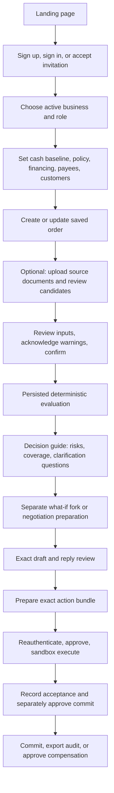

# OrderFit current workflow — QA and frontend handoff

Reviewed from `main` on 18 October 2026. Use this as the testable current
product contract. A page being compiled does not grant a user permission: every
write is also authorized by the API for the active business, role, session and
current resource version.

## Product purpose and authority boundaries

OrderFit helps a business decide whether it can afford an order, explore safer
terms, and record human-approved sandbox actions.

| Responsibility | Current owner | QA expectation |
| --- | --- | --- |
| Financial figures, feasibility, recommendation, cash series | Deterministic engine | Amounts are integer minor-unit strings and come from saved evaluation data, never browser arithmetic or AI text. |
| Document proposals and language what-if intent | Bounded AI layer | The user reviews every candidate/proposal. `off` and recording misses must show a useful unavailable/manual path. |
| Canonical inputs | Human reviewer | Confirmed inputs are versioned. A stale screen cannot silently submit old values. |
| Messages, bundles, commitments and compensation | Human approver plus sandbox workflow | An exact, current, step-up-approved bundle is required. No real email, bank, lender or payment provider exists. |

## Role and access matrix

The sidebar hides controls for convenience. Test API denial as well as the UI.

| Role | Read orders/data | Prepare order, what-if, draft, reply | Manage cash, offers, constraints, payees | Review audit | Approve/execute sandbox actions | Manage memberships |
| --- | --- | --- | --- | --- | --- | --- |
| Viewer | Yes | No | No | No | No | No |
| Auditor | Yes | No | No | Yes | No | No |
| Commercial lead | Yes | Yes | No | No | No | No |
| Risk officer | Yes | Yes | Yes | Yes | Yes | No |
| Owner | Yes | Yes | Yes | Yes | Yes | Yes |

Business scope comes from a membership. Switching business must clear
business-scoped cached data and must not retain a prior business's order,
notification, export, or pending-write state.

## End-to-end business journey



### 1. Public entry and authentication

1. `/` is the public product page. Its simulator is illustrative only and must
   never be presented as a saved assessment.
2. `/auth/signup` creates an account and initial business context.
3. `/auth/signin` creates the cookie-based session. The browser should never
   receive an auth token in JSON or persistent local storage.
4. `/auth/invitations/accept` accepts a one-time invitation after sign-in. The
   invitation token is read from the link and is not carried through sign-in.
5. An authenticated user selects an active business from the header. The
   selected membership controls the displayed navigation and all request scope.

QA must verify desktop/mobile navigation, light/dark mode, keyboard access,
sign-out, expired-session redirect, invitation errors, and business switching.

### 2. Business setup and source data

Before an order can produce a trustworthy evaluation, enter the business's
actual dated cash and available terms.

1. **Cash baseline and events:** `/deals/sources` is the editing surface;
   `/cash-flow` shows the resulting dated balance view. Add opening cash, an
   explicit as-of date, and known in/out events. Corrections are new revisions;
   a void does not rewrite history.
2. **Risk policy:** `/risk-constraints` displays the default policy. Policy
   edits create a new immutable version, so an existing order remains tied to
   its original policy unless deliberately revised.
3. **Financing:** `/financing` shows recorded offers that can be evaluated.
   Recording an offer is not lender availability, approval, or contact.
4. **Payees and bank accounts:** `/payees` displays only the last four account
   characters. A verified account means a person recorded evidence; it is not
   a bank confirmation.
5. **Customers:** `/deals/customers` stores customer details and known domains
   used when preparing a recipient for review.
6. **Members and profile:** `/useraccess` is owner-only membership/invitation
   management; `/settings` holds the authenticated user's/business settings.

QA must check missing data, invalid dates, decimal/minor-unit formatting,
stale revision errors, void/correction behavior, pagination/load-more controls,
and cross-business denial.

### 3. Create, review, and evaluate an order

1. Start at `/deals`, then use `/deals/new` to create a saved manual order.
   `/deals/new/validate` belongs to the new-order validation path and should
   keep the user in the saved-order workflow rather than fabricate an outcome.
2. The order detail `/deals/[id]?businessId=...` is the main review surface.
   It can edit a permitted draft, show review findings, confirm inputs, start
   an evaluation, reload saved operation state, and export decision evidence.
3. `/deals/[id]/confirm` intentionally redirects to the persisted order review;
   it is not a second, divergent confirmation screen.
4. Confirmation records the reviewed snapshot and acknowledgements. Blocking
   findings prevent evaluation; non-blocking warnings need an explicit
   acknowledgement where allowed.
5. Evaluation runs asynchronously and stores a result with decision,
   recommendation, scenarios, exact figures, alerts, coverage gaps,
   high-value clarification questions, calculator version and stale state.

The order detail shows the **Decision guide** after evaluation. It summarizes
existing deterministic facts; it cannot edit inputs, recalculate numbers,
approve anything, or initiate an action. A stale evaluation must say to
re-evaluate and must not show an acceptance recommendation.

### 4. Documents and extracted facts

`/deals/[id]/documents` supports private upload and review alongside manual
entry.

1. Upload PDF with a text layer, TXT, CSV, or JSON up to 25 MiB. OCR and
   DOCX/XLSX are unsupported and must produce an explicit manual path.
2. The original is retained privately. Downloaded source material is untrusted
   and is not opened by the application.
3. For a parsed document, request extraction. Candidate values include the
   original quote and source page; the reviewer confirms a candidate against
   that evidence.
4. CSV uses preview first. It shows parsed events, duplicates and errors;
   nothing changes until the user confirms the preview.
5. Conflicting, ambiguous, missing, unsupported, injection-like or unavailable
   AI outcomes remain review/manual states. They never become confirmed facts
   automatically.

AI modes are `off`, `recorded`, and bounded `live`. The default is `off`.
Recorded-mode misses never call a provider. Live OpenAI quality acceptance is
still open, so QA should verify visible fallback and provenance rather than
assume a provider response is required for a pass.

### 5. Explore safer terms and prepare negotiation

`/deals/[id]/negotiate` is the preparation workspace. It requires a current
evaluation.

1. Compare the persisted evaluated options and engine-backed explanation.
2. Run a typed what-if for a supported deposit percentage, customer delay,
   receivables delay, cost overrun, supplier extension, or recorded financing
   option.
3. The language input may propose a bounded what-if. It produces a separate
   fork and uses a deterministic fallback for explicit supported instructions.
   It cannot invent a financing offer, number, party, recipient, or approval.
4. Review a fork, then explicitly apply it if appropriate. Applying it still
   requires the normal review, confirmation and deterministic re-evaluation.
5. Prepare an exact message by selecting a known party/recipient. Drafts remain
   unsent. Unsupported claims, altered terms and invented figures are rejected.
6. Receive a reply at `/deals/[id]/reply`, record its source/attestation, review
   its bounded terms, and reassess through the same confirmed-input pipeline.
   Conditional replies are not an exact acceptance.
7. A bank-account-change reply creates a hold. Only a risk officer or owner can
   resolve it with the exact reply, a verified account and written evidence.

### 6. Exact approval, sandbox execution, commitment, and recovery

1. Record the review for the selected exact message/terms.
2. Prepare an action bundle. It captures the exact current order, recipient,
   option, calculation version and items.
3. Reauthenticate, approve the bundle's exact hash, and execute it in the
   sandbox. Sending a message bundle and committing an order are separate
   bundles and approvals.
4. Execution writes sandbox outbox/action evidence only. It sends no real
   communication and moves no real money.
5. Record a required party acceptance for current exact terms, then prepare and
   separately approve a commit bundle.
6. Commit settles engine-derived events into the baseline once, guarded by the
   business commitment gate. Reload to verify durable action, projection and
   audit state.
7. If a completed sandbox action requires reversal, prepare and separately
   approve compensation. The original audit/effect history stays immutable.
8. Export the decision and audit evidence from the order/audit views. The audit
   chain supports its documented range and anchoring limits.

A lost browser response is an unknown technical outcome, not a rejection.
The UI must preserve/reuse the command identity where appropriate, reload the
persisted operation, and never create a duplicate action.

## Route inventory

| Area | Routes | Frontend/QA focus |
| --- | --- | --- |
| Public/auth | `/`, `/auth/signup`, `/auth/signin`, `/auth/invitations/accept`, `/api/health` | Responsive landing content, auth errors, session recovery, invitation flow. |
| Main workspace | `/deals`, `/deals/new`, `/deals/new/validate`, `/deals/customers`, `/deals/sources`, `/cash-flow`, `/financing`, `/risk-constraints`, `/payees`, `/settings` | Business scope, role states, empty/loading/error/retry states, form validation and revisions. |
| Saved order | `/deals/[id]`, `/deals/[id]/confirm`, `/deals/[id]/documents`, `/deals/[id]/negotiate`, `/deals/[id]/reply` | The critical order-to-evaluation-to-approval journey. Test stale URLs and missing/unauthorized business scope. |
| Evidence and membership | `/audit-log`, `/useraccess` | Audit visibility for auditor/risk/owner and owner-only member management. |
| Sandbox and legacy/admin surfaces | `/sandbox`, `/orders`, `/users`, `/admin`, `/admin/users`, `/admin/orders`, `/admin/tenants`, `/admin/engine`, `/admin/security`, `/admin/logs`, `/admin/system` | Treat as a separate platform-admin QA surface. Confirm platform-admin authorization, intentional navigation, empty/error state, and whether `/orders` or `/users` are retained aliases or need consolidation. |

## QA acceptance checklist

### Critical workflow

- [ ] Sign up → business → baseline → customer → order → review → confirm → evaluate works after a browser refresh at every boundary.
- [ ] A persisted evaluation displays exact saved figures, calculator version,
      recommendation/decline state, alerts, coverage gaps and Decision guide.
- [ ] A current what-if is isolated; it cannot change canonical inputs until
      the user explicitly applies, reviews, confirms and re-evaluates it.
- [ ] Draft → review → bundle → reauthentication → approval → sandbox execution
      works only for the current exact bundle.
- [ ] Reply → reassessment → current exact acceptance → separately approved
      commit works, then reloads with one baseline projection.
- [ ] Compensation is separate and cannot erase the original action/audit record.

### Safety and permission regression

- [ ] Try every business route and write with each role, direct URL and API
      request. Hidden navigation must not be the only protection.
- [ ] Switch business, sign out, expire session, revoke role, and change an
      input/recipient/approval after loading a screen. The prior action must be
      refused or refreshed, never silently accepted.
- [ ] Force a lost response or retry. Confirm one durable operation/effect and
      one audit identity.
- [ ] Upload malformed, oversized, unsupported, scanned/no-text, conflicting
      and prompt-injection-like documents. Confirm no automatic canonical edit
      and no private bytes leak across tenants.
- [ ] Enter invalid money, date, percentage, delay and unsupported message terms.
      Confirm a specific safe validation error and no partial write.
- [ ] Verify bank-change hold creation and its strict resolution requirements.

### Frontend quality

- [ ] Run every route above as signed-out, signed-in with no business, empty
      business, populated business, and denied role where relevant.
- [ ] Exercise at 390px and 1280px in light and dark themes, including sidebar
      collapse/mobile drawer, keyboard navigation, focus visibility, labels,
      error announcements, loading skeletons and long translated-like text.
- [ ] Test slow reads, server 5xx, network loss, CSRF expiry and pagination/load
      more. The UI should explain recovery and preserve no sensitive form body
      in local/session storage.
- [ ] Check that all financial values retain exact minor-unit formatting and no
      float rounding appears in comparisons, exports or tooltips.
- [ ] Verify every link carries or restores the correct business scope and the
      back navigation returns to the expected saved order.

## Known boundaries, not defects

- Real email, payment, bank and lender integrations do not exist; the product
  is sandbox-only.
- Live provider quality has not been accepted. The supported QA behavior for
  AI-off/unavailable conditions is clear provenance plus manual/deterministic
  recovery.
- OCR and DOCX/XLSX extraction are unsupported.
- Hosted acceptance for provider behavior and some infrastructure remains a
  separate release gate; a successful disposable local run does not prove it.

## Recommended test environment

Use the disposable stack rather than a shared database:

```powershell
./scripts/run-e2e.ps1 -TestPattern '^(?!.*HTTP bursts).*' `
  -EvidenceDirectory 'E:\Order_Fit\var\qa-browser' `
  -BrowserReviewGate 'E:\Order_Fit\var\qa-review.json'
```

It creates isolated images, PostgreSQL, documents and synthetic credentials.
Keep raw browser traces under ignored `var/`, because even synthetic sessions
can contain credentials. Do not run stress/soak tests on a host that fails the
repository's 15% free-disk gate.

## Triage standard

| Severity | File when |
| --- | --- |
| P0 | A user can cross a tenant/role boundary, bypass review/approval, create duplicate/real effect, see an incorrect financial result, or lose immutable evidence. |
| P1 | The primary journey is blocked, a stale/failed state is misrepresented as a result, an approved action cannot recover, or accessibility/navigation prevents normal use. |
| P2 | A supporting page, error state, mobile/theme behavior, wording, empty state or presentation causes confusion but has a safe workaround. |

Include the route, role, business scope, exact precondition, screenshot/trace,
expected versus actual result, request/operation identifier when safe to share,
and whether refresh/retry changes the outcome. Never put credentials, cookies,
full account numbers, private documents, or raw production financial data in a
ticket.
