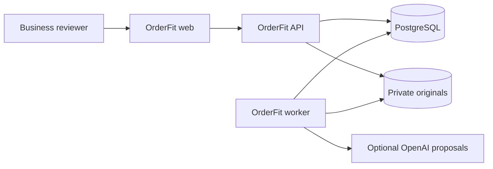
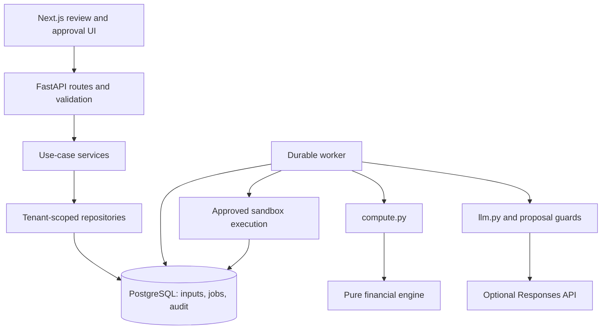

# OrderFit — Technical Documentation

| Metadata | Value |
| --- | --- |
| Purpose | 2026 Shenzhen International FinTech Competition, International Track; supplied theme: “AI as a Financial Participant” |
| Topic | **Topic E — SME Finance Copilot**, consistent with the repository [requirements](docs/architecture/orderfit/01-requirements-scenario-edge-cases.md) |
| Source snapshot | `main`, commit `2bb0635` (`2bb063582f1d02ed63aaab531bfb7edf904e2e4a`) |
| Verification date | 20 October 2026, Asia/Dhaka (UTC+6) |
| Technical scope | Source review, provider-free tests, reference cases, recorded evaluation and Linux-container checks |
| Release boundary | **Sandbox-only commercial execution**; live model tested in deployment (team-confirmed), with a passing 49-case live synthetic evaluation |
| Team | [[FILL: verified member names, affiliations, and implementation/submission roles]] |
| Source distribution | This repository and its [README](README.md); [[FILL: submitted repository URL or source-archive identifier]] |
| Demonstration | [[FILL: verified live-demo location and access instructions, or state local-only]] |

**Contents:** [Summary](#1-executive-technical-summary) · [Architecture/AI](#4-system-architecture) · [Algorithms](#7-core-algorithms-and-implementation) · [Interfaces](#9-data-architecture-and-interfaces) · [Evidence](#10-task-completion-evidence-and-testing) · [Security](#11-security-architecture-and-permission-tiers) · [Reproduction](#15-run-it-yourself) · [Status](#16-implementation-status-limitations-and-roadmap) · [Appendices](#appendix-a-annotated-repository-map)

## 1. Executive technical summary

OrderFit helps a small-business owner decide whether a customer order fits the business’s dated cash obligations, and which supported term changes make it feasible. Its strongest engineering contribution is the connection between source review, deterministic financial analysis, and narrowly authorized execution. A profitable order can still create a cash shortage before payment; OrderFit evaluates that timing explicitly rather than treating profit as available cash.

The application combines a Next.js interface, a FastAPI modular backend, a separate PostgreSQL-backed worker, private document storage, and a pure Python financial engine. Models propose quoted facts, bounded what-if changes, reply interpretations, clause hypotheses, and explanation wording. They cannot confirm inputs, calculate authoritative money, select trusted recipients, or authorize effects. People confirm immutable input snapshots and separately approve exact sandbox action bundles.

This session verified 22 financial reference cases, independent reference self-tests, 330 focused backend tests, 138 frontend unit tests, and 49 recorded synthetic AI cases. An existing live OpenAI evaluation also passed all 49 synthetic cases with zero grader-reported unsafe changes; the team confirms live-model testing in deployment. These are bounded functional results, not general accuracy or production-readiness claims. Historical database/browser evidence and committed synthetic screenshots complement them. Commercial messages, lending actions, ledger effects, and compensation remain simulations. No real payment or financing approval is demonstrated.

### Technical highlights

| Capability | Implementation | Why it matters | Evidence |
| --- | --- | --- | --- |
| Daily cash analysis | Outflows first; same-day baseline comparison | Separates inherited and order-caused shortages | [Timeline](backend/orderfit/engine/timeline.py), [tests](backend/tests/engine/test_independent.py) |
| Bounded planning | Term grids, loan sizing, constraints and capped scans | Explains profit/resilience trade-offs | [Options](backend/orderfit/engine/options.py), [ranking](backend/orderfit/engine/rank.py) |
| Proposal-only AI | Grounded quotes, isolated forks and engine-populated slots | Language cannot grant financial authority | [Gateway](backend/orderfit/agent/llm.py), [tests](backend/tests/test_ai_advisory_pure.py) |
| Exact approval/recovery | Immutable manifests, step-up, fencing and commitment gates | Binds authority to recoverable simulated effects | [Bundles](backend/orderfit/services/bundles.py), [execution](backend/orderfit/workflow/execution.py) |

### Judge’s quick map

Weights are **reported**, matching the [rules reconciliation](docs/architecture/orderfit/06-roadmap-and-submission-plan.md). Current official Appendix 2/templates were not independently checked.

| Reported criterion | Where to assess it | Primary evidence |
| --- | --- | --- |
| Task completion — 40% | Sections 3, 7–10 and 15 | [Reference cases](docs/test-cases.md), [browser lifecycle source](web/tests/e2e/order-lifecycle.spec.ts) |
| Security and compliance — 30% | Sections 9, 11 and 12 | [Tenant transactions](backend/orderfit/store/db.py), [SQL approval guards](backend/migrations/sql/0010_p6_approval.sql), [security evidence](docs/security/README.md) |
| Innovation and interaction — 30% | Sections 5, 7, 13 and 14 | [Clause hypotheses](backend/orderfit/services/clauses.py), [explanation slots](backend/orderfit/services/explanations.py), embedded screenshots |

## 2. Problem and engineering approach

The intended user is an owner-manager of a made-to-order B2B business. The synthetic anchor is Shapla Packaging, Dhaka, using BDT. Material purchases, payroll and debt can precede receipts despite a positive order margin.

OrderFit combines term search, decision-relevant questions, exact drafts and approved simulated actions with a deterministic scenario model. Scenarios are assumptions, not customer-behavior forecasts, credit scores or funding guarantees. The [requirements](docs/architecture/orderfit/01-requirements-scenario-edge-cases.md) record unvalidated demand; no interview findings, measured business savings or competitor-superiority claims are asserted.

## 3. What the agent does: end-to-end scenarios

**Status vocabulary:** **Verified-run** = exercised this session; **Implemented** = inspected, unexecuted workflow; **Partial** = stated gap; **Simulated/Mock** = authored/sandbox behavior; **Documented-only** = no supporting code found; **Planned** = future work. Verification scope matters: a pure-function pass does not verify its database/UI journey.

The agent is an application-controlled workflow. Models return typed proposals and have no unrestricted action tools.

| Scenario and user goal | Input and application steps | Output and boundary | Status |
| --- | --- | --- | --- |
| Review an order | Text → `extract` → `quote_supports` → human resolution | Page/quote candidates; unresolved values remain explicit | Simulated/Mock — recorded checks; upload journey not rerun |
| Assess affordability | Baseline, costs, dates, policy/offers → `compute` → engine | Dated series, feasibility, rankings, warnings and tolerance | Verified-run — engine/adapter tests |
| Explore terms | Typed/`propose_intent` changes → `fork_snapshot` → same engine | Separate comparison; apply requires review/reconfirmation | Verified-run — proposal/fork tests, not persisted apply |
| Clarify a clause | `read_clause`/template → alternate engine forks | Question when decision/recommendation changes; no canonical edit | Verified-run — advisory tests/replay |
| Negotiate/settle | Reviewed draft → send approval → reply/acceptance → separate commit/compensation approval | Sandbox outbox, effects, baseline projection and inverses | Simulated/Mock — historical lifecycle evidence only |

Captured from this session’s full reference check:

```text
DEMO-ASK | OK  | needs_input | None | ['E-MISSING-ANCHOR']
OF-02 | OK  | accept_with_changes | dep40 | []
OF-13 | OK  | accept_with_changes | dep50 | []
cases=22 problems=0 calc_version=ref-0.1.0
```

These are reference outputs, not API responses. [DEMO-ASK](docs/architecture/orderfit/fixtures/cases/DEMO-ASK.json) leaves “Net 45” without a start event. Its checked [output](docs/architecture/orderfit/fixtures/expected/DEMO-ASK.json) recommends different strategies for invoice/delivery readings, making clarification financially meaningful.

## 4. System architecture

The deployed shape is a modular monolith with a separate durable worker, rather than an autonomous multi-agent network.



Trust boundaries: authenticated browser/API, tenant-scoped API/database, and untrusted document/model proposals. Commercial effects terminate inside the sandbox database.



| Component | Responsibility | Technology | Path |
| --- | --- | --- | --- |
| Web | Saved intake, source review, results, forks, approval and recovery | Next.js/React/TypeScript | [web](web/) |
| API | HTTP contracts, CSRF/session checks and use-case admission | FastAPI/Pydantic | [API](backend/orderfit/api/) |
| Services/store | Transactions, current authority, immutable evidence and persistence | SQLAlchemy Core/psycopg | [services](backend/orderfit/services/), [store](backend/orderfit/store/) |
| Worker | Claims, heartbeats, computation, proposals and publication | Separate Python process | [worker](backend/orderfit/workflow/worker.py) |
| Engine | Pure financial analysis | Python integer arithmetic | [engine](backend/orderfit/engine/) |
| Storage | Private immutable originals; filesystem or S3 adapter | Local volume / boto3 | [filesystem](backend/orderfit/store/documents.py), [S3](backend/orderfit/store/s3_documents.py) |

The [web](web/next.config.ts) proxies `/api/v1` on the same origin. [Compose](docker-compose.yml) publishes only loopback web access. API/worker use distinct restricted logins; setup owns migration credentials. [Hosted configurations](docs/deployment/README.md) are deployment options, not acceptance evidence.

## 5. Agent and AI design

The sole provider boundary is [llm.py](backend/orderfit/agent/llm.py): extraction, bounded what-if, reply reading, clause hypotheses and slot explanations. Exact message preparation remains deterministic. Older template-only descriptions predate these additions.

| Mode | Behavior | Status |
| --- | --- | --- |
| `off` | No model request; manual review and deterministic fallbacks remain available | Verified-run |
| `recorded` | Replays synthetic outputs selected by version/hash; a miss returns unavailable/template behavior | Simulated/Mock |
| `live` | Configured OpenAI model through typed Responses calls; 49-case live synthetic evaluation passed, and deployment testing is team-confirmed | Implemented |

Context is stored source evidence, snapshots/revisions, evaluations, forks, messages and approvals, rather than conversational memory. No retrieval vector database or learned financial decision layer is used.

The [extraction prompt](backend/orderfit/agent/prompts/extract_order.md) requires quotes and forbids calculated totals. Escaped delimiters, schemas and deterministic downgrades constrain output. Grounding checks whole signed numeric tokens; cropped digits/hidden negatives cannot support a positive proposal. Unverifiable complex fields remain ambiguous.

Quoted reply conditions can remove acceptance candidates. AI stance never establishes acceptance; bank-change signals persist a hold before provider work.

[Clauses](backend/orderfit/services/clauses.py) evaluate alternate anchors on isolated snapshots. [Explanations](backend/orderfit/services/explanations.py) use qualitative signals and slots resolved from engine facts. Unsupported figures/terms/claims trigger template fallback; code appends fixed caveats.

Live requests use `store=False`, bounded concurrency/output/time, retries and a circuit breaker. This does not prove provider-wide retention/deletion. The [AI workflow evidence](docs/AI_WORKFLOW_PLAN.md) records a passing 49-case live run on 20 October 2026 with configured OpenAI model `gpt-6-luna`. The existing local report was inspected for this document; no new provider calls were made during documentation. The team additionally confirms live-model testing in deployment. Generalization beyond the synthetic corpus and broader operational/security acceptance remain separate.

## 6. Technology stack and rationale

Roles are observed; only ADR-backed motivations are asserted.

| Layer | Technology | Responsibility and trade-off | Evidence |
| --- | --- | --- | --- |
| Presentation | Next.js 16.4.1, React 19.3.0, Tailwind 4, React Query | Server-resource review; generated integration types | [Manifest](web/package.json), [types](web/lib/generated-api.d.ts) |
| Application | Python 3.12, FastAPI, Pydantic v2 | Typed inputs/results; authorization remains separate | [Manifest](backend/pyproject.toml) |
| Persistence/jobs | PostgreSQL, SQLAlchemy Core, psycopg 3, Alembic/SQL | One transaction system; custom lease/fencing maintenance | [ADR](docs/architecture/orderfit/adrs/0007-eight-state-durable-runner.md) |
| Language/auth | OpenAI Responses; Argon2id/sessions/WebAuthn | Optional proposals and passkey second factor | [Gateway](backend/orderfit/agent/llm.py), [identity](backend/orderfit/services/identity.py) |
| Verification/runtime | pytest, Ruff, Node tests, Playwright, Compose | Separate unit/integration/browser gates | [CI](.github/workflows/tests.yml) |

Locks are committed in [uv.lock](backend/uv.lock) and [package-lock.json](web/package-lock.json). This session used Windows Python 3.12.9 and Node 24.11.1; the documented Node/CI target is 22. That difference limits reproduction claims.

## 7. Core algorithms and implementation

The production calculator identifies itself as `engine-0.2.1`; the independently checked reference implementation retains `ref-0.1.0`.

### 7.1 Daily liquidity and order attribution

**Objective:** isolate order-caused shortages. Inputs are dates, integer minor-unit amounts, opening cash, baseline/order events and a stress scenario. Outputs are daily trough/close, breach intervals and funding gaps.

In [timeline.py](backend/orderfit/engine/timeline.py), for date `t`:

```text
candidate_trough[t] = previous_close - sum(outflows[t])
candidate_close[t]  = candidate_trough[t] + sum(inflows[t])
effective_floor[t]  = min(owner_reserve, baseline_trough[t])
order_violation[t]  = candidate_trough[t] < effective_floor[t]
```

Baseline and candidate share the scenario. Absolute reserve shortfalls remain visible. Global minima alone can miss new harm after a baseline recovery.

The [independent tests](backend/tests/engine/test_independent.py) use opening cash 100, same-day outflow 110 and inflow 110 minor units: trough **−10**, close **100**, reproduced in Linux. Another test detects a 30-unit order-caused gap after baseline recovery despite an unchanged global minimum.

[Money arithmetic](backend/orderfit/engine/money.py) rounds half up: `(amount * bps + 5000) // 10000`, preserving split residuals. The [horizon](backend/orderfit/engine/horizon.py) includes delayed receipts and loan repayments; unsupported bounds return limits rather than clipped liabilities. The sweep visits each event/day once; the complete search costs more.

### 7.2 Bounded term search, ranking and delay tolerance

Supported levers are deposits, eligible supplier extensions and supplied fixed-term loans. Production contracts exclude staged delivery, start deferral, variable-rate and receivable-advance products.

[Options](backend/orderfit/engine/options.py) enumerate deposit/extension combinations and scan loan grids. They retain the smallest base-feasible draw meeting each sizing scenario, deduplicate strategies and retain as-offered/decline comparators.

```text
validate inputs, policies, complete horizon and work admission
enumerate non-financing strategies and scenario-sized loan strategies
evaluate each in base, downside and severe scenarios
reject hard failures; retain their reasons for explanation
prune plans dominated by a strict subset of identical levers
sort by target attainment, then the owner's ordered priorities
break remaining ties by borrowing, asks and stable strategy identity
scan customer delay from zero until first failure or the explicit cap
return the catalogue, series, warnings and bounded tolerance
```

[Hard feasibility](backend/orderfit/engine/rank.py) checks base liquidity, financing-cost cap, minimum profit and applicable dates. Downside/severe targets are ranking preferences. Resilience is an ordinal **0–3 scenario-survival level**, not a probability.

Incremental profit equals net revenue after concession minus incremental costs, surcharge and financing cost. Existing obligations affect cash without becoming new expenses. [Financing](backend/orderfit/engine/financing.py) dates draw, fee, flat-term interest and repayment separately; principal is not an expense.

Checked [OF-02](docs/architecture/orderfit/fixtures/expected/OF-02.json) recommends `dep40`; a more profitable loan misses the downside target. The trade-off follows declared preferences.

Delay scanning returns first failure or `capped_scan`, never infinity. Self-tests include a non-monotone **unsupported** receivable-advance counterexample. [Admission](backend/orderfit/engine/validation.py) bounds combinations, output, expanded money and work; exhaustion supplies no partial recommendation.

### 7.3 Exact approval and recoverable sandbox effects

**Objective:** recover retries without authorizing changed/extra effects. [Preparation](backend/orderfit/services/bundles.py) derives items from current evaluation/snapshot and reviewed messages/acceptances. Client amounts/recipients cannot replace those facts.

Canonical JSON uses explicit nulls, sorted keys, ordered arrays, UTC timestamps and string money; no floats. The manifest binds scope/revisions, calculator/option, content, recipients/accounts, amounts/dates, expiry and `sandbox=true`. SHA-256 identifies content, not authority.

```text
authenticate current member and required permission
lock business and deal; compare revisions and exact bundle hash
consume the approver's unexpired session-and-bundle step-up grant
record approval; execution admission rechecks current usability
persist run, exact action rows and durable job atomically
for each item: lock scope, recheck approval and operation lease fence
commit simulated effect, action outcome and audit together
settle once: project attributed events, bump revision, release gate
```

[Execution](backend/orderfit/workflow/execution.py) rereads completed actions. A durable gate serializes unresolved business commitments across partial work. Lost-response replay recovers the result; interrupted-run resume may create a new operation linked to the **same run**.

Commitment requires separate approval and exact-term acceptances. Compensation separately approves inverses of completed actions, preserving originals. DB integration tests exist but were not rerun here.

## 8. End-to-end execution flow

```mermaid
sequenceDiagram
    actor Person as Reviewer
    participant Web as Next.js
    participant API as FastAPI
    participant DB as PostgreSQL
    participant Worker as Durable worker
    participant Engine as Compute and engine
    Person->>Web: Review saved order and confirm
    Web->>API: Confirmation with versions, hash, CSRF and key
    API->>DB: Verify session, membership and current inputs
    alt Denied, conflicting or stale
        API-->>Web: Explicit error; no confirmation
    else Current and reviewable
        API->>DB: Persist snapshot, confirmation and audit
        API-->>Web: Snapshot identity and fresh versions
        Web->>API: Admit evaluation for confirmed snapshot
        API->>DB: Atomically save operation and idempotency
        API-->>Web: 202 and polling URL
        Worker->>DB: Claim leased job and read snapshot
        Worker->>Engine: Calculate outside transaction
        Engine-->>Worker: Result or explicit analysis limit
        Worker->>DB: Recheck revisions, authority and fence; publish
        Web->>API: Poll operation and read saved result
        API-->>Web: Completed, blocked or failed operation
    end
    Person->>Web: Review exact sandbox bundle and reauthenticate
    Web->>API: Separate approval and execution commands
    API->>DB: Record approved run and queued job
    Worker->>DB: Guarded sandbox items, audit and settlement
```

Confirmation and evaluation admission are separate persisted commands. A technical failure or analysis limit is not a financial rejection. Refresh reads durable operation state; it does not rerun a browser calculation. The final two commands are conditional on current authority, freshness and approval, not automatic consequences of a favorable recommendation.

## 9. Data architecture and interfaces

SQL owns DDL. [Alembic](backend/migrations/versions/) executes [manual SQL](backend/migrations/sql/); verified source head: `0025_admin_read_isolation`. Configured database state was not probed.

| Entity group | Relationships and invariants | Data sensitivity |
| --- | --- | --- |
| Users/sessions/memberships | Current identity, tenant role and revocation | Identifiers, password hashes, token digests |
| Business/policy/cash/offers | Dated baseline and pinned terms; revision invalidation | Private financial records |
| Documents/candidates/snapshots | Original hash/quotes → immutable reviewed inputs | Originals and source text |
| Evaluations/options/what-ifs | Snapshot/calculator identity; isolated alternatives | Decision evidence |
| Messages/acceptances | Exact content, party identity and expiry | Correspondence/attestations |
| Bundles/approvals/runs/actions/effects | Manifest membership; one run/bundle, one effect/action | Approval/simulation evidence |
| Commitment gate/projection/settlement | Serialization, attribution and inverse reconciliation | Consistency evidence |
| Operations/idempotency/audit | Recovery identity and tenant sequencing | Operational metadata |

Tenant foreign keys, RLS, uniqueness and immutable triggers supplement services. [Contracts](backend/orderfit/contracts/primitives.py) preserve decimal-string minor units/BIGINT identities, UUIDs, ISO business dates and UTC instants. Zero/missing/unsupported/stale differ. Each analysis uses one supported exponent-2 currency, without FX.

Routes were checked against runtime OpenAPI. **B** expands to `/api/v1/businesses/{business_id}`.

| Method / operation | Path | Purpose | Auth / permission | Implementation |
| --- | --- | --- | --- | --- |
| GET / POST | `/api/v1/auth/csrf`, `/api/v1/auth/signin` | Challenge / sign-in | Origin/CSRF; throttled credentials | [Identity](backend/orderfit/api/routes/identity.py) |
| GET / POST | `B/deals/{deal_id}/review`, `B/deals/{deal_id}/confirm` | Candidate / confirmation | `prepare` | [Deals](backend/orderfit/api/routes/deals.py) |
| POST | `B/deals/{deal_id}/evaluations` | Queue evaluation | `prepare`, current snapshot | [Deals](backend/orderfit/api/routes/deals.py) |
| GET | `B/operations/{operation_id}` | Recover status | `read` | [Identity](backend/orderfit/api/routes/identity.py) |
| POST | `B/deals/{deal_id}/documents` | Preserve original | `prepare`, upload gate | [Documents](backend/orderfit/api/routes/documents.py) |
| POST | `B/deals/{deal_id}/whatifs`, `B/whatifs/{whatif_id}/apply` | Explore / apply | `prepare`, versions | [Preparation](backend/orderfit/api/routes/preparation.py) |
| POST | `B/deals/{deal_id}/clause-assessments` | Compare readings | `prepare`, evaluation | [Preparation](backend/orderfit/api/routes/preparation.py) |
| POST | `B/deals/{deal_id}/bundles` | Prepare manifest | `prepare` | [Bundles](backend/orderfit/api/routes/bundles.py) |
| POST | `/api/v1/auth/step-up` | Bundle reauthentication | Session, `execute` | [Identity](backend/orderfit/services/identity.py) |
| POST | `B/bundles/{bundle_id}/approvals`, `B/bundles/{bundle_id}/execute` | Approve / execute | `execute`, step-up/freshness | [Bundles](backend/orderfit/api/routes/bundles.py) |
| POST | `B/deals/{deal_id}/compensation-bundles` | Prepare inverse | `execute`; approval separate | [Bundles](backend/orderfit/api/routes/bundles.py) |
| GET | `B/audit/export` | Export chain bytes | `audit` | [Exports](backend/orderfit/api/routes/exports.py) |

Commands normally require idempotency, session-bound CSRF/origin checks and revisions. Errors distinguish malformed input (422), stale authority/data (409), authentication (401), permissions (403), foreign resources (404), capacity/dependency failure (429/503). Webhooks use provider signatures. Sandbox records model obligations; their atomicity is not bank settlement or on-chain finality.

## 10. Task-completion evidence and testing

Executed against existing environments; no source/configuration/dependency/golden changes.

| Test/check | Command or location | Coverage | Observed result | Status |
| --- | --- | --- | --- | --- |
| Reference catalogue | First root command below | All reference goldens | 22 cases, 0 problems; `ref-0.1.0` | Passed (executed this session) |
| Reference self-tests | Second root command below | Independent arithmetic/sweep, boundaries, guards | 0 failures | Passed (executed this session) |
| Focused backend | Backend command below | Architecture/engine/guards/DTOs/AI/admin/passkey configuration | **330 passed**, 1 Starlette/httpx warning; 632.88 s | Passed (executed this session) |
| Frontend units | `web/`: `npm run test` | Money, recovery, scope, provenance/UI helpers | **138 passed**, 0 failed; 18.47 s | Passed (executed this session) |
| Backend checks | Modules `ruff check --no-cache .`, `orderfit.contracts.export --check`, `alembic heads` | Lint/drift/migration graph | Passed; 134 operations; sole head 0025 | Passed (executed this session) |
| Runtime interfaces | `create_app().openapi()` versus `ENDPOINTS` | Mounted schema | 134/134, none missing | Passed (executed this session) |
| Recorded evaluator | `scripts/ai_eval.py::run("recorded", 1)`, in memory | Authored five-task corpus | 49 passed; 0 grader unsafe changes | Passed (executed this session) |
| Existing live OpenAI evaluation | [AI workflow evidence](docs/AI_WORKFLOW_PLAN.md); local ignored `var/ai-eval-live.json` inspected | Five-task synthetic corpus; deployment testing additionally confirmed by team | 49/49 passed, 0 grader unsafe changes; live call not rerun in this documentation session | Historical evidence only |
| Docker/Linux | Image `6eaf76c4cdfe`; current source read-only, no network/capabilities | Routes/rounding/daily sweep | 134 routes; trough −10, close 100 | Passed (executed this session) |
| Document consistency | In-memory Markdown/path/route checks | Links, anchors, tables, fences and referenced APIs | 183 links/anchors valid; 16 route pairs valid; 3 committed images; 0 secret-pattern matches | Passed (executed this session) |
| DB/browser | [DB](backend/tests/db/), [lifecycle](web/tests/e2e/order-lifecycle.spec.ts) | Persistence, SQL/races/recovery/UI | Not run | Not executed |
| Fresh install/build/full hosted acceptance | [Procedures](docs/development.md) | Complete deployment/operational gates | Not rerun during documentation; existing live-model evidence is listed separately above | Not executed |

Root commands:

```powershell
backend/.venv/Scripts/python.exe -B docs/architecture/orderfit/fixtures/reference_engine.py --check
backend/.venv/Scripts/python.exe -B docs/architecture/orderfit/fixtures/selftest.py
```

Backend selection, from `backend/`:

```powershell
$env:PYTHONDONTWRITEBYTECODE='1'
.\.venv\Scripts\python.exe -B -m pytest -q -p no:cacheprovider tests/test_architecture.py tests/engine tests/agent tests/contracts tests/test_ai_eval.py tests/test_ai_advisory_pure.py tests/test_ai_workflow_pure.py tests/test_admin_security_rbac.py tests/test_passkey_configuration.py
```

“Model-path cases” counts retained authored outputs; passing fallbacks are not model results.

| Task | Cases / passed | Model-path cases | Grader unsafe changes |
| --- | --- | --- | --- |
| Extraction | 13 / 13 | 13 | 0 |
| What-if | 16 / 16 | 15 | 0 |
| Reply | 13 / 13 | 6 | 0 |
| Clause | 4 / 4 | 3 | 0 |
| Explanation | 3 / 3 | 1 | 0 |

To reproduce the in-memory replay from `backend/` without overwriting a corpus report:

```powershell
$replay = @'
import asyncio, importlib.util, json
s = importlib.util.spec_from_file_location('submission_eval', '../scripts/ai_eval.py')
m = importlib.util.module_from_spec(s)
s.loader.exec_module(m)
r = asyncio.run(m.run('recorded', 1))
print(json.dumps({'passed': r['passed'], 'cases': len(r['cases']), 'tasks': r['tasks']}))
'@
$replay | .\.venv\Scripts\python.exe -B -
```

Recorded what-if adds 10 labeled cases beyond the baseline’s 6/16; this replay comparison is separate from the live evaluation below. Bengali/Hindi/Simplified-Chinese have only 4/2/2 cases; `qualified` means replay qualification.

The separately inspected **live** report records extraction **13/13**, what-if **16/16**, reply **13/13**, clause **4/4** and explanation **3/3** passes. All 49 cases retained live model results, with zero grader-reported unsafe changes. Its English/Bengali/Hindi/Simplified-Chinese subsets passed, but the small non-English samples do not establish broad language accuracy. The evaluator is a proposal-path check; the team's deployed live-model test is additional functional confirmation, not evidence that every hosted security/recovery gate passed.

**Historical evidence only:** [progress](docs/backend_implementation_progress.md) reports 828 backend passes/2 skips, build/typecheck and lint (0 errors/62 warnings), with repaired browser selectors awaiting rerun. A prior [hosted synthetic restore](docs/security/neon_acceptance_2026-10-17.md) predates this schema.

Exceptions: initial Docker connection/startup failures resolved after user enablement (daemon 29.7.2). Direct `app.routes` inspection missed included routers; OpenAPI corrected the probe. Mermaid was manually reviewed, not rendered: no installed offline CLI. Install/startup commands remain unexecuted because they change environments/provision databases. The report contains nine human-fill fields and no unfinished implementation markers; pattern scanning is not a complete secret audit.

## 11. Security architecture and permission tiers

### 11.1 Objectives and assumptions

Protect isolation, source integrity, financial semantics, exact authority and recovery. Assume hostile/mistaken documents/models, forged browser state, permission revocation and lost write responses. Application tests do not protect against a compromised database owner/provider.

### 11.2 Authentication flow

[Identity](backend/orderfit/services/identity.py) verifies Argon2id hashes, throttles attempts and issues opaque tokens; SQL stores digests. [Cookies](backend/orderfit/api/routes/identity.py) are HttpOnly/SameSite=Lax, Secure per validated configuration. Mutations require signed session-bound CSRF and exact origin. Sessions have eight-hour absolute/30-minute idle limits.

[WebAuthn](backend/orderfit/services/passkeys.py) validates one-use challenges, RP/origin, user verification, signatures and counters. Enrolled passkeys provide a login second factor. Bundle password re-entry is **step-up, not MFA**. Production trust anchors/recovery require acceptance.

### 11.3 Permission tiers and enforcement

Sources: [PERMISSIONS](backend/orderfit/contracts/protocol.py), [Database.tenant](backend/orderfit/store/db.py), routes and [role mapping](backend/migrations/sql/0004_reference_data.sql). Every “Yes” requires current membership/session/scope.

| Actor / role | Read orders | Prepare / confirm | Manage finance | Audit | Approve effects | Manage members | Enforcement location | Status |
| --- | --- | --- | --- | --- | --- | --- | --- | --- |
| Viewer, T0 | Yes | No | No | No | No | No | `Database.tenant`, `PERMISSIONS` | Implemented |
| Auditor, T0 | Yes | No | No | Yes | No | No | Same, export routes | Implemented |
| Commercial lead, T2 | Yes | Yes | No | No | No | No | Same, prepare/confirm routes | Implemented |
| Risk officer, T3 | Yes | Yes | Yes | Yes | Yes | No | Same plus SQL approval guards | Implemented |
| Owner, T3 | Yes | Yes | Yes | Yes | Yes | Yes | Same plus membership service | Implemented |
| Platform administrator | Membership required | Membership required | Membership required | Membership required | Membership required | Membership required | [Admin routes](backend/orderfit/api/routes/admin.py), tenant checks, [0025 isolation repair](backend/migrations/sql/0025_admin_read_isolation.sql) | Implemented |

Global summaries additionally require verified platform identity, enabled capability and SQL-function privileges. Global logs/mutations are unavailable. Historical T4 `superadmin` grants no tenant membership through the API; no tenant role maps to T1.

### 11.4 Agent autonomy limits

Models read bounded text and propose outputs; code computes/saves/drafts. People confirm facts. Owner/risk officer approval plus session-bound step-up authorizes exact sandbox effects. Dispatch/commit/compensation remain separate. Models have no payment, shell, SQL, browser or send tools.

### 11.5 Validation and injection defenses

[DTOs](backend/orderfit/contracts/primitives.py) reject extra fields and invalid types/bounds. SQL binds values; interpolated identifiers are application-defined. Delimiters, injection signals, grounding, term checks, isolated forks and slots constrain prose-to-data paths. Pattern detection can miss attacks; models also lack action authority.

[BodyLimit](backend/orderfit/api/main.py) verifies session, `prepare` membership and saved deal before large-body admission: 1 MiB normal, 26 MiB multipart, 25 MiB stored file. Concurrency/deadlines limit spooling. [PDF parsing](backend/orderfit/services/pdf_parser.py) uses a bounded subprocess. No-text PDFs need manual review; OCR/DOCX/XLSX are unsupported.

### 11.6 Data protection

[Tenant transactions](backend/orderfit/store/db.py) establish local context and current authority; [forced RLS](backend/migrations/sql/0003_security.sql) supplements scoping. Startup rejects privileged/owning runtime logins and wrong schema; API/worker privileges differ.

Originals are private/hash-verified. Filesystem/S3 checks exist; encryption/KMS, storage credential scope and retention require operations. [Accounts](backend/orderfit/services/accounts.py) store versioned keyed fingerprints/last four characters, not raw submitted numbers. “Verified” means human attestation, not bank confirmation. Documents may contain PII; universal redaction/deletion is not implemented.

### 11.7 Audit, throttling and idempotency

PostgreSQL sequences tenant audit rows under an advisory transaction lock, hashing previous hash plus canonical bytes. Success evidence commits with mutation. [Verification](backend/orderfit/services/exports.py) checks bytes/links, rejects empty ranges and limits partial-range claims. Privileged tail deletion requires an independently retained head to detect.

Idempotency binds actor/business/method/path/body; secret-bearing bodies use keyed digests. Auth/password/upload/parser/job capacity controls are not comprehensive DDoS protection. [API headers](backend/orderfit/api/security_headers.py) prevent shared caching; [web CSP](web/proxy.ts) uses request-specific nonces.

### 11.8 Third-party trust boundaries

OpenAI is optional/server-side. Storage, PostgreSQL TLS and proxy trust need target-specific checks. Default-off account email/Resend is separate from commercial delivery. CI configures pinned actions, dependency audits and CodeQL; fresh online scans were not run.

### 11.9 Threat model

Severity describes potential impact, not confirmed exploitability.

| Threat | Component | Actual protection | Remaining risk | Severity and reason | Evidence |
| --- | --- | --- | --- | --- | --- |
| Cross-tenant access | API/SQL | Membership, local context, RLS, restricted logins | Misconfiguration/privileged compromise; DB checks not rerun | High — financial disclosure | [DB](backend/orderfit/store/db.py) |
| Forged/stale approval | Bundles | Exact manifest/revisions, expiry, consumed grant, SQL checks | Incorrect human evidence | High — unauthorized obligation | [Guards](backend/migrations/sql/0010_p6_approval.sql) |
| Duplicate commitment | Worker/SQL | Idempotency, uniqueness, fence, durable gate | Partial-run reconciliation; external protocol absent | High — duplicated obligations | [SQL](backend/migrations/sql/0011_p6_execution_runtime.sql) |
| Prompt/value manipulation | Documents/model | Grounding, typed proposals, confirmation, slots; no tools | Semantic errors/false negatives | High — wrong decisions | [Tests](backend/tests/agent/test_hackathon_ai_boundaries.py) |
| Bank-change fraud | Reply/accounts | Persisted hold; exact evidence resolution | Mistaken/fraudulent human verification | High — destination authority | [Workflow](backend/orderfit/workflow/preparation.py) |
| Malicious file | Upload/parser | Pre-body auth, caps/deadlines, subprocess | Authorized resource pressure/parser defects | Medium — resource exhaustion | [Parser](backend/orderfit/services/documents.py) |
| Audit rewrite | Audit/storage | Hash links, immutability, exact verification | No external anchor | High — evidence integrity | [SQL](backend/migrations/sql/0002_integrity_and_audit.sql) |
| Historical secret exposure | Operations | Ignore rules/runtime separation | Rotation/revocation evidence unresolved | High — persistent credential access | [Report](docs/security/security_acceptance_2026-10-17.md) |

### 11.10 Residual risks and missing capabilities

No production-readiness, regulatory/certification or bank/KYC claim is made. Open gates: credential rotation, scoped storage keys, retention/KMS evidence, current joint restore and hosted origin/cookie/passkey checks. The historical [Neon drill](docs/security/neon_acceptance_2026-10-17.md) found off-prefix credential access; its successful restore does not close that gap.

Not implemented: real commercial/payment/lender adapters, on-chain activity, FX/tax/APR conversion, OCR or portfolio allocation. No root application distribution license is declared.

## 12. Reliability, consistency and failure handling

[Operations](backend/orderfit/workflow/operations.py) atomically persist admission/idempotency before 202. Leases last 60 seconds, heartbeats occur every 15 seconds, and attempts are bounded. The effective fence is the changing **operation lease token** under lock, not the immutable run identity marker.

Compute uses a spawned process, 90-second timeout and default 512 MiB bound, outside short transactions. Publication rechecks authority/revisions/fence. Missing/unsupported/limited analysis is blocked; technical exceptions fail operations. [Execution](backend/orderfit/workflow/execution.py) bounds retries of rolled-back transient SQL failures.

Atomicity is per item. Partial completion stays visible; holds/revocation stop remaining effects. Settlement projects once and releases the gate; compensation preserves original history.

Readiness checks DB privileges/schema, live worker and storage; `/health` is liveness only. Safe IDs/error codes support diagnosis. Host/storage loss and joint database/original restoration require separate acceptance.

## 13. Innovation and interaction

The distinctive evidence-to-action chain compares interpretations financially, confirms revisions and authorizes exact sandbox content. It combines baseline-relative liquidity, preference-ordered terms and engine-backed clarification rather than a chatbot’s unverified proposal; global novelty is not claimed.

UI provenance, stale/error states and separate effect panels expose those boundaries. Scope reset clears caches; unknown-outcome keys retain original business/path/body identity ([tests](web/tests/)).

These **historical synthetic, provider-off captures** show persisted local workflows, not live AI. The simple evaluation fixture displays BDT 100,000 opening cash and BDT 50,000 profit.


## 14. Key design decisions and challenges

| Context → decision | Alternative rejected | Trade-off | Confidence |
| --- | --- | --- | --- |
| Financial authority → pure engine | Model/browser formulas | Explicit adapters, reproducibility | High: architecture/engine tests |
| Durable work → PostgreSQL jobs | Process-local/second queue | Custom fencing maintenance | High: [ADR 0007](docs/architecture/orderfit/adrs/0007-eight-state-durable-runner.md); DB evidence historical |
| Approval → exact bundles/coarse revisions | Mutable drafts/unchecked dependencies | Extra invalidation/refresh | High: [ADR 0008](docs/architecture/orderfit/adrs/0008-snapshots-and-exact-bundles.md), contract tests |
| Model failure → visible fallback | Silent live/fabricated success | Less offline language coverage | High: replay/guard tests |

Source/history challenges:

| Problem → root cause | Implemented correction | Result/evidence |
| --- | --- | --- |
| Browser-only apparent success → state diverged from API | `3dcb5ac`: save UUIDs/read engine results; retire duplicate confirmation | [Config](web/next.config.ts), [lifecycle test](web/tests/e2e/order-lifecycle.spec.ts); browser rerun pending |
| Full deposit publication failure → zero receipt versus positive-only DTO | Omit zero no-op movement; retain positive-money constraints | [Mapper](backend/orderfit/services/evaluations.py), [DB regression](backend/tests/db/test_hackathon_financial.py); historical execution |
| Conditional assent → qualified phrase mistaken for exact acceptance | Check whole reply before candidate acceptance | [Parser](backend/orderfit/services/preparation.py), executed [tests](backend/tests/agent/test_hackathon_ai_boundaries.py) |
| Admin isolation → historical overbroad grants | Forward 0025 narrows summaries/removes inherited privileges | [SQL](backend/migrations/sql/0025_admin_read_isolation.sql), [reconciliation](docs/admin_readiness_2026-10-20.md); head verified |

## 15. Run it yourself

Run section 10’s reference/tests in the existing environment without provider/shared-DB credentials. They take minutes, not subsecond demo time. Fresh setup needs Compose, or Python 3.12/uv, Node.js 22 and PostgreSQL; see [Development](docs/development.md). The following database-creating recipe is **not executed here**.

```text
Copy .env.example to an ignored .env for a NEW disposable local database.
Set distinct migration/API/worker credentials and application keys.
Set LLM_MODE=off; keep account mail and admin reads disabled.
docker compose build api
docker compose --profile setup run --rm provision
docker compose up --build
Open the web at localhost:3000.
```

Provisioning is one-time and refuses existing roles. Use a new disposable DB; migration credentials must not reach runtime processes.

| Environment name | Purpose | Required | Placeholder / mode |
| --- | --- | --- | --- |
| `POSTGRES_PASSWORD`, `DATABASE_URL_DIRECT` | Bootstrap/migration | Setup | Generated; disposable target |
| `DATABASE_URL`, `WORKER_DATABASE_URL` | Restricted runtime connections | Yes | Distinct local role URLs |
| `RUNTIME_PASSWORD`, `WORKER_PASSWORD` | Provisioner credentials | Setup | Distinct generated values |
| `SESSION_SECRET` | Session/CSRF | Yes | Generated, ≥32 characters |
| `ACCOUNT_FINGERPRINT_KEY`, `ACCOUNT_FINGERPRINT_KEY_VERSION` | Account identity | Yes | Distinct generated key; initial version `1` |
| `LLM_MODE`, `LLM_RECORDINGS_DIR` | Proposal mode | Mode yes | `off`; exact recordings optional |
| `OPENAI_API_KEY`, `OPENAI_MODEL` | Live proposals | Live only | Empty for walkthrough |
| `COOKIE_SECURE`, `ALLOWED_ORIGINS` | Origin/cookies | Yes | Local HTTP only locally; exact HTTPS deployed |
| `DOCUMENT_STORAGE_BACKEND`, `DOCUMENT_DIR` | Private originals | Yes | `filesystem`; mounted path |
| `API_INTERNAL_URL`, `NEXT_PUBLIC_API_URL` | Same-origin proxy | Deployment | Internal target; public value empty |

See [validated settings](backend/orderfit/contracts/configuration.py) and sanitized [root](.env.example)/[backend](backend/.env.example)/[web](web/.env.example) templates.

**Five-minute presentation target after setup**, not measured completion time:

1. Sign up with synthetic identity/strong generated password. In `/deals/sources`, save opening date, `10000000` minor units, coverage a year ahead and synthetic attestation.
2. New order → Manual Order Form: synthetic customer/reference, amount `50000` **major units**, today’s order date, delivery/invoice +30 days, payment +30 days. Use the no-cost/no-financing fixture documented in the [test helper](web/tests/e2e/helpers/manual-order.ts).
3. Save and review → Confirm and evaluate. Expect UUID, succeeded operation and persisted result; reload. The richer reference catalogue demonstrates financing trade-offs separately.
4. Prepare a draft to synthetic `purchasing@buyer.test`, record exact review, review its send bundle and reauthenticate/approve/execute. Expect sandbox outbox and `awaiting_reply`.
5. Record “Synthetic buyer: I accept the exact proposed terms.” Review/attest, separately approve/execute commit, then reload settlement. Optionally compensate and inspect inverses/audit. Attestation is not independent commercial verification.

The [lifecycle test](web/tests/e2e/order-lifecycle.spec.ts) adds lost-response checks. The [browser runner](scripts/run-e2e.ps1) provisions/migrates a disposable stack and was not run here. Exact-input recordings can miss arbitrary orders; no hosted demo is accepted here.

## 16. Implementation status, limitations and roadmap

| Capability | Status | Limitation | Evidence |
| --- | --- | --- | --- |
| Deterministic calculation and confirmed-input adapter | Verified-run | Synthetic cases; no real-business outcome validation | [Engine tests](backend/tests/engine/), section 10 |
| Recorded extraction, reply, what-if, clause and explanation pipeline | Simulated/Mock | Authored replay; distinct from live results | [Corpus/evaluator](scripts/ai_eval.py), [evaluation limits](docs/evaluation.md) |
| Live model functionality | Implemented | 49/49 live synthetic cases passed; deployed live-model testing team-confirmed; broader accuracy/operational acceptance is separate | [Live evaluation record](docs/AI_WORKFLOW_PLAN.md), inspected local live report |
| Saved review, tenant persistence and document handling | Implemented | Current DB/browser acceptance not rerun | [Repositories](backend/orderfit/store/repositories.py), [DB tests](backend/tests/db/) |
| Exact approval, sandbox commitment and compensation | Simulated/Mock | No real commercial adapter; fresh SQL/recovery acceptance outstanding | [Execution](backend/orderfit/workflow/execution.py) |
| Account mail and admin summaries | Partial | Implemented contracts; separate default-off rollout/operational gates | [Deployment](docs/deployment/README.md) |
| Hosted operation and recovery | Partial | Historical synthetic drill exists; current credentials, retention and least-privilege storage remain unaccepted | [Security evidence](docs/security/neon_acceptance_2026-10-17.md) |
| Real payments/lending, FX/tax, OCR, portfolio optimization | Planned | Outside current supported scope; no delivery commitment | [Requirements](docs/architecture/orderfit/01-requirements-scenario-edge-cases.md) |

**Now:** current browser rerun, sanitized decision/audit export, package the existing live-model evidence, rotation evidence and submission metadata. **Next 30 days (proposal, not team commitment):** user validation, a larger independent live-model evaluation and hosted storage/restore acceptance. **Later:** new products only with contracts/independent tests. No adoption, savings, throughput or financing-outcome forecast is claimed.

Reconciliations: architecture still names schema 0023; verified source requires 0025. Historical disabled-admin/template-only AI descriptions predate current guarded paths. Legacy 540-day SQL views do not define the complete typed engine horizon. Historical acceptance counts retain their original snapshots.

## 17. Team, credits and AI-assistance disclosure

The team must confirm identity/ownership; Git authors are insufficient. Libraries are recorded in manifests/locks; OpenAI is optional, Resend separately handles account email, and fixtures/recordings are synthetic.

No root application license/completed attribution inventory was found; skill licenses do not license OrderFit. [[FILL: application distribution license, dependency/data attribution inventory, and redistribution approval]].

Agent instructions/AI-assisted review records evidence coding-assistant use. Codex prepared this report through source review/local checks. [[FILL: team-confirmed disclosure of AI tools used for implementation, prompts, media and submission materials]].

Companion deliverables are referenced, not created:

| Deliverable | Submission handoff |
| --- | --- |
| Technical report | This file |
| Source with deployment instructions/tests | This checkout, [Development](docs/development.md), [test catalogue](docs/test-cases.md) |
| Presentation deck | [[FILL: final English presentation filename/location]] |
| Demo video | [[FILL: final English demo-video filename/location and duration]] |
| Security self-assessment | [[FILL: final submitted security self-assessment filename/location; reconcile the repository risk evidence]] |
| Execution evidence | [[FILL: final sanitized execution-evidence package identifier, tested source revision, audit head, verifier result and live-model test evidence]] |

Confirm current official templates, eligibility, required items and submission channel; repository rules notes contain ambiguities.

## 18. Repository evidence index

| Technical claim | File or directory | Function/module/route | Supporting check/artifact | Status |
| --- | --- | --- | --- | --- |
| One calculation entry boundary | [compute](backend/orderfit/agent/nodes/compute.py) | `compute`, `to_engine_input` | [Architecture tests](backend/tests/test_architecture.py) | Verified-run |
| Daily trough and counterfactual floor | [timeline](backend/orderfit/engine/timeline.py) | `sweep`, `scenario_metrics` | [Independent tests](backend/tests/engine/test_independent.py), Linux check | Verified-run |
| Bounded ranking/search and delay scan | [options](backend/orderfit/engine/options.py), [rank](backend/orderfit/engine/rank.py), [tolerance](backend/orderfit/engine/tolerance.py) | `enumerate_strategies`, `hard_ok`, `delay_scan` | [Reference parity](backend/tests/engine/test_reference.py) | Verified-run |
| Reviewed snapshot and canonical identity | [repositories](backend/orderfit/store/repositories.py), [protocol](backend/orderfit/contracts/protocol.py) | `DealRepository.confirm`, `canonical_bytes` | [Golden contract fixtures](backend/tests/contracts/fixtures/); confirmation DB tests not rerun | Implemented |
| Current tenant/role boundary | [database](backend/orderfit/store/db.py), [security SQL](backend/migrations/sql/0003_security.sql) | `Database.tenant`, transaction-local context and policies | [Foundation tests](backend/tests/db/test_foundation.py), historical reports | Implemented |
| Exact approval authority | [bundles](backend/orderfit/services/bundles.py), [approval SQL](backend/migrations/sql/0010_p6_approval.sql) | `prepare`, `decide`, `approval_guard` | [Approval suite](backend/tests/db/test_p6_approval.py), not rerun | Implemented |
| Fenced effects and recovery | [execution](backend/orderfit/workflow/execution.py) | `_execute_item_once`, `_fence`, settlement | [Recovery suite](backend/tests/db/test_execution_recovery.py), not rerun | Simulated/Mock |
| Grounded proposals and safe fallback | [gateway](backend/orderfit/agent/llm.py), [documents](backend/orderfit/services/documents.py) | `extract`, `read_reply`, `quote_supports` | [Adversarial tests](backend/tests/agent/test_hackathon_ai_boundaries.py), 49-case replay | Verified-run |
| Live proposal paths tested | [AI workflow evidence](docs/AI_WORKFLOW_PLAN.md), [evaluator](scripts/ai_eval.py) | Five live AI task types | Existing 49/49 live report inspected; deployment test team-confirmed; not rerun here | Implemented |
| Decision-relevant clarification | [clauses](backend/orderfit/services/clauses.py), [explanations](backend/orderfit/services/explanations.py) | `decision_changes`, `problems`, `resolve` | [Advisory tests](backend/tests/test_ai_advisory_pure.py) | Verified-run |
| Audit byte integrity and limitations | [exports](backend/orderfit/services/exports.py), [audit SQL](backend/migrations/sql/0002_integrity_and_audit.sql) | `verify_audit_export`, `operation_log_chain` | [Export DB suite](backend/tests/db/test_p3_exports.py), not rerun | Implemented |
| Real persisted browser workflow exists | [Lifecycle test](web/tests/e2e/order-lifecycle.spec.ts) | Owner evaluate/send/commit/compensate journey | [Committed screenshots](docs/assets/screenshots/), historical evidence | Simulated/Mock |
| Runtime API catalogue is mounted | [App factory](backend/orderfit/api/main.py), [catalogue](backend/orderfit/contracts/catalogue.py) | `create_app().openapi()` | 134-operation local and Linux comparisons | Verified-run |

## 19. Technical conclusion

OrderFit joins deterministic cash reasoning, constrained language, explicit review and exact sandbox authority. Fresh checks support calculations/contracts/guards/UI helpers; existing evidence establishes a 49/49 live synthetic pass, and the team confirms deployed live-model testing. Broader full-stack security, recovery and operational acceptance remain distinct requirements.

## Appendix A. Annotated repository map

Selected application/evidence paths, to depth three; generated output, environments, caches, unrelated local workspaces and vendored skill inventories are omitted.

```text
Order_Fit/
├── technical_document.md          This submission report
├── README.md                     Entry point and synthetic screenshots
├── docker-compose.yml            Local DB/API/worker/web topology
├── backend/
│   ├── pyproject.toml, uv.lock    Python dependencies and frozen resolution
│   ├── orderfit/
│   │   ├── api/                  HTTP routes, validation and headers
│   │   ├── contracts/            Wire types, canonicalization and export
│   │   ├── engine/               Pure financial algorithms
│   │   ├── agent/                Provider boundary and compute adapter
│   │   ├── services/, store/     Use cases, transactions and persistence
│   │   └── workflow/             Durable worker and capability handlers
│   ├── migrations/
│   │   ├── sql/                  Authoritative manual DDL and guards
│   │   └── versions/             Alembic forward/merge graph
│   └── tests/
│       ├── engine/, agent/       Financial and proposal-boundary tests
│       ├── contracts/            DTO and canonical-byte fixtures
│       └── db/                   Disposable integration/race/recovery tests
├── web/
│   ├── app/, components/         Next.js routes and review/approval UI
│   ├── lib/                      API/state/security helpers and generated types
│   ├── tests/                    Node tests and e2e browser journeys
│   └── package.json              Frontend scripts/dependencies
├── docs/
│   ├── architecture/orderfit/    Financial specifications, ADRs and fixtures
│   ├── assets/screenshots/       Committed synthetic workflow captures
│   ├── contracts/                Offline schemas and integration documentation
│   ├── security/, deployment/    Controls, historical evidence and rollout gates
│   └── evidence/reports/         Dated implementation/acceptance records
├── data/ai_workflow/              Synthetic corpus and authored recordings
├── scripts/                      Evaluation and disposable browser runners
└── .github/workflows/            Test, security and deployment configuration
```

## Appendix B. Glossary

| Term | Meaning in OrderFit |
| --- | --- |
| Minor unit | Smallest supported currency unit; 100 minor units equal one major unit for supported currencies |
| Basis point (bps) | One ten-thousandth; a unit for supplied fees, concessions and stress percentages |
| Baseline | Dated cash obligations/receipts without the proposed order |
| Daily trough | Balance after that day’s outflows and before its inflows |
| Reserve / headroom | Owner’s cash floor / difference between the lowest balance and that floor |
| Counterfactual floor | Minimum of the reserve and baseline trough on the same date |
| Incremental profit | New order revenue less new order costs, concessions and financing costs |
| Payment anchor | Explicit event, such as invoice or delivery, from which payment days are counted |
| Scenario / resilience | Supplied deterministic stress / ordinal survival of base, downside and severe cases |
| Value of information | Whether different supported readings of a missing fact change the decision or recommended option |
| Snapshot / revision | Immutable confirmed input / identity of the source or business state on which it depends |
| Action bundle / step-up | Exact immutable set of proposed effects / short-lived reauthentication bound to that bundle |
| Idempotency | Reusing a command identity recovers the same admitted result instead of duplicating work |
| Lease / fencing | Temporary job ownership / database rejection of writes from stale ownership tokens |
| RLS | PostgreSQL row-level security restricting visible/writable tenant rows |
| Compensation | Separately authorized inverse evidence for completed sandbox actions |
| Tamper-evident audit | Hash-linked evidence that reveals tested modifications; not protection against all privileged rewrites |
| Recorded mode | Replay of authored synthetic model outputs, not live inference |
